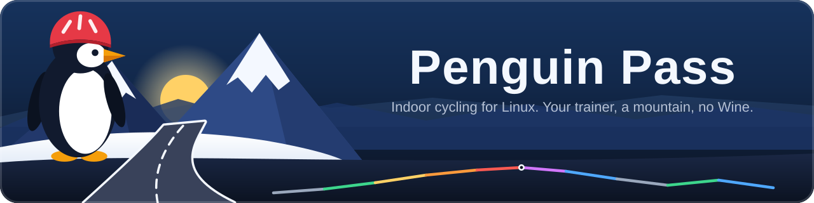
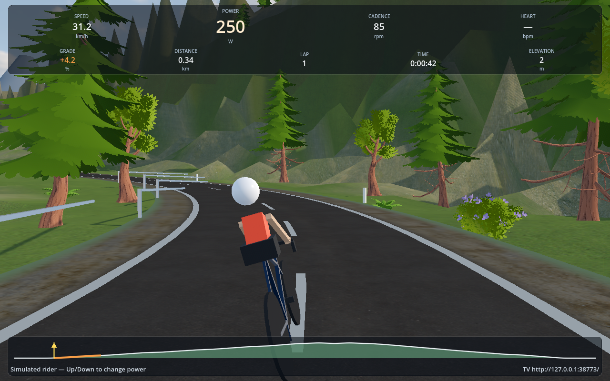
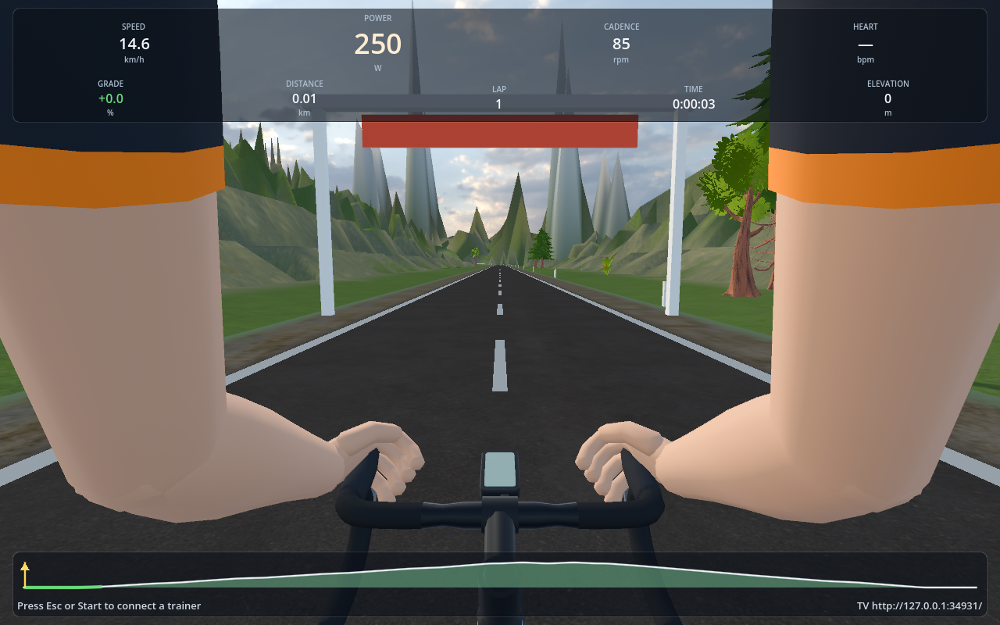
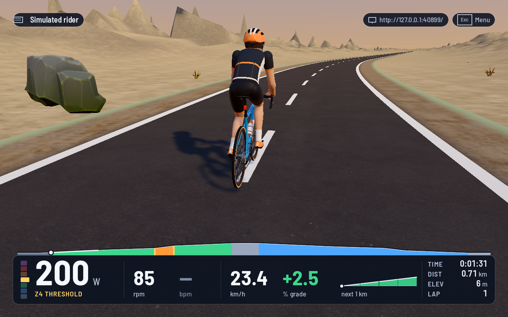
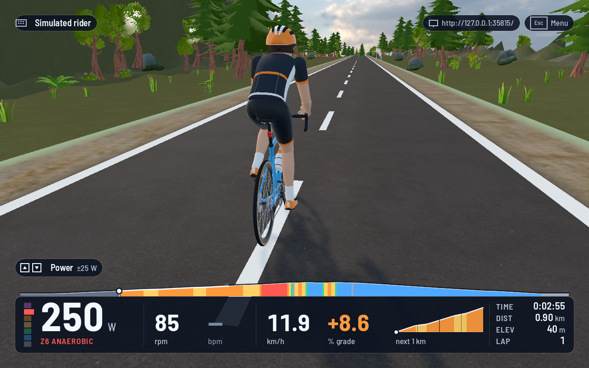
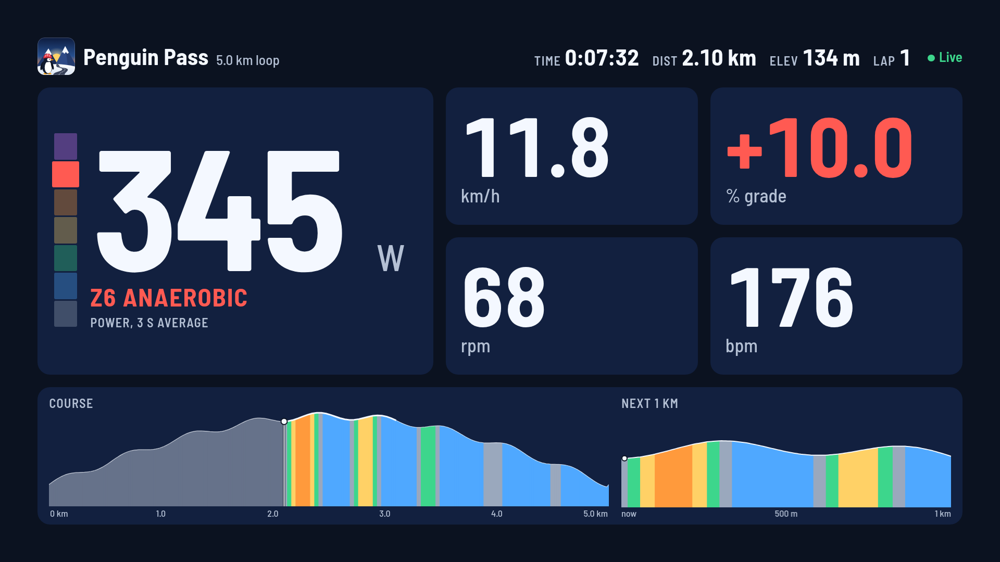
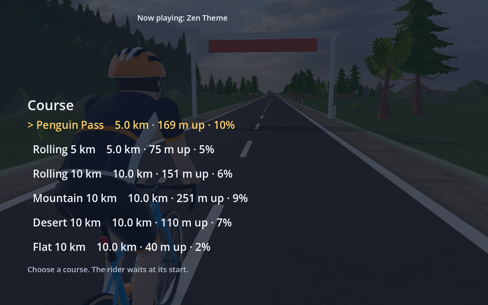
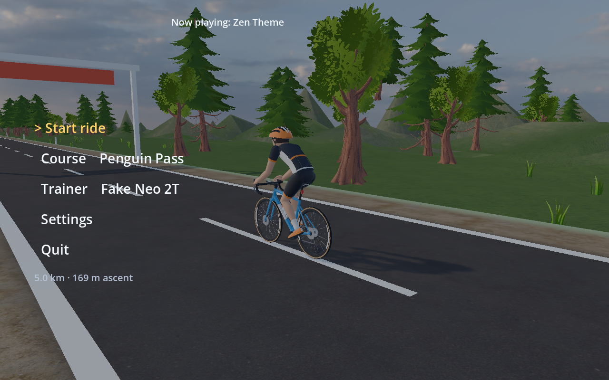

# Penguin Pass



A native Linux indoor-cycling game. The core is Rust, the front end is
Godot 4, and it runs on SteamOS. No Wine.

`./x fetch` once, then `./x play`. The title screen offers Start ride,
Course, Trainer, Settings, and Quit. With no trainer, Up and Down change
power in 25 W steps.

The game speaks Bluetooth FTMS and Tacx FE-C. A scan finds a real
Tacx Neo 2T. Connecting and resistance control have not yet been
confirmed on a real trainer.

## Status

Playable on the desktop. Automated tests pass, and the owner has ridden
it. It is not on Steam. Menus are being restyled, and the far mountains
are being reworked. See [Roadmap](#roadmap).

## Screenshots

The title screen and menus are a first pass and are being restyled.

<table>
<tr>
<td width="400" valign="top">
<br>
Chase view on a switchback. The console shows the power zone, the grade, and the course profile.
</td>
<td width="400" valign="top">
<br>
Handlebar view at the start arch.
</td>
</tr>
<tr>
<td width="400" valign="top">
<br>
Desert theme, chase view.
</td>
<td width="400" valign="top">
<br>
A climb, at 8.6 percent.
</td>
</tr>
<tr>
<td width="400" valign="top">
<br>
TV dashboard, a web page on the LAN. Checked in a desktop browser.
</td>
<td width="400" valign="top">
<br>
Course picker. Six routes. Generated ones can be rerolled.
</td>
</tr>
<tr>
<td width="400" valign="top">
<br>
Title screen. The trainer row here is a stand-in, Fake Neo 2T.
</td>
<td width="400" valign="top">
Rider weight, FTP, resistance, the TV page, full screen, and music
are saved between sessions.
</td>
</tr>
</table>

## Why

Zwift and MyWhoosh do not ship for Linux, and neither casts to a TV from
a Steam Deck. Penguin Pass is a Godot 4 game with its core in Rust, so it
runs natively on SteamOS and can ship on Steam.

## How it works

```text
Trainer  <-- BLE / FTMS or FE-C -->  pp-trainer  -->  pp-course (physics)
                                         |                  |
                                         v                  v
                                     pp-godot (GDExtension, Godot 4 scene)
                                         |
                                         v
                                     pp-cast  -->  TV / tablet browser
```

- A trainer reports power, cadence, and speed. The game owns the
  physics: it turns that power into speed on the current slope, and
  can send the grade back so climbs add resistance.
- That send path is implemented for FTMS and Tacx FE-C. Connecting and
  resistance control have not yet been confirmed on a real trainer.
- With no trainer, a simulated rider drives the game from the keyboard.
  Up and Down step power by 25 W. Hold either key and the step repeats.
  Power stays between 0 and 1500 W.

## Courses

Six courses, chosen in the game. Penguin Pass is the built-in 5 km loop
(`crates/pp-course/courses/penguin_pass.json`). The other five are
generated: Rolling 5 km, Rolling 10 km, Mountain 10 km, Desert 10 km,
and Flat 10 km. A generated route can be rerolled for a new seed.
Alpine and desert are themes. The 3D world is built from the course at
startup, so a new route does not need hand-built scenery. See
`docs/course.md` and `docs/route-generator.md`.

Not built yet: world streaming for long routes, and an endless mode.

## Layout

| Path | What it holds |
| --- | --- |
| `crates/pp-core` | Shared types: telemetry snapshot, units, rider profile |
| `crates/pp-ftms` | Bluetooth GATT codec for FTMS, Cycling Power, Heart Rate. No I/O |
| `crates/pp-course` | Course data, grade lookup, bike physics |
| `crates/pp-trainer` | `Trainer` trait, BLE trainer (BlueZ), simulated trainer |
| `crates/pp-cast` | LAN TV dashboard: HTTP page plus live telemetry stream |
| `crates/pp-session` | Ride loop without Godot: settings file, trainer connect, TV dashboard |
| `crates/pp-world` | Which world chunks to load around the rider, and per-chunk seeds |
| `crates/pp-rider` | The bike and rider as generated meshes, with pedalling poses |
| `crates/pp-routegen` | Routes generated from a seed, a distance, and a terrain preset |
| `crates/pp-view` | Interface logic without Godot: formatting, menu state, HUD values, theme parsing |
| `crates/pp-godot` | GDExtension library: world, HUD, rider, camera |
| `godot/` | Godot project: `project.godot`, scenes, export presets |
| `godot/assets/` | CC0 models, textures, and sky. Credits in `docs/assets.md` |
| `godot/assets/music/` | Seven bundled CC0 tracks, the manifest, and credits |
| `docs/` | Design notes and the Steam release checklist |
| `tools/` | Build container definition and helper scripts |
| `tools/rider-preview/` | Standalone Godot project that renders the rider. It does not load the game library |
| `tools/steam/` | SteamPipe upload templates. Placeholders only. See `docs/steam-release.md` |
| `packaging/flatpak/` | Flatpak manifest and install scripts. The workflow has not been run |

## Requirements

- SteamOS or another Linux with BlueZ
- `podman` (ships with SteamOS)
- `rustup` is optional on the host; the build runs in a container
- Godot 4.7.2 via `./x fetch`, which downloads the official editor and
  export templates, checks them against Godot's published sums, and
  stores them in `tools/godot/`. `./x play` downloads the editor if it
  is missing. `./x smoke` and `./x run` use the Godot flatpak unless
  `GODOT` points at another binary

SteamOS has no C compiler, so Rust cannot link on the host. All cargo
commands run inside a build container based on the Steam Runtime 4 SDK.
The same container produces binaries that are safe to ship on Steam.

## Commands

SteamOS does not ship `make` either, so the command runner is the `./x`
script. The `Makefile` calls the same script on hosts that have `make`.

| Command | What it does |
| --- | --- |
| `./x toolbox` | Build the build container (once) |
| `./x build` | Build the GDExtension library into `godot/bin/` |
| `./x test` | Run all Rust tests |
| `./x fmt` | `cargo fmt --check` |
| `./x clippy` | `cargo clippy -D warnings` |
| `./x lint` | `./x fmt`, then `./x clippy` |
| `./x typecheck` | `cargo check` across the workspace |
| `./x smoke` | Load the game headless in Godot and check it starts |
| `./x run` | Open the project with the Godot flatpak, with Bluetooth access |
| `./x scan` | List nearby trainers over Bluetooth |
| `./x fetch` | Download the official Godot editor and export templates, checksum-checked, into `tools/godot/` |
| `./x play` | Build if needed and start the game full screen. `--windowed`, `--fullscreen`, `--resolution WxH`, `--quit-after N`, `--scratch-data`. Anything after `--` goes to the game |
| `./x export` | Export the player build into `dist/penguin-pass-linux-x86_64/` |
| `./x package` | Make a versioned `.tar.gz` of the export and print its SHA-256 |
| `./x licenses` | Write `docs/third-party-licenses.md` from the crates the game ships |

Narrow `test`, `fmt`, `clippy`, `lint`, and `typecheck` to one crate
with `CRATE=`, for example `CRATE=pp-core ./x test`.
`PROFILE=release ./x build` makes the release library.

`PP_NATIVE=1` runs cargo on the host instead of in the build container.
`GODOT=/path/to/godot ./x smoke` uses that binary instead of the Godot
flatpak. CI sets both.

## Checks

After `git init`, run `lefthook install`. `pre-commit` runs `./x fmt`
and `./x clippy` in parallel when Rust or Cargo files are staged.
`pre-push` runs `./x typecheck`, then `./x test`. GitHub Actions runs
`./x lint`, `./x typecheck`, `./x test`, and `./x smoke` on
`ubuntu-latest`. Details are in `docs/dev-workflow.md`.

## Riding

`./x play` opens the title screen. Start ride, or pick a course first.
Chase and handlebar cameras, a pause menu, and an end-of-ride summary
are in the game. Settings are saved between sessions: rider and bike
weight, FTP, trainer difficulty, resistance on or off, the TV dashboard,
full screen, music volume, and an optional music folder.

Music is seven bundled CC0 tracks, or the player's own folder of mp3,
ogg, or wav files.

| Action | Keyboard | Steam Deck |
| --- | --- | --- |
| More power | Up, W | D-pad up, right trigger |
| Less power | Down, S | D-pad down, left trigger |
| Chase camera or handlebars | C | Y |
| Full screen | F11 | |
| Menu | Esc | Start |

Esc or Start opens the pause menu. Arrows move in the menu, Left and
Right change a value, Enter or Space selects. `docs/play.md` covers a
desktop entry and adding the game to Steam as a non-Steam game.

To look for a trainer, wake it, close any other app paired to it, and
run `./x scan`. A trainer accepts one Bluetooth controller at a time.
Connecting from the game has not been confirmed on hardware.

## TV

Three tiers, in the order they arrive:

1. **Steam Link / Remote Play.** Streams a Steam game, including a
   non-Steam shortcut. Install Steam Link on the TV and start the
   shortcut from the library. Game Mode and streaming have not been
   tried from this checkout.
2. **TV dashboard.** The game serves a web page on the LAN with live
   power, speed, cadence, grade, and course position. Open it from a
   browser. Checked on the desktop, not yet on a TV.
3. **Chromecast video.** Cast the game view itself. Not built yet.

## Roadmap

- [x] M0: workspace, build container, Godot loads the Rust extension
- [x] M1: FTMS codec, course data, bike physics, all with tests
- [x] M2: simulated trainer
- [ ] M2: BLE trainer connection, over FTMS or Tacx FE-C. The scan finds
  a real Neo 2T. Connecting and resistance are built but not yet
  confirmed on it
- [x] M3: 5 km mountain loop, HUD, ride session
- [x] M4: TV dashboard (checked in a desktop browser, not yet on a TV)
- [x] M4: settings menu (rider and bike weight, FTP, trainer difficulty,
  trainer pairing, TV dashboard on or off), saved between sessions
- [x] M5: Steam export presets and release checklist
- [ ] M5: Flatpak bundle built by GitHub Actions and attached to GitHub
  Releases. The workflow is written (`docs/flatpak.md`) but has never
  run. A Flathub listing is a separate, later step with its own rules
- [x] M6: free CC0 art assets, textured terrain and road, a real rider
- [x] M7: themes as data (alpine, desert) and a course picker
- [ ] M7: mountains that look like mountains (in progress)
- [x] M8: generated routes from a seed, in six fixed choices up to 10 km
- [ ] M8: any chosen distance, with the world streamed in chunks; then
  an endless mode
- [x] M9: title screen, pause menu, ride summary, and a console HUD with
  power zones
- [ ] M9: menus restyled to the design in `docs/ui.md`
- [x] M9: music. Seven bundled CC0 tracks, or the player's own folder
  of mp3, ogg, or wav, and a volume setting
- [ ] M10: first ride through Steam: Game Mode, Steam Link, and Bluetooth
  from inside the Steam runtime
- [x] M11: a second rider (Sigrid) and a rider choice in settings
- [ ] M11: heart-rate straps over Bluetooth (Garmin HRM and others). Built; not yet tried with a real strap
- [ ] M11: Zwift controllers for lanes, power, and menus. Built; not yet tried with real controllers
- [x] M11: ride in the right-hand lane, and move left and right within it (five positions)
- [ ] M12: save each ride as an activity file for Strava and other sites
- [ ] M12: push rides to Strava with the rider's own API keys (no server)
- [ ] Later: Chromecast video, ANT+, riding a course in reverse

## Steam

Publishing needs a Steamworks partner account and an app ID. Those are
owner tasks. See `docs/steam-release.md`.

## License

Not chosen yet.
