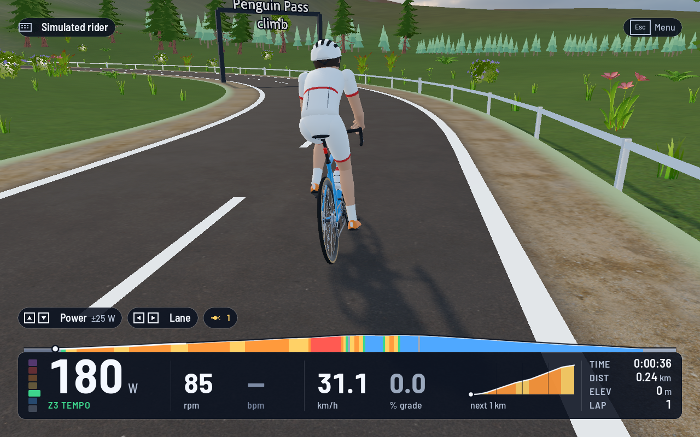
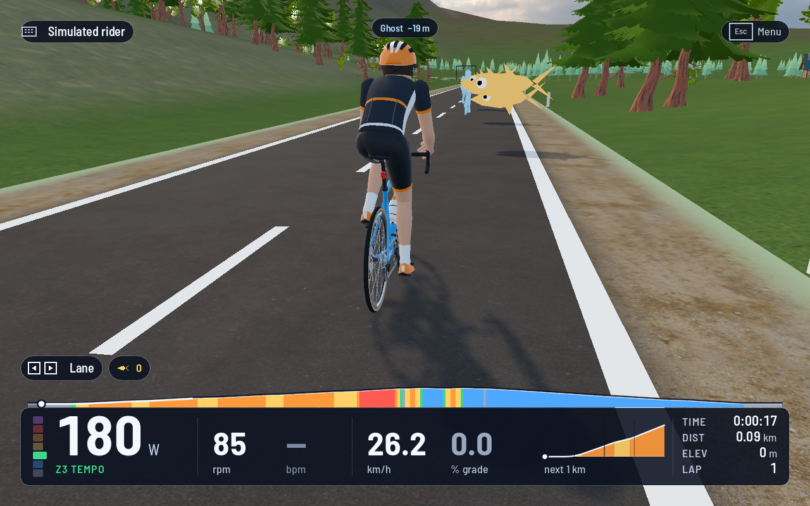
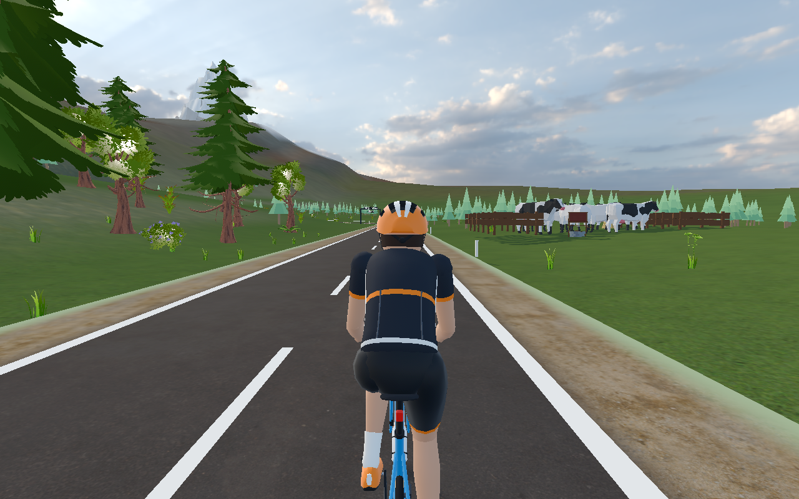
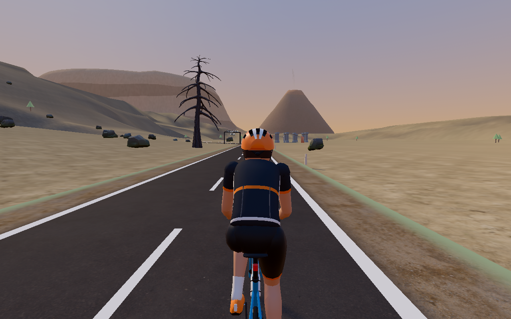
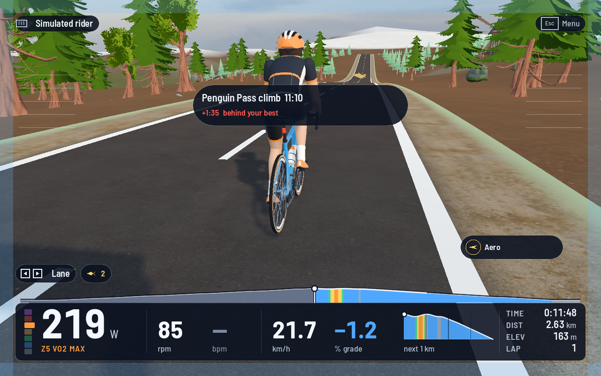
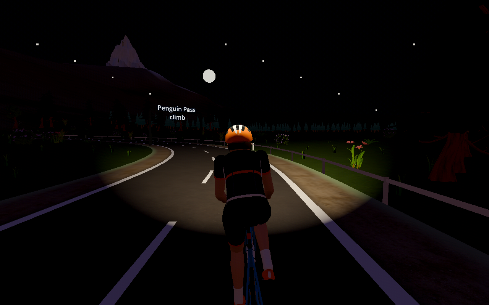
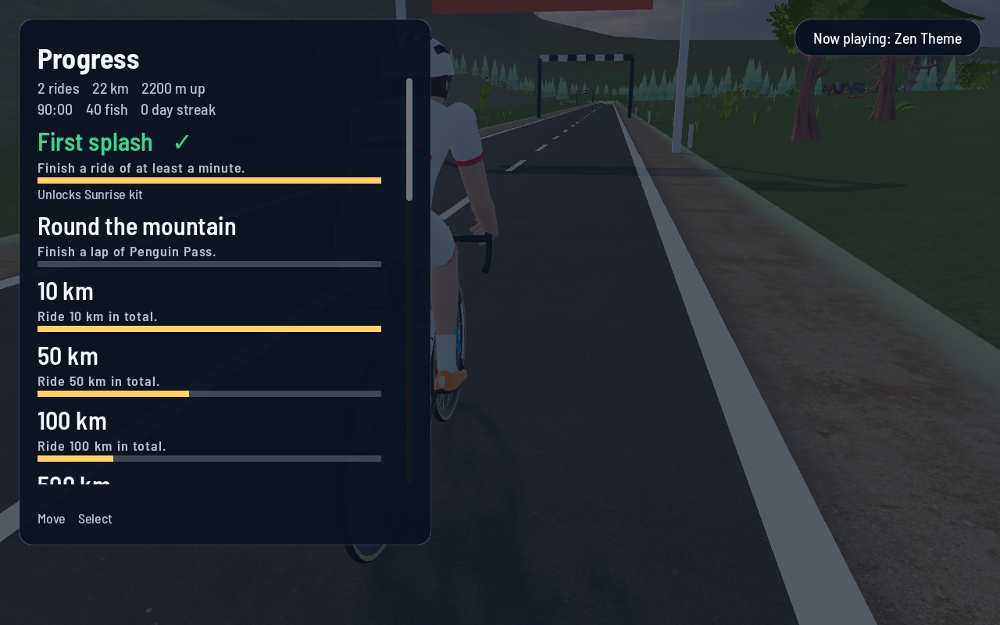

# Penguin Pass


A native indoor-cycling game built with Rust and Godot 4 for winter
fitness riding, with FIT ride recording and Strava upload support.

It started out to give Linux and SteamOS riders a native trainer app
without Wine, and targets SteamOS and Flatpak first — because the core
is Rust and the front end is Godot 4, Windows and macOS ports are open
too.

`./x fetch` once, then `./x play`. The title screen offers Start ride,
Course, Trainer, Settings, and Quit. With no trainer, Up and Down change
power in 25 W steps.

The game speaks Bluetooth FTMS and Tacx FE-C. It connects to a real
Tacx Neo 2T over FE-C, reads power, and takes control of resistance.
Whether the resistance tracks the hills correctly has not been measured
yet.

## Status

Playable on the desktop. Automated tests pass, and the owner has ridden
it on a real trainer. Each ride is saved as a FIT file. It is not on
Steam, and no release has been published yet. The far mountains are
still being reworked. See [Roadmap](#roadmap).

## Screenshots

<table>
<tr>
<td width="400" valign="top">
<br>
Approaching the Penguin Pass climb arch in the right-hand lane, with the console HUD and course profile.
</td>
<td width="400" valign="top">
<br>
Fish pickups in the five lane positions and your ghost rider from a previous lap.
</td>
</tr>
<tr>
<td width="400" valign="top">
<br>
Alpine landmarks: roadside pasture and the snow horn on the horizon.
</td>
<td width="400" valign="top">
<br>
Desert theme with temple ruins, sandstone mesa, and volcano.
</td>
</tr>
<tr>
<td width="400" valign="top">
<br>
Timed segment finish card and an active Aero powerup.
</td>
<td width="400" valign="top">
<br>
Night riding with the bike headlight (part of the time-of-day and weather system).
</td>
</tr>
<tr>
<td width="400" valign="top">
<br>
Progress screen with lifetime totals, badges, and unlockable kits.
</td>
<td width="400" valign="top">
<br>
TV dashboard, a web page on the LAN. Checked in a desktop browser.
</td>
</tr>
</table>

## Why

Zwift and MyWhoosh do not ship for Linux, and neither casts to a TV from
a Steam Deck. Penguin Pass is a Godot 4 game with its core in Rust, so it
runs natively on SteamOS and can ship on Steam.

## How it works

```text
Trainer  <-- BLE / FTMS or FE-C -->  pp-trainer  -->  pp-course (physics)
                                         |                  |
                                         v                  v
                                     pp-godot (GDExtension, Godot 4 scene)
                                         |
                                         v
                                     pp-cast  -->  TV / tablet browser
```

- A trainer reports power, cadence, and speed. The game owns the
  physics: it turns that power into speed on the current slope, and
  can send the grade back so climbs add resistance.
- That send path is implemented for FTMS and Tacx FE-C. Connecting and
  resistance control have not yet been confirmed on a real trainer.
- With no trainer, a simulated rider drives the game from the keyboard.
  Up and Down step power by 25 W. Hold either key and the step repeats.
  Power stays between 0 and 1500 W.

## Courses

Six courses, chosen in the game. Penguin Pass is the built-in 5 km loop
(`crates/pp-course/courses/penguin_pass.json`). The other five are
generated: Rolling 5 km, Rolling 10 km, Mountain 10 km, Desert 10 km,
and Flat 10 km. A generated route can be rerolled for a new seed.
Alpine and desert are themes. The 3D world is built from the course at
startup, so a new route does not need hand-built scenery. See
`docs/course.md` and `docs/route-generator.md`.

Not built yet: world streaming for long routes, and an endless mode.

## Layout

| Path | What it holds |
| --- | --- |
| `crates/pp-core` | Shared types: telemetry snapshot, units, rider profile |
| `crates/pp-ftms` | Bluetooth GATT codec for FTMS, Cycling Power, Heart Rate. No I/O |
| `crates/pp-course` | Course data, grade lookup, bike physics |
| `crates/pp-trainer` | `Trainer` trait, BLE trainer (BlueZ), simulated trainer |
| `crates/pp-cast` | LAN TV dashboard: HTTP page plus live telemetry stream |
| `crates/pp-session` | Ride loop without Godot: settings file, trainer connect, TV dashboard |
| `crates/pp-world` | Which world chunks to load around the rider, and per-chunk seeds |
| `crates/pp-rider` | The bike and rider as generated meshes, with pedalling poses |
| `crates/pp-routegen` | Routes generated from a seed, a distance, and a terrain preset |
| `crates/pp-view` | Interface logic without Godot: formatting, menu state, HUD values, theme parsing |
| `crates/pp-godot` | GDExtension library: world, HUD, rider, camera |
| `godot/` | Godot project: `project.godot`, scenes, export presets |
| `godot/assets/` | CC0 models, textures, and sky. Credits in `docs/assets.md` |
| `godot/assets/music/` | Seven bundled CC0 tracks, the manifest, and credits |
| `docs/` | Design notes and the Steam release checklist |
| `tools/` | Build container definition and helper scripts |
| `tools/rider-preview/` | Standalone Godot project that renders the rider. It does not load the game library |
| `tools/steam/` | SteamPipe upload templates. Placeholders only. See `docs/steam-release.md` |
| `packaging/flatpak/` | Flatpak manifest and install scripts. A push to `main` is set up to publish a `latest` prerelease; `./x release` publishes a numbered release (`docs/release.md`). The workflow has not been run |

## Requirements

- SteamOS or another Linux with BlueZ
- `podman` (ships with SteamOS)
- `rustup` is optional on the host; the build runs in a container
- Godot 4.7.2 via `./x fetch`, which downloads the official editor and
  export templates, checks them against Godot's published sums, and
  stores them in `tools/godot/`. `./x play` downloads the editor if it
  is missing. `./x smoke` and `./x run` use the Godot flatpak unless
  `GODOT` points at another binary

SteamOS has no C compiler, so Rust cannot link on the host. All cargo
commands run inside a build container based on the Steam Runtime 4 SDK.
The same container produces binaries that are safe to ship on Steam.

## Commands

SteamOS does not ship `make` either, so the command runner is the `./x`
script. The `Makefile` calls the same script on hosts that have `make`.

| Command | What it does |
| --- | --- |
| `./x toolbox` | Build the build container (once) |
| `./x build` | Build the GDExtension library into `godot/bin/` |
| `./x test` | Run all Rust tests |
| `./x fmt` | `cargo fmt --check` |
| `./x clippy` | `cargo clippy -D warnings` |
| `./x lint` | `./x fmt`, then `./x clippy` |
| `./x typecheck` | `cargo check` across the workspace |
| `./x smoke` | Load the game headless in Godot and check it starts |
| `./x run` | Open the project with the Godot flatpak, with Bluetooth access |
| `./x scan` | List nearby trainers over Bluetooth |
| `./x fetch` | Download the official Godot editor and export templates, checksum-checked, into `tools/godot/` |
| `./x play` | Build if needed and start the game full screen. `--windowed`, `--fullscreen`, `--resolution WxH`, `--quit-after N`, `--scratch-data`. Anything after `--` goes to the game |
| `./x export` | Export the player build into `dist/penguin-pass-linux-x86_64/` |
| `./x package` | Make a versioned `.tar.gz` of the export and print its SHA-256 |
| `./x licenses` | Write `docs/third-party-licenses.md` from the crates the game ships |

Narrow `test`, `fmt`, `clippy`, `lint`, and `typecheck` to one crate
with `CRATE=`, for example `CRATE=pp-core ./x test`.
`PROFILE=release ./x build` makes the release library.

`PP_NATIVE=1` runs cargo on the host instead of in the build container.
`GODOT=/path/to/godot ./x smoke` uses that binary instead of the Godot
flatpak. CI sets both.

## Checks

After `git init`, run `lefthook install`. `pre-commit` runs `./x fmt`
and `./x clippy` in parallel when Rust or Cargo files are staged.
`pre-push` runs `./x typecheck`, then `./x test`. GitHub Actions runs
`./x lint`, `./x typecheck`, `./x test`, and `./x smoke` on
`ubuntu-latest`. Details are in `docs/dev-workflow.md`.

## Riding

`./x play` opens the title screen. Start ride, or pick a course first.
Chase and handlebar cameras, a pause menu, and an end-of-ride summary
are in the game. Settings are saved between sessions: rider and bike
weight, FTP, trainer difficulty, resistance on or off, the TV dashboard,
full screen, music volume, and an optional music folder.

Music is seven bundled CC0 tracks, or the player's own folder of mp3,
ogg, or wav files.

| Action | Keyboard | Steam Deck |
| --- | --- | --- |
| More power | Up, W | D-pad up, right trigger |
| Less power | Down, S | D-pad down, left trigger |
| Chase camera or handlebars | C | Y |
| Full screen | F11 | |
| Menu | Esc | Start |

Esc or Start opens the pause menu. Arrows move in the menu, Left and
Right change a value, Enter or Space selects. `docs/play.md` covers a
desktop entry and adding the game to Steam as a non-Steam game.

To look for a trainer, wake it, close any other app paired to it, and
run `./x scan`. A trainer accepts one Bluetooth controller at a time.
Connecting from the game has not been confirmed on hardware.

## TV

Three tiers, in the order they arrive:

1. **Steam Link / Remote Play.** Streams a Steam game, including a
   non-Steam shortcut. Install Steam Link on the TV and start the
   shortcut from the library. Game Mode and streaming have not been
   tried from this checkout.
2. **TV dashboard.** The game serves a web page on the LAN with live
   power, speed, cadence, grade, and course position. Open it from a
   browser. Checked on the desktop, not yet on a TV.
3. **Chromecast video.** Cast the game view itself. Not built yet.

## Roadmap

- [x] M0: workspace, build container, Godot loads the Rust extension
- [x] M1: FTMS codec, course data, bike physics, all with tests
- [x] M2: simulated trainer
- [x] M2: BLE trainer connection, over FTMS or Tacx FE-C. Confirmed on a
  real Tacx Neo 2T: reads power and controls hill resistance
- [ ] M2: standing-start acceleration tuned from a traced ride on the
  real trainer (see `docs/trainer-trace-plan.md`)
- [x] M3: 5 km mountain loop, HUD, ride session
- [x] M4: TV dashboard (checked in a desktop browser, not yet on a TV)
- [x] M4: settings menu (rider and bike weight, FTP, trainer difficulty,
  trainer pairing, TV dashboard on or off), saved between sessions
- [x] M5: Steam export presets and release checklist
- [ ] M5: Flatpak bundle built by GitHub Actions and attached to GitHub
  Releases. The workflow is written (`docs/flatpak.md`, `docs/release.md`)
  and publishes a `latest` prerelease on pushes to `main` plus numbered
  releases on `v*` tags, but has not run on GitHub yet. A Flathub listing
  is a separate, later step with its own rules
- [x] M6: free CC0 art assets, textured terrain and road, a real rider
- [x] M7: themes as data (alpine, desert) and a course picker
- [x] M7: natural hillsides beside the road, with the road cut into them
- [x] M7: horizon mountains (alpine snow horn, desert sandstone mesa and
  volcano)
- [x] M8: generated routes from a seed, in six fixed choices up to 10 km
- [ ] M8: any chosen distance, with the world streamed in chunks; then
  an endless mode
- [x] M9: title screen, pause menu, ride summary, and a console HUD with
  power zones
- [x] M9: menus restyled with the shared style: title, pause, settings,
  pairing, course picker, and summary
- [x] M9: music. Seven bundled CC0 tracks, or the player's own folder
  of mp3, ogg, or wav, and a volume setting
- [ ] M10: first ride through Steam: Game Mode, Steam Link, and Bluetooth
  from inside the Steam runtime
- [x] M11: a second rider (Sigrid) and a rider choice in settings
- [ ] M11: heart-rate straps over Bluetooth (Garmin HRM and others).
  Built; not yet tried with a real strap (see `docs/trainer-trace-plan.md`)
- [x] M11: Zwift controllers for lanes, power, and menus (confirmed on
  real controllers)
- [x] M11: lateral lane movement (currently 5 positions in the right
  lane; expanding to full road width + right shoulder next)
- [x] M12: save each ride as a FIT activity file for Strava and other
  sites
- [ ] M12: push rides to Strava with the rider's own API keys (built and
  tested against a local mock; first real Strava upload not tried yet —
  see `docs/strava.md` and `docs/trainer-trace-plan.md`)
- [x] M13: fish to collect in the lanes, with a combo count
- [x] M13: timed climb, sprint, and lap segments with a ghost of the
  best first lap
- [x] M13: powerups (Feather, Aero, Burst) earned from fish and segments
- [x] M13: badges, a Progress screen, and three unlockable kits
- [x] M13: roadside landmarks (alpine village, windmill, pastures, camp,
  gate, castle keep; desert temple ruins, cacti, wagon wreck; waterfalls
  and statues still open for better CC0 models)
- [x] M13: ridden on a real trainer (Tacx Neo 2T)
- [x] M14: computer pace riders and drafting (`pp-bots`)
- [x] M14: time of day (dawn, day, sunset, night with headlight, auto)
  and weather (clear, cloudy, rain, snow/dust, fog, auto)
- [ ] M14: structured workouts with Zwift `.zwo` import and ERG mode
  (built and tested; first real ERG ride on the Neo 2T pending — see
  `docs/trainer-trace-plan.md`)
- [ ] M14: ambient nature, bike coasting, breathing, and UI sound effects
  (26 CC0 sounds wired with volume sliders; first real listen pending —
  see `docs/trainer-trace-plan.md`)
- [ ] Later: Chromecast video, ANT+, riding a course in reverse,
  Windows/macOS hardware testing

## Contributors wanted

A lot of the code, tests, and plumbing here was built with coding
agents, which got the game riding quickly — but several parts really
benefit from a human eye, ear, or bike:

- **3D art and landmarks:** low-poly CC0 models that fit the world
  (waterfalls, statues, roadside props, bridges, desert ruins, extra
  riders and bikes, and custom kit textures like real KOM polka dots).
- **Sound effects and music:** real CC0 recordings of bike sounds we
  still lack (tyre hum, drivetrain whirr, a true freehub ratchet), extra
  nature ambience (streams, hawks), and cycling-friendly music tracks.
- **Courses and themes:** new route profiles, elevation curves, and
  visual themes beyond alpine and desert.
- **Hardware testing:** trying Bluetooth FTMS / Tacx FE-C trainers
  beyond the Tacx Neo 2T, heart-rate straps, and Zwift controllers, and
  reporting what works or breaks.
- **Windows and macOS support:** packaging, Bluetooth backend testing,
  and CI builds so Penguin Pass isn't Linux-only.

See `docs/assets.md` for how assets are licensed and credited (CC0 for
art and audio) and `docs/play.md` to run a local build.

## Steam

Publishing needs a Steamworks partner account and an app ID. Those are
owner tasks. See `docs/steam-release.md`.

## License

Penguin Pass code is licensed under the MIT License (see `LICENSE`). Bundled art, audio, and fonts keep their respective licenses (CC0 1.0 and SIL OFL 1.1; see `docs/assets.md` and `docs/third-party-licenses.md`).
