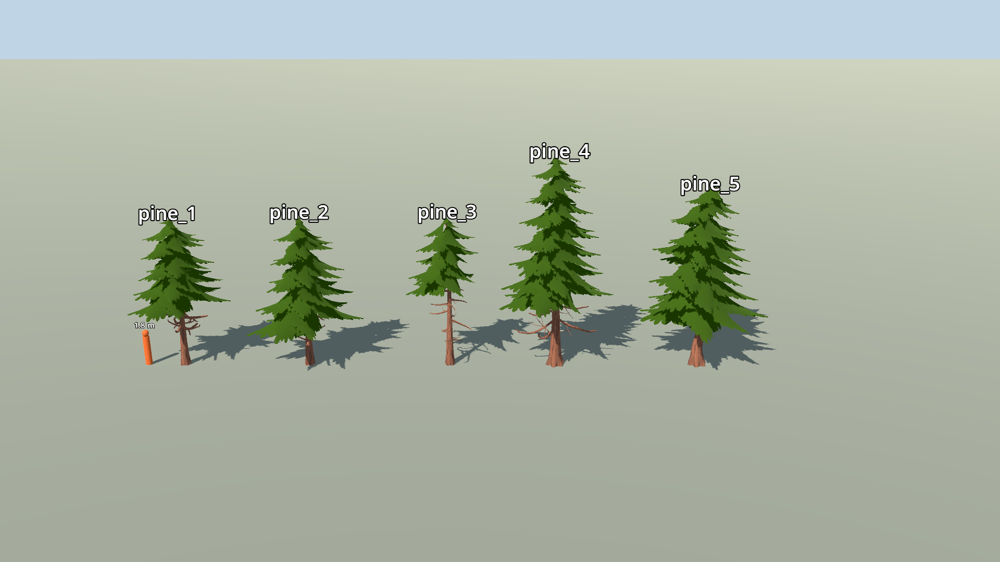
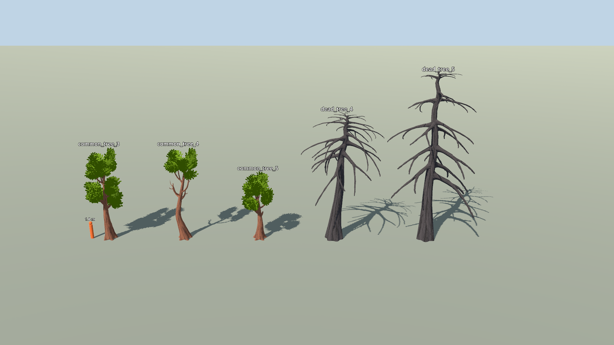
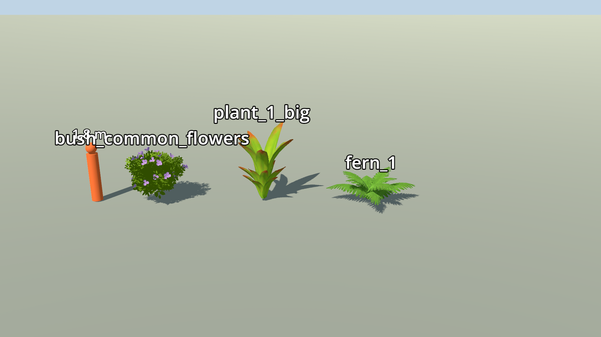
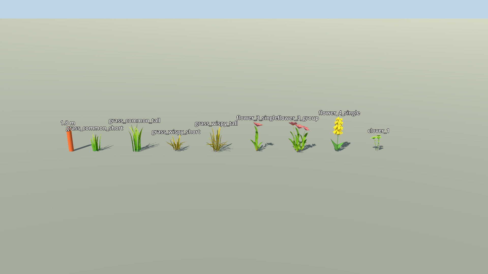
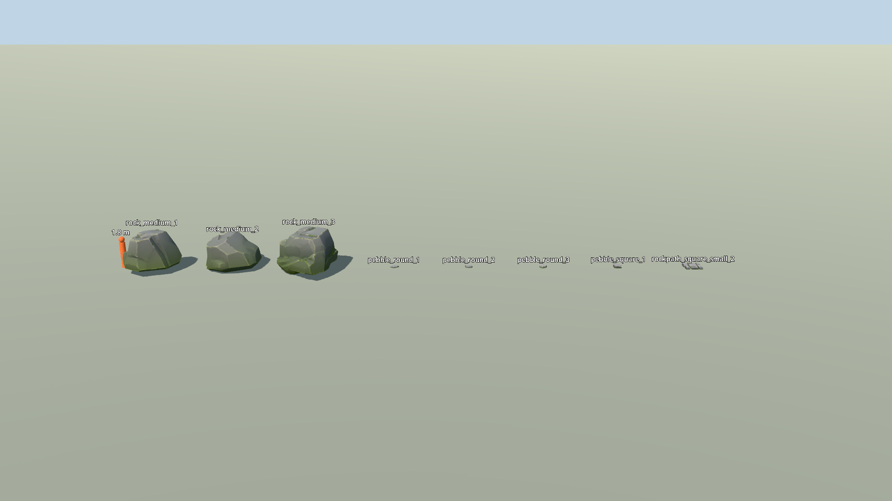
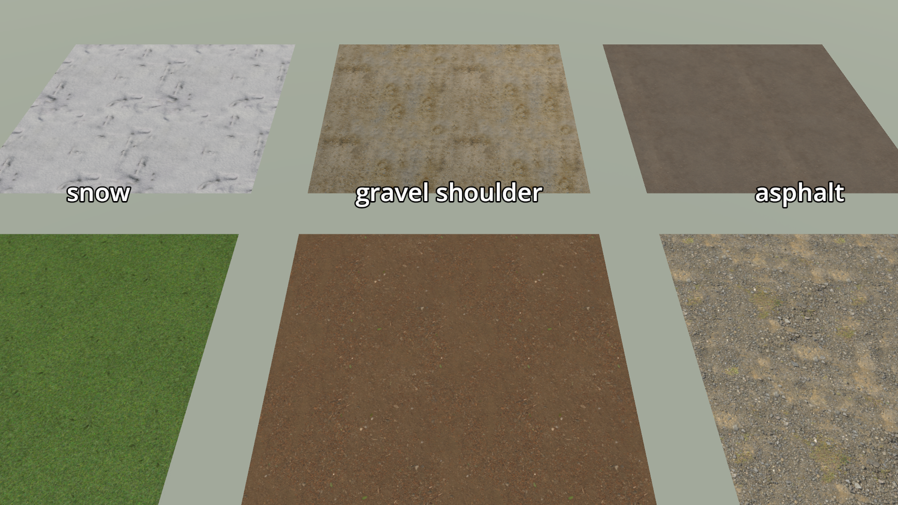
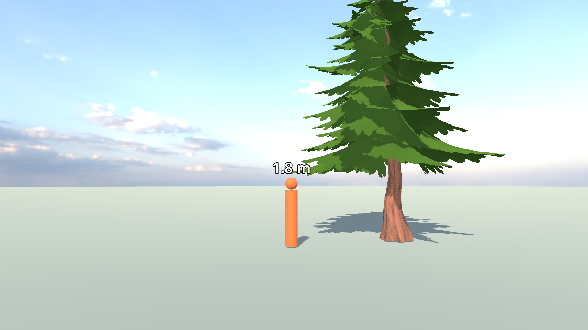

# Art assets

The alpine library is stylized low-poly nature from one model family
(Quaternius), with CC0 ground and road textures and one morning sky.
Everything in `godot/assets/` was loaded in Godot 4.7.2 on this machine.
`godot/assets/manifest.json` is the index.

## Credits

CC0 does not require credit. This is the line to paste into the game's
credits and the Steam page.

| Pack | Author | Licence | Source | Used for |
| --- | --- | --- | --- | --- |
| Stylized Nature MegaKit, standard edition | Quaternius | CC0 1.0 | https://quaternius.com/packs/stylizednaturemegakit.html | Pines, broadleaf trees, dead trees, bush, fern, grass, flowers, rocks |
| LowPoly Medieval Village Pack, December 2020 | Quaternius | CC0 1.0 | https://opengameart.org/content/lowpoly-medieval-village-pack | Houses, inn, mill, bell tower, stable, blacksmith, fence, hay, well, barrel, cart |
| Farm Animals | Quaternius | CC0 1.0 | https://opengameart.org/content/lowpoly-farm-animal-pack | Sheep and cow |
| Nature Kit 2.1 | Kenney | CC0 1.0 | https://kenney.nl/assets/nature-kit | Wooden bridge, cacti, tents, campfire, statue pieces, waterfall cliffs |
| Castle Kit | Kenney | CC0 1.0 | https://kenney.nl/assets/castle-kit | Watchtower, gate, wall, flag, rocks |
| Grass 001 | ambientCG | CC0 1.0 | https://ambientcg.com/a/Grass001 | Meadow grass texture |
| Asphalt 01 | Dario Barresi and Charlotte Baglioni, via Poly Haven | CC0 1.0 | https://polyhaven.com/a/asphalt_01 | Road |
| Forest Ground 06 | Charlotte Baglioni, via Poly Haven | CC0 1.0 | https://polyhaven.com/a/forest_ground_06 | Forest floor |
| Gravel Ground 01 | Rob Tuytel, via Poly Haven | CC0 1.0 | https://polyhaven.com/a/gravel_ground_01 | Road shoulder |
| Rock Ground 02 | Rob Tuytel, via Poly Haven | CC0 1.0 | https://polyhaven.com/a/rock_ground_02 | Scree |
| Snow 02 | Rob Tuytel, via Poly Haven | CC0 1.0 | https://polyhaven.com/a/snow_02 | Snow |
| Sand 01 | Rob Tuytel, via Poly Haven | CC0 1.0 | https://polyhaven.com/a/sand_01 | Desert sand |
| Kloppenheim 06 (Pure Sky) | Greg Zaal, sky edits by Jarod Guest, via Poly Haven | CC0 1.0 | https://polyhaven.com/a/kloppenheim_06_puresky | Sky |
| Barlow Semi Condensed 1.408 (Medium, SemiBold, Bold) | Jeremy Tribby and The Barlow Project Authors | SIL OFL 1.1 | https://github.com/jpt/barlow | All interface text and numbers |
| Zen Theme | beardalaxy, via OpenGameArt | CC0 1.0 | https://opengameart.org/content/zen-theme | Title-screen music |
| Cyber March | iamoneabe, via OpenGameArt | CC0 1.0 | https://opengameart.org/content/cyber-march | Ride music |
| Bathing in the sun electronic, Pro Sensory, Rocking the Synth Machine, Forever, Intense Fight | Pro Sensory, via OpenGameArt | CC0 1.0 | https://opengameart.org/content/bathing-in-the-sun-electronic | Ride music |

Per-track pages, download links, and checksums for the music are in
`godot/assets/music/CREDITS.md`.

Optional ambientCG wording, if a credit is given anyway: "Created using
Grass001 from ambientCG.com, licensed under the Creative Commons CC0 1.0
Universal License."

## Licence obligations

Every file under `godot/assets/`, except the interface font, is CC0 1.0 Universal
(https://creativecommons.org/publicdomain/zero/1.0/). They may be copied,
modified, and shipped inside a commercial Steam build. Attribution is not
required. There is no share-alike duty and no non-commercial limit. Each
pack directory still carries a `LICENSE.txt` and a `SOURCE.md`; shipping
those next to the files is good practice, not a CC0 requirement.

The one exception is the interface font in
`godot/assets/fonts/barlow-semi-condensed/`, which is SIL Open Font License
1.1. It may ship inside a commercial build; `OFL.txt` must ship with it, and
the font files may not be sold on their own. No other licence is in the
library.

## Landmarks

These were confirmed CC0 on each pack's own page, then fetched on 2026-11-21.
Only the models the game places were kept. The village OBJ files were turned
into glTF using the author's material colours. Kenney files are the pack's
own glTF. Added size is about 5.8 MB.

The box-built stand-ins (the grey gate, the white church block, the horn made
of cubes) are not used. A kind is placed only when its rider's-eye frames
looked like something to leave in the ride: the village, the mill, the wooden
bridge, the sheep and cow, the cactus group, and the small desert ruin.
The waterfall had no steep face on the built-in loop. The horizon rocks
floated and did not read as a peak, so they are not placed.

## What is in the library

50,000,166 bytes (about 48 MiB) under `godot/assets/`. The budget was 80 MB.

| Kind | Count |
| --- | --- |
| Conifer | 5 |
| Broadleaf | 3 |
| Dead tree | 2 |
| Bush (flowering bush, leafy plant, fern) | 3 |
| Grass clump | 4 |
| Flower | 4 |
| Rock | 8 |
| Ground texture | 5 |
| Road texture | 1 |
| Sky | 1 |

Largest files: `Bark_DeadTree_Normal.png` 5.7 MB, the sky HDR 4.4 MB,
`Bark_NormalTree_Normal.png` 4.4 MB, `Bark_DeadTree.png` 4.2 MB,
`Bark_NormalTree.png` 3.9 MB. Bark maps are 2048². Ground maps are 1024².

The models are one family, and they read as a bright alpine morning: green
pines, leafy valley trees, grey snags, painted grey rocks, and small green
plants. The ground textures are photographs, quieter than the trees. Meadow
is a real lawn, scree and forest floor show real grit at 1K, and snow and
asphalt are the calmest. Tile them at the `tile_m` in the manifest and let
the terrain vertex colors tint the meadow so it stays in the same green
family. They are not a painted ground, and they are not 4K scan grit.

There is no snow-dusted pine in the free edition. Use the smaller pines and
the dead trees up high. There is no cliff mesh in the free edition; the
large cliffs in the pack trailer are in the pro/source download. There is
no guard rail, sign, fence, or start arch in this set. A mismatched prop
pack was not forced in.

Triangle counts are above the rough scatter guide for most trees (about
1,600 to 5,700; the guide was 1,500) and for the grass clumps (155 to 622
modeled blades; the guide was 50). `pine_5` is the lightest conifer at
1,646 triangles. Alpha-cutout foliage costs more than the raw triangle
count. Repeat `pine_5` and the shorter grass, and do not carpet thousands
of the heavy trees or the wispy grass.

Pivots are at the origin and the glTF nodes have no transform, so 1 unit is
1 metre and Y is up. Many meshes extend below y = 0. `origin_at_base` is
false for those, and `lift_m` is how far to raise the instance so the
lowest vertex sits on the ground (about 0.24 m for the pines, 0.34 m for
the dead trees, up to 0.32 m for a boulder).

`Bush_Common` was loaded, rendered, and then removed. Its only leaf card
averages red (about 166, 22, 22). The rest of the set is green.

## How to load them

Use runtime loading. Do not depend on Godot's import pipeline for this set.

On a scratch project with no GDExtension, both Godot binaries finished
`godot --headless --import` cleanly, including the "Loading docks" step
that aborts on the main project:

| Run | Result |
| --- | --- |
| Official 4.7.2 binary, scratch project | Exit 0. First import 6.5 s, reimport 4.6 s. 61 `.import` files. `.godot/` was 53 MB. |
| Flatpak `org.godotengine.Godot` 4.7.2, same scratch project | Exit 0 in 5.6 s. Passed "Loading docks". |
| Main project (has the GDExtension) | Not re-run here. A flatpak `--headless --import` on that project has already aborted with exit 134 while loading editor docks. |

After that import, `load()` of the 30 glTF files as `PackedScene` took
696 ms. One of those files was the red bush removed afterwards; it is a
90 KB glTF and does not change the result. Reimporting with the `.import`
files kept produced the same UIDs and the same `res://` paths. Deleting
the `.import` files and importing again on this machine produced the same
61 UIDs. The imported `.scn` sizes still drifted by a byte or two, so
`.godot/imported/` is not a stable blob to commit. `.import` files contain
only `res://` paths.

The default texture import is wrong for this set: normal maps came in with
`compress/normal_map=0` and mipmaps off. Scene import has
`meshes/generate_lods=true`, so the imported mesh is not the author's
triangle list. Fixing that means hand-written `.import` files. The runtime
path does not need them.

Runtime loading was timed on the full set:

| Run | Models | Textures and sky |
| --- | --- | --- |
| Official binary, mobile renderer, a real window | 1.95 s | 0.23 s |
| Official binary, `--headless` (dummy renderer, one extra bush) | 1.90 s | 0.22 s |

`res://` opened the raw files with no `.import` beside them. Headless
parsed every file and did not draw. The windowed run is the one that
produced the sheets below: alpha-cutout foliage, bark, rocks, the six
ground quads, and the sky all showed up. Nothing was pink or black.
Nothing had inside-out lighting.

An exported game was not produced. Export templates are not installed, and
a trial `--export-pack` stopped because the scratch project has no
`export_presets.cfg`. The rule to follow, not a result from an export this
session: Godot leaves non-imported files out of the PCK unless the export
preset's include filter names them (`*.gltf,*.bin,*.png,*.jpg,*.hdr` under
`assets/`). Once those bytes are in the PCK, `res://` reads them with
`FileAccess`, `Image.load`, and `GLTFDocument`. Until an export is actually
run, treat that as the documented rule.

```gdscript
# Reference for the Rust side. Call the same Godot classes.
func load_model(path: String) -> Mesh:
    var doc := GLTFDocument.new()
    var state := GLTFState.new()
    var err := doc.append_from_file(path, state)
    if err != OK:
        push_error("gltf %s %s" % [path, err])
        return null
    var packed := doc.generate_scene(state)
    var mesh_instance := packed.find_children("*", "MeshInstance3D", true, false)[0] as MeshInstance3D
    return mesh_instance.mesh

func scatter(mesh: Mesh, count: int) -> MultiMeshInstance3D:
    # Every kept model is one MeshInstance and one Mesh.
    # A pine is two surfaces (bark, then leaves). A flower is two
    # (leaves, then petals). Dead trees, grass, and rocks are one.
    # MultiMesh draws every surface, so one MultiMesh per model is enough.
    # Do not build a new material: the surface materials already have
    # alpha scissor at 0.2 and cull disabled. Vertex colors are on the
    # mesh and vertex_color_use_as_albedo is false; leave that off.
    var multi := MultiMesh.new()
    multi.transform_format = MultiMesh.TRANSFORM_3D
    multi.mesh = mesh
    multi.instance_count = count
    var node := MultiMeshInstance3D.new()
    node.multimesh = multi
    return node

func load_texture(path: String) -> ImageTexture:
    var image := Image.new()
    var err := image.load(path)
    if err != OK:
        push_error("image %s %s" % [path, err])
        return null
    image.generate_mipmaps()
    return ImageTexture.create_from_image(image)

func ground_material(albedo: String, normal: String, roughness: String, tile_m: float) -> StandardMaterial3D:
    var mat := StandardMaterial3D.new()
    mat.albedo_texture = load_texture(albedo)
    mat.normal_enabled = true
    mat.normal_texture = load_texture(normal) # OpenGL normal, nor_gl / NormalGL
    mat.roughness_texture = load_texture(roughness)
    mat.roughness_texture_channel = BaseMaterial3D.TEXTURE_CHANNEL_RED
    # Quad is 1 m. Scale UV so one repeat is tile_m.
    mat.uv1_scale = Vector3(1.0 / tile_m, 1.0 / tile_m, 1.0)
    return mat
```

Raise each instance by that asset's `lift_m` before it meets the heightfield.

The sky is an equirectangular HDR. `Image.load` on the `.hdr` succeeded
(2048×1024), and `PanoramaSkyMaterial.panorama` showed it behind `pine_5`.

## Previews

Rendered off a `SubViewport` with the mobile renderer, a daylight sun, a
neutral ground plane, and a 1.8 m post. Labels are the manifest ids.









Left to right after the post: `grass_common_short`, `grass_common_tall`,
`grass_wispy_short`, `grass_wispy_tall`, `flower_3_single`,
`flower_3_group`, `flower_4_single`, `clover_1`. A few of those labels
overlap.



The three boulders are about 2 m. The pebbles and the flat path stone are
about 10–15 cm, so they read as small next to the post.



Top row, far side: snow, gravel shoulder, asphalt. Near side: meadow,
forest floor, scree. Relief from the normal maps is visible on the snow,
the soil, and the scree. Asphalt stays smooth.



## Rules for adding a pack

Same rules as `godot/assets/README.md`. Short version: CC0, or MIT,
Apache-2.0, or CC-BY 4.0 with the author's credit line copied into the
table above. No NC, ND, SA, GPL, "personal use", or a custom store
licence. One directory per pack, with the pack's own licence file and a
`SOURCE.md` that records the download URL, the date, and the SHA-256.
Keep glTF, not a second copy as FBX or OBJ. Keep textures at 1K or 2K.
Add a manifest entry only after Godot has loaded the file. Stay near the
current size.

## Needs the owner to download

These were not fetched. Each one needs a login, a pay-what-you-want
checkout, or a session cookie.

| What | Why it was skipped | Where to get it | Where to drop it |
| --- | --- | --- | --- |
| Stylized Nature MegaKit, pro and source editions | The free standard edition is already in the library (68 of 116 models). The rest is a pay-what-you-want itch checkout. The author still marks those files CC0. The trailer cliffs are in this edition, not in the free zip. | https://quaternius.itch.io/stylized-nature-megakit and https://quaternius.com/packs/stylizednaturemegakit.html | `godot/assets/third_party/_incoming/stylized-nature-megakit-source.zip` |
| Kenney Nature Kit | CC0 on https://kenney.nl/assets/nature-kit. The download is a "continue without donating" step. The old CDN URL redirects to the page, and `https://kenney.nl/download-link/…` returns 403 without a site session. | https://kenney.nl/assets/nature-kit | `godot/assets/third_party/_incoming/kenney_nature-kit.zip` |
| Forest Vegetation - Sample Pack, Renard Noir | The store page lists MIT and a 16.4 MB download. The file is behind the store (`/download/5545/`), not a public zip. A second author's plants would also break the one-family look. | https://store.godotengine.org/asset/renard-noir/forest-vegetation-sample-pack/ | `godot/assets/third_party/_incoming/forest-vegetation-sample.zip` |
| CC0Tree, Skywolf Game Studios | Named as CC0 on the store. The old asset-library API returned no hit, and `https://store.godotengine.org/asset/skywolf/cc0tree/` was a 404 on 2026-11-20. No public file was found. | The Godot Asset Store page the owner already has | `godot/assets/third_party/_incoming/cc0tree.zip` |

## Rejected

| Candidate | Reason |
| --- | --- |
| Lyricsz "Bike" on OpenGameArt (CC0) | Previewed. It is a chunky red dirt bike, not a road bicycle. OBJ and blend only, 2,521 triangles, separate `frontTire` and `backTire`, no cranks. The OBJ bounds are about 3.4 × 2.4 × 1.6, too big for a bicycle. Not loaded into Godot. |
| Clint Bellanger bicycle on OpenGameArt (CC-BY 3.0) | A rigged upright bike with a pedaling animation, about 820 triangles. Blend only, so Godot cannot import it here (no Blender). It is a BMX, not a road bike. |
| Gaitkit bicycle | The page allows commercial use and then adds its own rules ("do not resell it as an asset"). That is a custom licence, not CC0, MIT, Apache-2.0, or CC-BY. The download was not taken. |
| tevy.dev road bicycle and cyclist | The pages say CC0 and list a 57,900-triangle road bike and a rigged cyclist. There is no named author and no licence file beyond the badge. Left out as unclear provenance. |
| zeroenergygames.com "Ride: Bike & Rider" | The URL returned 404 on 2026-11-20. |
| Quaternius twisted trees, the two heaviest broadleaf trees, three of the dead trees, the large rock-path pieces, mushrooms, petals | In the standard zip, and CC0, but 9,000–10,000 triangles for the twisted trees plus a second bark set, or duplicates of a kept model. Not copied in. |
| `Bush_Common` | Loaded and rendered. Removed. The leaf card is red and the rest of the set is green. |
| Poly Haven `leafy_grass`, `forest_floor`, cracked asphalt | Looked at the thumbnails. Too much leaf litter, autumn leaves, or cracked grit next to these trees. |
| Godot Asset Store copy of the MegaKit | Same CC0 standard edition as the OpenGameArt zip that was actually downloaded. The store file itself was not fetched. |

## Rider and bicycle

Nothing suitable is in the library. No CC0 or CC-BY road cyclist, and no
road bicycle with separate wheels and cranks, could be downloaded without
a login and then loaded in Godot. The two OpenGameArt bikes above are the
closest licence-clear files, and neither is a road bike. The game should
keep building the rider in code.

## Desert survey

No desert files were added. This is only a list.

The same Quaternius pack is the first place to look. The standard zip
contains `Rocks_Desert_Diffuse.png` and no model that uses it, so the
desert rocks are in the pro/source edition (CC0, pay-what-you-want, listed
above). Cacti were not in the file list of the free zip. Whether the paid
edition has them was not checked, because that zip was not downloaded.

Other CC0 sources with direct downloads, not fetched:

- Poly Haven textures: `sand_01`, `sand_02`, `sand_03`, `gravelly_sand`, and the `rocky_terrain` set. https://polyhaven.com/ CC0. Same 1K JPG API as the alpine textures.
- ambientCG sand and rock materials, same licence and zip pattern as Grass001. https://ambientcg.com/
- Kenney Nature Kit, if the owner downloads it. The public page describes trees, rocks, plants, and camping props. Cacti were not confirmed, because the zip never arrived.
- Quaternius "Low Poly Nature Pack" on OpenGameArt, CC0, FBX/OBJ/blend only, no glTF: https://opengameart.org/content/low-poly-nature-pack-1. Not downloaded, so desert coverage is not confirmed.

## Requested ignore rules

`godot/assets/` has no `.import` files. Opening the main project in the
editor will create them, and `.godot/`, next to this raw set. Please add:

```text
godot/.godot/
godot/assets/**/*.import
```

Do not commit either while loading stays on `GLTFDocument` and `Image.load`.
