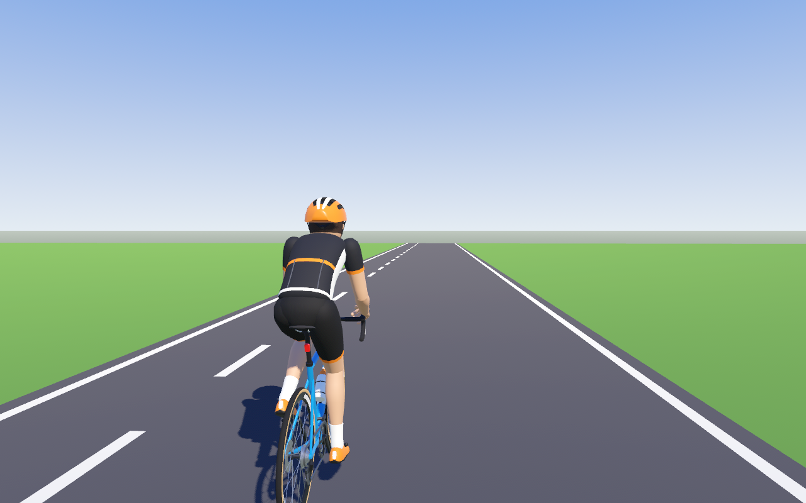
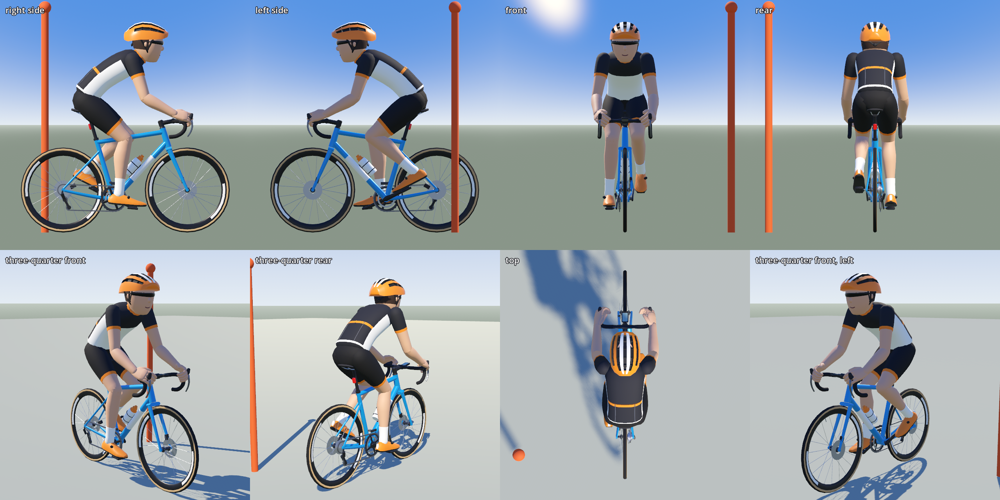
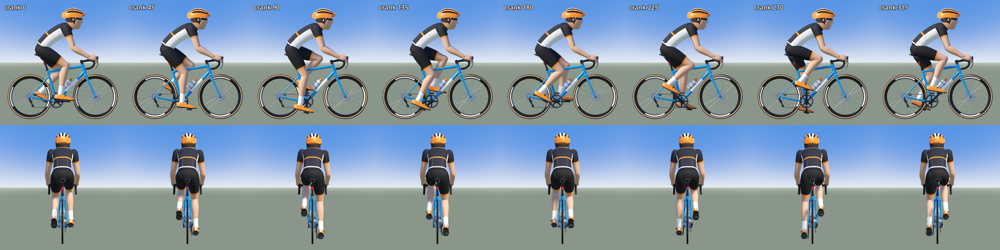
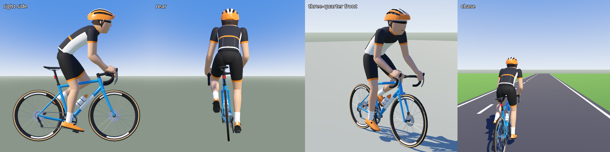
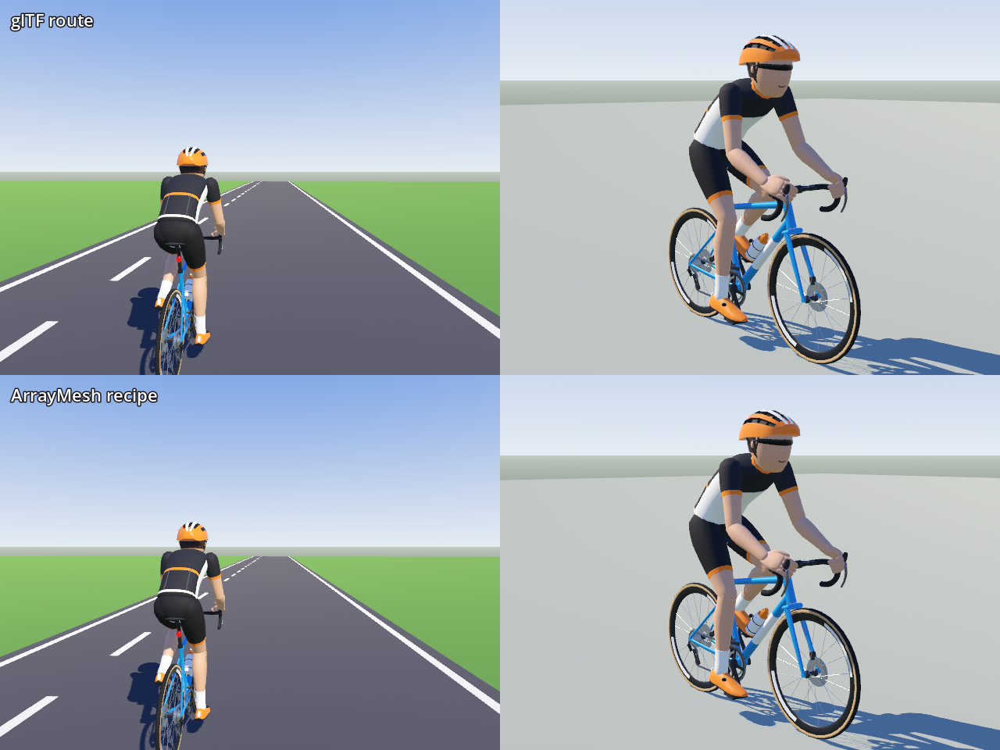

# Road bike and rider model

`crates/pp-rider` generates the cyclist and the bike the player watches.
It has no Godot dependency. `RiderModel::build` makes the meshes once, as
rigid named parts. `RiderModel::pose` gives every part a transform for a
crank angle, with the feet locked to the pedals and the hands to the bars.
Everything is procedural: there is no modelling tool and no asset file.

It is not wired into the game yet. `crates/pp-godot/src/rider.rs` still
draws the placeholder. The [integration recipe](#godot-integration) below
is for the worker who replaces it.

## Pictures

The chase camera, placed as `crates/pp-godot/src/camera.rs` places it, at
the game's 1280x800. This is the view the player has for the whole ride.



The placeholder in the game (left) and the new model from the same camera
(right). The right half is the preview project's stand-in road, not the
game world. The left half is a copy of `docs/img/shots/start-chase.png`
taken before the new model, kept as
`docs/img/rider/history/placeholder-start-chase.png`.


Turnaround: both sides, front, rear, three-quarter views, top. The post is
1.8 m tall.



One pedal revolution in eight steps of 45 degrees, from the drive side and
from behind, at `effort = 0.6`.



Close-ups: drivetrain and cockpit (bike only), hands on the hoods, helmet
from behind, face, legs and shoes from behind.


First person from the game's handlebar camera, with the offsets
`camera.rs` uses today (position `0, 1.22, -0.18`, looking at
`0, 0.55, -6`, 72 degrees). That point is in clear air in front of the
chest, so the game's camera works with the new model unchanged.


First person from the `eye` anchor, looking 50 degrees down, with the head
part hidden. From the real eye point the bars are almost straight below, so
they only come into frame when the camera looks down this far.


Next to the Quaternius pine, bush, fern, and rock the scenery uses.


Bars turned 20 degrees to the right at full effort: the hands stay on the
hoods and the shoulders follow.


Out of the saddle (`stand = 1`, right pedal going down, so the bike leans
left) and the descending tuck (`tuck = 1`, cranks level).




Earlier rounds are kept in `docs/img/rider/history/`: `round1-bike` (frame
and wheels only), `round1`, `round2`, `round3`.

## Conventions

- Meters and radians. Colours are sRGB, 0..=1.
- Right-handed, Y up. The bike faces -Z, as a Godot node does. The rider's
  left is -X.
- The model origin is on the road under the bottom bracket. Both tyres
  touch `y = 0`.
- Triangles are counter-clockwise seen from outside, as in glTF. Godot's
  `ArrayMesh` wants clockwise. Use `Surface::indices_clockwise()` there.
- Normals are unit length: smooth where a shape is round, split where two
  faces meet at an edge.
- No textures and no vertex colours. One surface per material.

## Parts

`RiderModel::parts()` returns 22 parts, always in this order. The index is
`PartId::index()` and the name is `PartId::name()`.

| Index | Name | What it is | Local origin |
| --- | --- | --- | --- |
| 0 | `frame` | Frame, seatpost, saddle, bottle, derailleurs, chain, tail light | Model origin |
| 1 | `fork_bars` | Fork, stem, bars, hoods, levers, head unit | Model origin |
| 2 | `front_wheel` | Tyre, rim, hub, spokes, rotor, valve | Axle centre, axle along X |
| 3 | `rear_wheel` | The same, plus the cassette | Axle centre, axle along X |
| 4 | `crankset` | Both arms, spider, chainrings | Bottom bracket, right arm to -Z |
| 5, 6 | `pedal_l`, `pedal_r` | Pedal body and spindle | Middle of the pedal, on its axle |
| 7 | `pelvis` | Hips in bib shorts | Mid-point between the hip joints |
| 8 | `torso` | Jersey, neck, collar | Waist pivot |
| 9 | `head` | Head, helmet, sunglasses, hair | Top of the neck |
| 10, 11 | `upper_arm_l`, `upper_arm_r` | Sleeve and upper arm | Shoulder joint |
| 12, 13 | `forearm_l`, `forearm_r` | Forearm | Elbow |
| 14, 15 | `hand_l`, `hand_r` | Hand | Wrist |
| 16, 17 | `thigh_l`, `thigh_r` | Thigh in the shorts | Hip joint |
| 18, 19 | `shin_l`, `shin_r` | Shin and sock | Knee |
| 20, 21 | `foot_l`, `foot_r` | Shoe | Cleat, on the pedal axle |

There is no hierarchy and no skeleton. Each part has its geometry in its own
local space and one rigid transform (rotate, then translate) straight to
model space. Limbs overlap at rounded joints instead of being skinned. Put
all 22 nodes directly under the rider node.

## API

```rust
pub const WHEEL_RADIUS_M: f32 = 0.34;
pub const CRANK_LENGTH_M: f32 = 0.1725;
pub const MAX_STEER_RAD: f32 = 0.45;

impl RiderModel {
    pub fn build(style: &RiderStyle) -> Self;
    pub fn parts(&self) -> &[Part];
    pub fn part(&self, id: PartId) -> &Part;
    pub fn triangle_count(&self) -> usize;
    pub fn pose(&self, input: &PoseInput) -> Pose;
}
impl Default for RiderModel; // the default kit

impl Part {
    pub fn name(&self) -> &'static str;
    pub fn surfaces(&self) -> &[Surface];
    pub fn triangle_count(&self) -> usize;
}

pub struct Surface {
    pub positions: Vec<[f32; 3]>,
    pub normals: Vec<[f32; 3]>,
    pub indices: Vec<u32>,
    pub material: Material,
    pub style_color: Option<StyleColor>,
}
impl Surface {
    pub fn triangle_count(&self) -> usize;
    pub fn indices_clockwise(&self) -> Vec<u32>;
}

pub struct Material {
    pub base_color: [f32; 3],
    pub roughness: f32,
    pub metallic: f32,
}

pub struct PoseInput {
    pub crank_angle_rad: f32,
    pub wheel_angle_rad: f32,
    pub steer_rad: f32,
    pub effort: f32,
    pub stand: f32,
    pub tuck: f32,
}

pub struct Pose {
    pub transforms: [PartTransform; PartId::COUNT],
    pub anchors: Anchors,
}
impl Pose {
    pub fn transform(&self, part: PartId) -> &PartTransform;
}

pub struct PartTransform {
    pub translation: [f32; 3],
    pub rotation: [f32; 4], // unit quaternion, x y z w
}
impl PartTransform {
    pub const IDENTITY: PartTransform;
    pub fn transform_point(&self, local: [f32; 3]) -> [f32; 3];
    pub fn transform_vector(&self, local: [f32; 3]) -> [f32; 3];
    pub fn to_cols(&self) -> [[f32; 3]; 4]; // X, Y, Z basis, then origin
}

impl PartId {
    pub const COUNT: usize = 22;
    pub const ALL: [PartId; 22];
    pub const fn index(self) -> usize;
    pub const fn name(self) -> &'static str;
    pub const fn is_bike(self) -> bool;
}
```

`build` is deterministic: equal styles give equal models, vertex for vertex.
A different style changes material colours only. Geometry and the surface
layout stay the same.

## Pose input

| Field | Unit | Meaning |
| --- | --- | --- |
| `crank_angle_rad` | radians | 0: right crank horizontal, pointing forward. Positive is forward pedalling. `PI/2`: right pedal at the bottom. `PI`: right crank pointing back. `3*PI/2`: right pedal at the top. The left crank is half a turn behind. Repeats every `2*PI`. |
| `wheel_angle_rad` | radians | Positive rolls forward. Use `distance_m / WHEEL_RADIUS_M`. Wrap it in `f64` before casting, or `f32` loses precision on a long ride. |
| `steer_rad` | radians | About the head-tube axis. Positive turns the bars to the rider's right. Clamped to plus or minus `MAX_STEER_RAD` (0.45). |
| `effort` | 0..=1 | 0: still upper body. 1: shoulders rock about 22 mm each way. Clamped. |
| `stand` | 0..=1 | 0 seated, 1 out of the saddle. Clamped. |
| `tuck` | 0..=1 | 0 on the hoods, 1 in the drops with a flat back. Clamped, and scaled by `1 - stand`. |

What the pose does:

- **Cranks and pedals.** The crankset turns by `crank_angle_rad`. Each pedal
  stays on its axle and tilts with the foot: 5 degrees toe-down in the
  power phase, 27 degrees half-way up the upstroke.
- **Legs.** Two-bone inverse kinematics from the hip to the ankle. Thigh
  0.445 m, shin 0.440 m, never stretched. The knee leads forward and comes
  in 23 mm over the top of the stroke. Knee angle seated: 67.5 to
  145.1 degrees (180 is a straight leg).
- **Hips.** On the saddle. The pushing side drops: 4 mm peak to peak at no
  effort, 9 mm at full effort.
- **Arms.** Two-bone inverse kinematics from the shoulder to the wrist.
  Upper arm 0.320 m, forearm 0.270 m. Elbow angle at rest: 136 degrees.
  The hand is fixed to the bar, so it follows the steering.
- **Sway.** With `effort`, the torso rolls toward the pushing leg, twists a
  little, and nods at twice the cadence. Every term is a sine of the crank
  angle, so it is zero-mean and exactly zero at `effort = 0`.
- **Head.** Rides on the neck but keeps its own orientation, so it keeps
  facing up the road.
- **Wheels.** Both turn by `wheel_angle_rad` about their axles. The front
  one also turns with the steering.
- **Stand.** Hips 50 mm up and 165 mm forward, bobbing 16 mm each way at
  twice the cadence. The bike rolls up to 4.9 degrees on its tyres, away from the
  pushing leg, and the knees open out to clear the top tube.
- **Tuck.** Hands close round the front of the hooks, back about 18 degrees
  flatter, head down. The cranks are level if the caller holds
  `crank_angle_rad` at 0.

Lean into corners is not handled. The caller rotates the whole model.

## Anchors

`Pose::anchors` holds points in model space, in meters, already posed.
Values at rest:

| Anchor | At rest (x, y, z) | Notes |
| --- | --- | --- |
| `saddle_top` | 0, 0.981, 0.211 | Middle of the saddle's top. Leans with the bike in a stand. |
| `hood_l`, `hood_r` | -0.200 / 0.200, 0.917, -0.571 | Grip point on top of each hood. Turns with the steering. |
| `eye` | 0, 1.518, -0.387 | Between the eyes. Moves with sway, stand, and tuck. |
| `eye_forward` | 0, -0.122, -0.993 | Unit vector the head faces along. |
| `rear_axle` | 0, 0.340, 0.404 | |
| `front_axle` | 0, 0.340, -0.588 | Turns with the steering. |
| `bottom_bracket` | 0, 0.270, 0 | |

## Style

`RiderStyle` holds twelve sRGB colours. `Default` is the penguin kit.

| Field | Default | Where it shows |
| --- | --- | --- |
| `jersey_primary` | near-black | Jersey back, shoulders, sleeves |
| `jersey_secondary` | white | Jersey front panel, hem, helmet stripes |
| `jersey_accent` | orange | Collar, cuffs, pocket band, shorts hem, bottle cap |
| `bibs` | black | Shorts |
| `helmet` | orange | Helmet shell |
| `shoes` | orange | Shoe uppers |
| `socks` | white | Socks |
| `skin` | light tan | Face, neck, arms, hands, legs |
| `frame` | glacier blue | Frame and fork |
| `bar_tape` | black | Handlebar tape |
| `tyre` | black | Tyre tread |
| `tyre_wall` | tan | Tyre sidewall. Set it to `tyre` for all-black tyres. |

Each `Surface` carries `style_color: Option<StyleColor>`, the style field its
colour came from. A settings menu can recolour a built model by that tag
without rebuilding a mesh. `None` marks a fixed colour such as the chain.

## Numbers

Measured in this checkout.

- **Triangles:** 18,766 of a 20,000 budget. Bike 11,272, rider 7,494.
- **Bounding box at rest:** x -0.271 to 0.271, y 0 to 1.686, z -0.928 to
  0.744. That is 0.54 m wide, 1.69 m tall, 1.67 m long.
- **Bike:** wheelbase 0.992 m, bottom bracket 0.270 m high, cranks 0.1725 m,
  wheels 0.340 m to the outside of a 30 mm tyre, stack 0.565 m, reach
  0.390 m, head angle 73 degrees, seat angle 73.5 degrees, saddle 0.742 m
  from the bottom bracket, hoods 0.400 m apart and 64 mm below the saddle.
- **`pose`:** about 0.4 microseconds per call in a release build on this
  machine (`examples/bench_pose.rs`, two million calls). It returns a `Copy`
  value and does not allocate.
- **`build`:** 3 to 5 ms in a release build.

## Tests

`CRATE=pp-rider ./x test` runs 40 unit tests, 2 integration tests, and one
doc test. They check, among other things:

- every mesh: indices in range, no degenerate triangle, unit normals,
  normals on the side the winding says, and every part made only of closed
  shells with positive volume;
- the triangle budget, the fixed part order, and that `build` is
  deterministic;
- both tyres on `y = 0` and nothing below the road in any mode;
- over a full revolution in 1 degree steps, for both legs, seated, at full
  effort, standing, and tucked: cleat within 1 mm of the pedal axle, thigh
  and shin length within 0.1 mm, knee angle in range, knee in front of the
  hip-ankle line and not bowed out, no jump between steps;
- left and right legs exactly half a revolution apart;
- hands fixed on the bars for every steering angle, arms never stretched;
- sway exactly zero at no effort and zero-mean with effort;
- wheels turning about their axles by exactly the wheel angle;
- the pose repeating every revolution;
- default colours on the expected parts, and a recolour touching only the
  surfaces tagged with that colour.

## Previews

`tools/rider-preview/` is a stand-alone Godot 4.7 project. It loads no
GDExtension, so the game library cannot break a render. One script
regenerates every picture in `docs/img/rider/`:

```text
tools/rider-preview/render.sh
```

It builds `examples/export_glb.rs` in the build container, exports one
`.glb` per pose into `tools/rider-preview/.cache/`, and runs
`preview.gd` once. Godot needs a real window. The whole set takes about
8 seconds.

```text
ONLY=chase,closeups tools/rider-preview/render.sh   # some jobs only
OUT=$PWD/docs/img/rider/history/next tools/rider-preview/render.sh
BIKE_ONLY=1 tools/rider-preview/render.sh           # leave the rider out
```

Jobs: `turnaround`, `chase`, `first`, `strip`, `style`, `closeups`,
`arraymesh`, `steer`, `stand`, `tuck`, `compare`.

To export one pose by hand:

```text
target/debug/examples/export_glb --out rider.glb \
  --crank 55 --wheel 140 --steer 0 --effort 0.5 --stand 0 --tuck 0 --stats
```

The `.glb` has one node per part, named as the part, plus empty nodes
`anchor_*`. `--stats` prints the triangle count of each part and the
anchors.

## Godot integration

Replace `Rider::assemble` and `Rider::pose_legs` in
`crates/pp-godot/src/rider.rs`. Keep
`Rider::place(position, tangent, distance_m, cadence_rpm, dt, lean)` as it
is. Add `pp-rider = { path = "../pp-rider" }` to
`crates/pp-godot/Cargo.toml`.

The three facts the recipe rests on were checked in Godot 4.7.2 by
`preview.gd`, which builds the model from plain arrays this way and renders
it beside the glTF route. The two match:



1. **Winding.** Pass `surface.indices_clockwise()` as the index array.
2. **Colour.** `Material::base_color` is sRGB. Give it to
   `Color::from_rgb` as it is. Do not convert to linear.
3. **Transform.** `to_cols()` returns the X, Y, Z basis vectors and the
   origin, the argument order of `Basis::from_cols` and `Transform3D::new`.

### Once, in `assemble`

One `MeshInstance3D` per part, all direct children of the rider node. One
`ArrayMesh` surface per `Surface`, with its own `StandardMaterial3D`.

The Rust below follows the `SurfaceTool` calls `road.rs` already uses. It
was not compiled in this job, because this crate does not depend on `godot`;
check the method names against gdext 0.5.5.

```rust
let model = RiderModel::build(&RiderStyle::default());
for part in model.parts() {
    let mut mesh = ArrayMesh::new_gd();
    for surface in part.surfaces() {
        let mut tool = SurfaceTool::new_gd();
        tool.begin(PrimitiveType::TRIANGLES);
        for (p, n) in surface.positions.iter().zip(&surface.normals) {
            tool.set_normal(Vector3::new(n[0], n[1], n[2]));
            tool.add_vertex(Vector3::new(p[0], p[1], p[2]));
        }
        for index in surface.indices_clockwise() {
            tool.add_index(index as i32);
        }
        let m = surface.material;
        let [r, g, b] = m.base_color;
        tool.set_material(&standard_material(
            Color::from_rgb(r, g, b),
            m.roughness,
            m.metallic,
        ));
        tool.commit_ex().existing(&mesh).done();
    }
    let mut node = MeshInstance3D::new_alloc();
    node.set_name(part.name());
    node.set_mesh(&mesh);
    self.base_mut().add_child(&node);
    self.parts.push(node);
}
self.model = Some(model);
```

The same thing in GDScript, as `preview.gd` runs it:

```gdscript
var arrays := []
arrays.resize(Mesh.ARRAY_MAX)
arrays[Mesh.ARRAY_VERTEX] = positions      # PackedVector3Array
arrays[Mesh.ARRAY_NORMAL] = normals        # PackedVector3Array
arrays[Mesh.ARRAY_INDEX] = indices         # PackedInt32Array, clockwise
mesh.add_surface_from_arrays(Mesh.PRIMITIVE_TRIANGLES, arrays)
var material := StandardMaterial3D.new()
material.albedo_color = Color(r, g, b)     # sRGB, as given
material.roughness = roughness
material.metallic = metallic
mesh.surface_set_material(surface_index, material)
```

### Every frame, at the end of `place`

`place` already moves and leans the rider node and advances
`self.crank_angle`. After that:

```rust
let wheel = (distance_m / f64::from(WHEEL_RADIUS_M)).rem_euclid(TAU) as f32;
self.crank_angle = self.crank_angle.rem_euclid(std::f32::consts::TAU);
let pose = model.pose(&PoseInput {
    crank_angle_rad: self.crank_angle,
    wheel_angle_rad: wheel,
    steer_rad: 0.0,
    effort: self.effort,
    stand: self.stand,
    tuck: self.tuck,
});
for (node, transform) in self.parts.iter_mut().zip(&pose.transforms) {
    let [x, y, z, origin] = transform
        .to_cols()
        .map(|c| Vector3::new(c[0], c[1], c[2]));
    node.set_transform(Transform3D::new(Basis::from_cols(x, y, z), origin));
}
```

Notes for the integrator:

- The placeholder turned its wheels and cranks backwards (a positive
  rotation about +X). The pose has the right sense built in. Pass positive
  angles for forward motion.
- `place` has no power argument. Add setters for `effort`, `stand`, and
  `tuck` rather than changing its signature. A reasonable `effort` is
  power over 1.2 times FTP, clamped to 0..=1 and smoothed over about a
  second. Blend `stand` and `tuck` over about half a second so the pose
  does not snap.
- Suggested triggers: `stand` on a grade above 8 % at a cadence under 70
  rpm; `tuck` when coasting above 45 km/h, holding `crank_angle_rad` at 0.
- `steer_rad` can stay 0. If the game wants the bars to turn into bends,
  a few hundredths of a radian is plenty at road speed.
- The chase and handlebar camera offsets in `camera.rs` work as they are.
  A camera at the `eye` anchor should hide the `head` node, or the helmet
  and sunglasses fill the frame.
- `Rider::wheel_angle` and `Rider::crank_angle` can keep returning the
  accumulated values.
- To recolour: build a new model from the new `RiderStyle` and swap the
  materials, or walk the surfaces and set `albedo_color` where
  `style_color` matches. The geometry does not change.
- `docs/game.md` says the rider is a placeholder under "Rough edges".
  Update it when this lands.

## What still falls short

- The parts are rigid. The torso does not bend, so a stand or a tuck shows
  a hinge at the waist, and a deeply bent knee shows the overlap of two
  rounded ends, not stretched skin.
- The face is a nose, a mouth, and sunglasses. There are no eyes and no
  expression.
- Hands have separate fingers but one pose each for the hoods and the
  drops. In between, the blend passes through the bar.
- The chain is a smooth ribbon and does not move. The cassette is a
  stepped cone without teeth. There are no cables or hoses.
- The kit is flat colour. There is no logo, no lettering, and no cloth
  fold, because there are no textures.
- Wheels have 36 sides. The tyre's outline is visibly a polygon in a very
  close shot. It does not show from the chase camera.
- Spokes are under 3 mm thick. From the chase camera they are thinner than
  a pixel, so they may shimmer when the wheel turns. That was not checked
  in motion; every picture here is a still.
- There is one level of detail. A field of other riders would need a
  cheaper one.
- Stand and tuck were tuned by eye from four views each, not from footage.
- The model was judged in the preview project's lighting. It has not been
  seen under the game's sun, fog, and sky.
