# Road bike and rider model

`crates/pp-rider` generates the cyclist and the bike the player watches.
It has no Godot dependency. `RiderModel::build` makes the meshes once, as
rigid named parts. `RiderModel::pose` gives every part a transform for a
crank angle, with the feet locked to the pedals and the hands to the bars.
Everything is procedural: there is no modelling tool and no asset file.

It is in the game. `crates/pp-godot/src/rider.rs` builds the 22 parts as
`ArrayMesh` nodes in `ready` and poses them in `Rider::place`, through
`RideAnimator`, which turns the ride's distance, cadence, lean, and grade
into a pose input. [In the game](#in-the-game) has the pictures and what
they showed. [Godot integration](#godot-integration) has how `rider.rs`
uses the crate and the lines three other files still need.

## In the game

Every picture in this section is the game itself (`godot/main.tscn`, the
library in `godot/bin`), taken by `tools/rider-preview/ingame.sh` at
1280x800 with the simulated rider at 250 W.

The placeholder and the model at the same spot in the switchback, from the
game's chase camera:

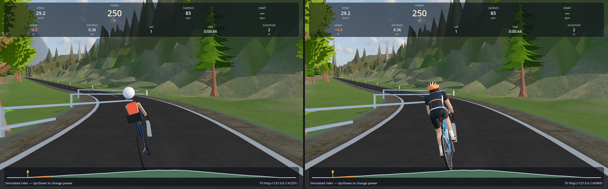

The chase camera at the start line, on the 8.6 % climb, at the summit, and
on the descent at 79 km/h. The chase camera trails the bike by its speed
divided by 7.5 per second, so the rider is about 6 m away on the descent.

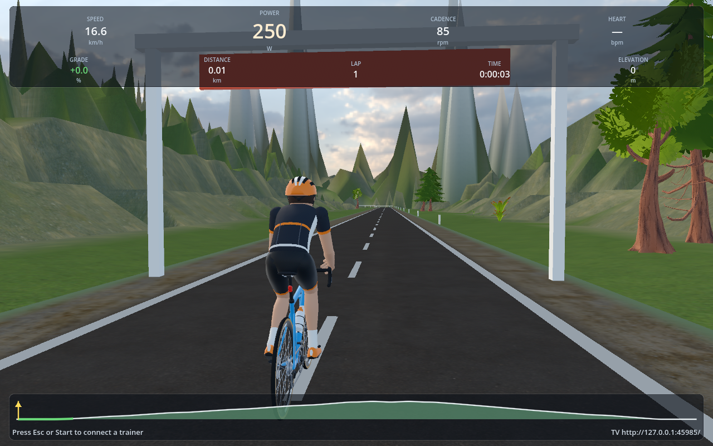

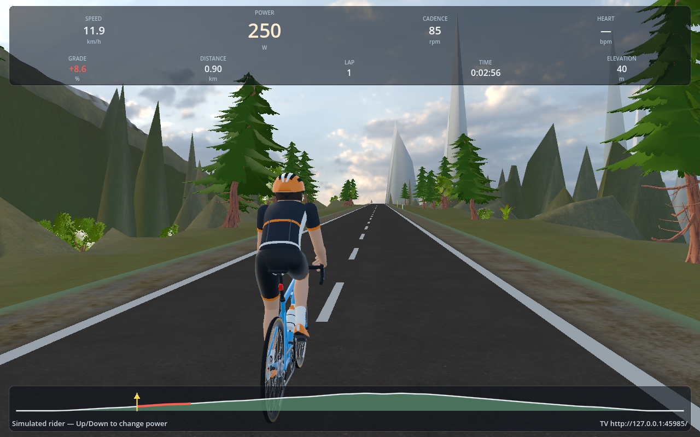

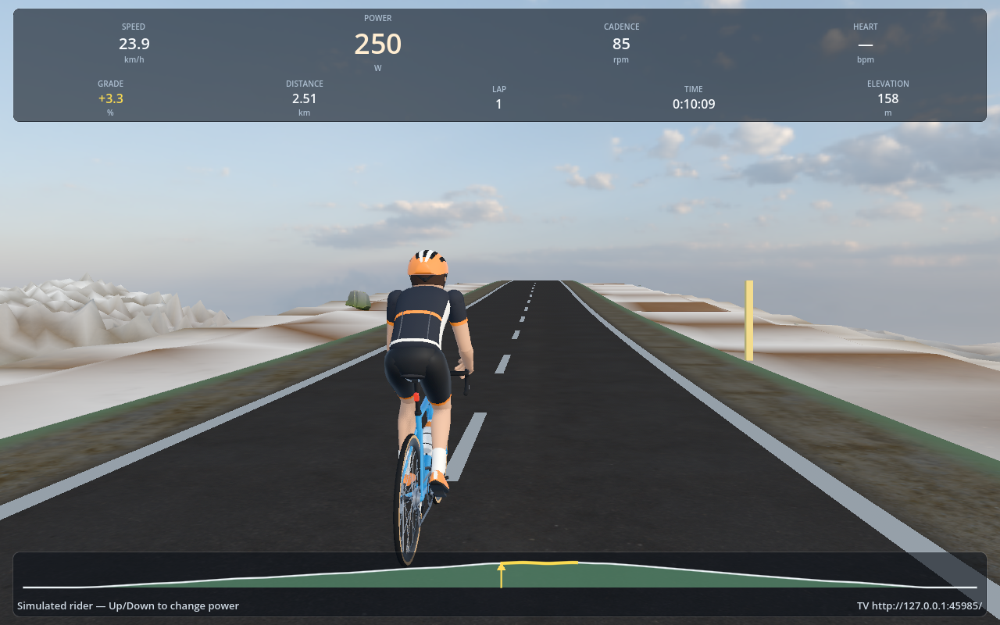

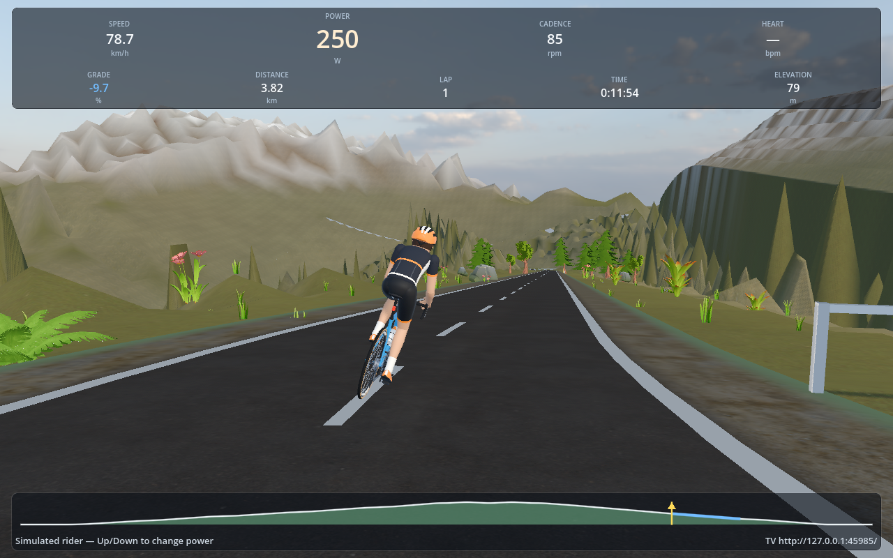

`ingame-switchback-chase.png` is the fifth. The five `ingame-*-fp.png`
pictures are the handlebar camera at the same places, as the game shows
it today; see the first finding below.

Twelve frames across one pedal revolution on the climb, from the chase
camera and side on. The feet stay on the pedals, the knees track, the
shoulders rock a little, and the white patches on the rims show the wheels
turning.

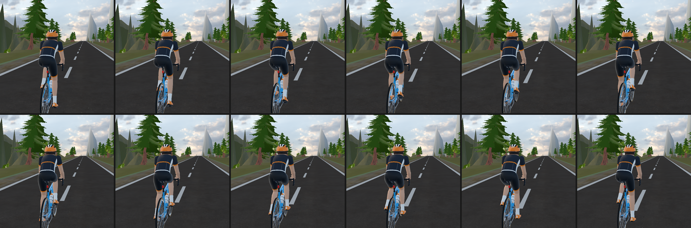

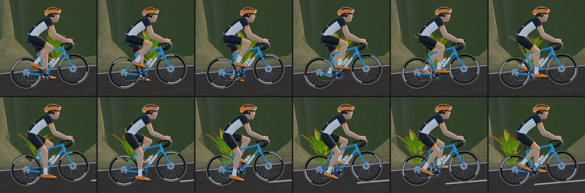

Lean and steering in the switchback, from ahead and from above behind. The
road bends to the rider's left; the bike leans left and the bars are
turned 3 degrees left.

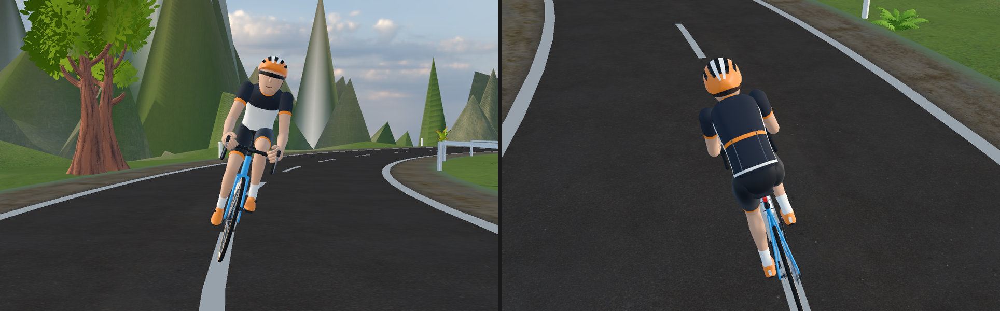

Where the tyres meet the road: the climb, the descent, and the switchback
with the bike leaning. Each row is the bike side on, then the rear and the
front contact patch from road level.

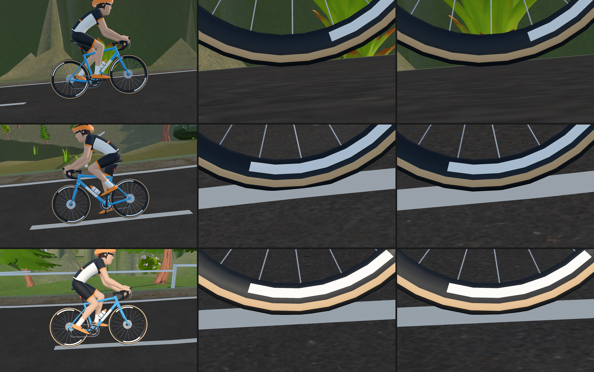

Size against the 6 m road, the guard rail, the trees, and the start arch:

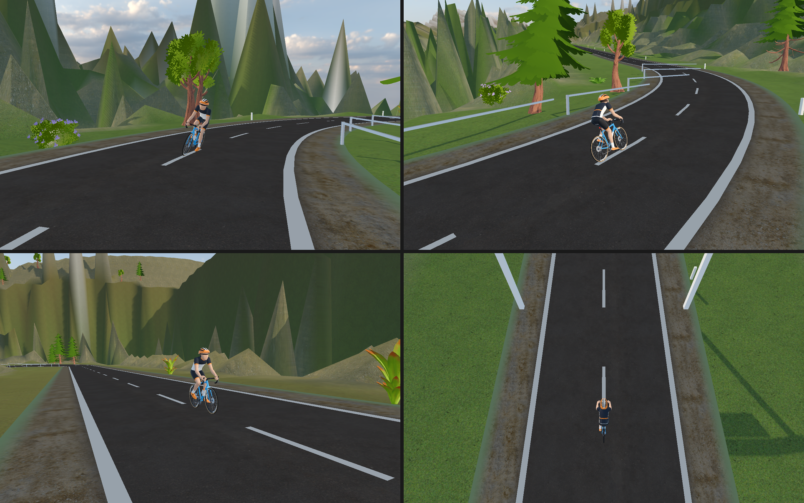

Out of the saddle on the climb at 55 rpm (six frames of one revolution
from the chase camera, then side on), and tucked while coasting down the
descent. Both postures come on by themselves; see
[Stand and tuck](#stand-and-tuck).

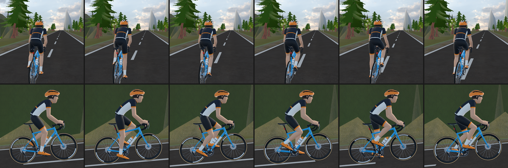

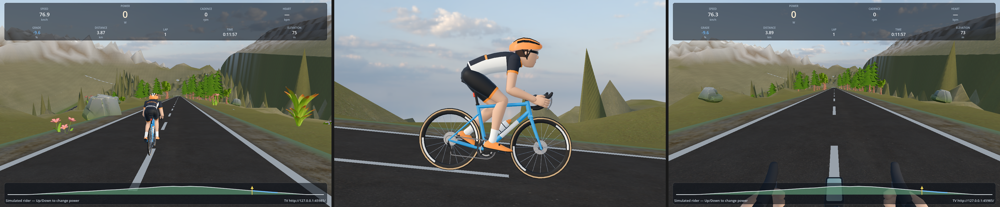

### What the game's pictures showed

Three things are wrong in the pictures and are not in the rider's files.
The lines that fix them are under [Lines other files need](#lines-other-files-need).

1. **The handlebar camera falls behind the bike.** `camera.rs` smooths the
   first-person camera's position the same way as the chase camera's, so
   in play it trails the bike by speed / 7.5: 0.6 m at 17 km/h, 1.1 m at
   30 km/h, 2.9 m at 79 km/h. That puts the lens in or behind the rider's
   back. `ingame-start-fp.png` is filled by the jersey;
   `ingame-switchback-fp.png` and `ingame-descent-fp.png` look at the
   rider from close behind. The standard screenshot set shows less of
   it, because it cuts to the view and waits only twelve frames. With the
   camera held at its rest position, the view is what it should be, in
   every posture:

   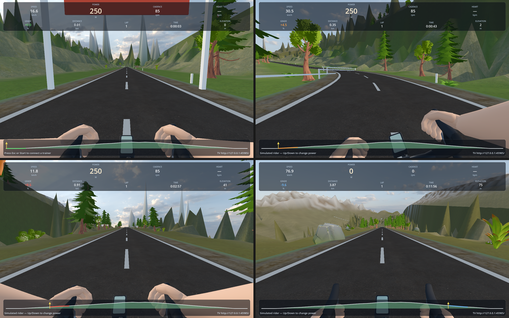

2. **The road takes no sunlight and no shadows.** The ribbon in `road.rs`
   is wound so that its top is the back face. The shader draws both sides,
   and Godot flips the normal of a back face, so the sun never reaches the
   asphalt and nothing can cast a shadow on it. The rider's shadow is
   drawn and falls on the grass, not on the road. Left: the game. Right:
   the same frame with the ribbon rewound by the preview script at run
   time:

   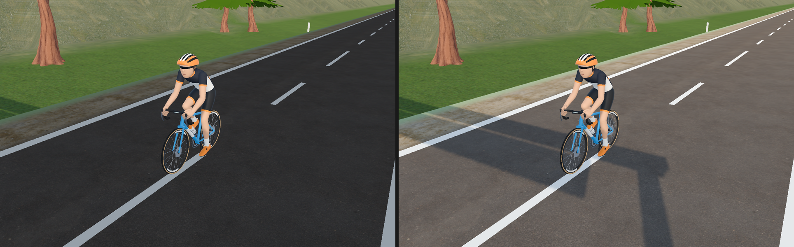

3. **The road is 2 cm above where the game puts the rider.** `Game` places
   the rider 0.06 m above the course line and the ribbon is drawn 0.08 m
   above it. `rider.rs` lifts the model by the difference
   (`MODEL_ORIGIN`). `history/ingame-round2/contact-offset-ab.png` is the
   tyre without and with the lift.

A camera at the rider's eyes is not better than the handlebar camera. From
the eyes the bars are almost straight down, so the view is road and
nothing of the bike:

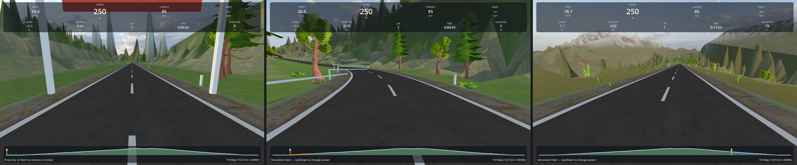

### What changed for the game's light

- The black of the kit was too black. Under the game's sky the shorts and
  the jersey back were one flat shape against the asphalt. The shorts are
  now `0.07, 0.072, 0.085` with a roughness of 0.55 instead of 0.82, so the
  sky puts a sheen on the hips and thighs, and the jersey's dark panels are
  a very dark blue-grey, `0.13, 0.14, 0.18`, so they part from the shorts.
- The whites are not blown out. The front panel in full sun reads as light
  grey-blue with its shading intact (the brightest pixel of the rider in
  a side-on frame is luma 206 of 235).
- A ball was added round each shoulder joint. From the chase camera a notch
  showed between the jersey's yoke and the sleeve.
- A camera within 0.75 m of the rider's eyes does not draw the head or the
  torso; they still cast their shadows. Seated, the handlebar camera looks
  out between the arms. Tucked, the collar came down into its view.

### Frame time

At the switchback, 1280x800, debug library, Radeon 890M. `shot.gd --bench`
sits on this display's 144 Hz refresh (6.94 ms), so it cannot show a
difference of a fraction of a millisecond. `ingame.sh bench` turns vsync
off and alternates 400 frames with the rider drawn and 400 with it hidden.

| | Placeholder | Model |
| --- | --- | --- |
| `shot.gd --bench`, average (three runs) | 6.95, 6.95, 6.96 ms | 6.95, 6.95, 6.95 ms |
| `shot.gd --bench`, 95th percentile | 7.26, 7.16, 7.24 ms | 7.65, 8.39, 7.86 ms |
| `shot.gd --bench`, slowest frame | 7.71, 8.06, 8.76 ms | 8.17, 8.66, 8.07 ms |
| Vsync off, rider drawn, average | 4.46, 4.69 ms | 4.31, 4.38, 4.39, 4.39 ms |
| Vsync off, rider hidden, average | 4.75, 4.93 ms | 4.30, 4.36, 4.38, 4.32 ms |
| Vsync off, rider drawn, 95th percentile | 5.40, 5.43 ms | 5.16, 5.34, 5.26, 5.28 ms |
| Vsync off, rider hidden, 95th percentile | 5.83, 6.60 ms | 5.20, 5.51, 5.31, 5.11 ms |
| Draw calls for the rider | 42 | 22 |
| Triangles for the rider, view + shadow | 1,584 + 3,072 | 18,966 + 37,932 |

Drawn against hidden in the same process, the model costs about 0.03 ms,
which is less than the run-to-run noise. The higher 95th percentile in the
model's `shot.gd` runs came with a busier machine (load average 3.2
against 1.8, from other builds); an earlier set with the model, at load
2.2, gave 7.25, 7.42, and 7.74 ms. The budget is 10 ms average and 13 ms
at the 95th percentile.

World build (`PENGUIN_PASS_READY_MS`) was 1.7 to 1.9 s before and 1.4 to
2.2 s after; the spread is other work on the machine. Building the model
is 2 to 5 ms of that in a release build.

Earlier rounds of these pictures are in `docs/img/rider/history/`:
`ingame-before` (the placeholder), `ingame-round1` to `ingame-round4`.

## Preview pictures

The pictures from here on are from the stand-alone preview project, not the
game.

The chase camera, placed as `crates/pp-godot/src/camera.rs` places it, at
the game's 1280x800. This is the view the player has for the whole ride.


The placeholder in the game (left) and the new model from the same camera
(right). The right half is the preview project's stand-in road, not the
game world. The left half is a copy of `docs/img/shots/start-chase.png`
taken before the new model, kept as
`docs/img/rider/history/placeholder-start-chase.png`.

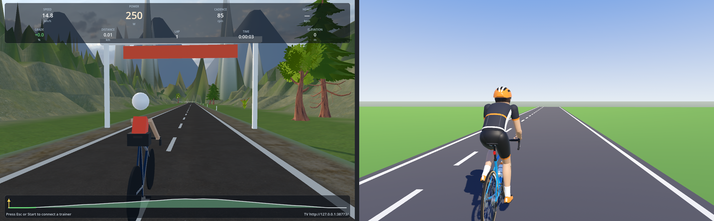

Turnaround: both sides, front, rear, three-quarter views, top. The post is
1.8 m tall.


One pedal revolution in eight steps of 45 degrees, from the drive side and
from behind, at `effort = 0.6`.


Close-ups: drivetrain and cockpit (bike only), hands on the hoods, helmet
from behind, face, legs and shoes from behind.

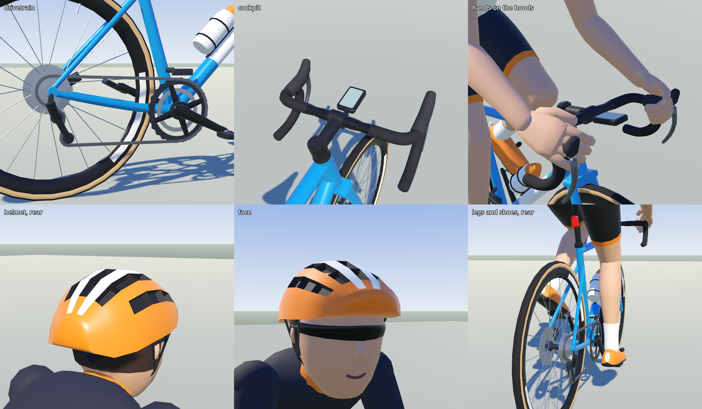

First person from the game's handlebar camera, with the offsets
`camera.rs` uses today (position `0, 1.22, -0.18`, looking at
`0, 0.55, -6`, 72 degrees). That point is inside the rider's chest; with
the torso and the head not drawn it looks out between the arms.

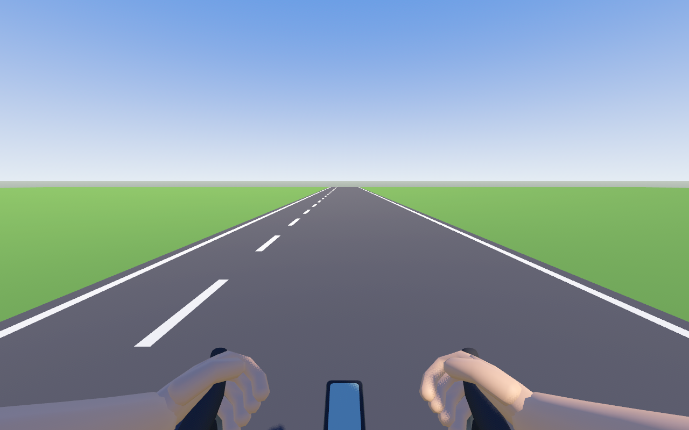

First person from the `eye` anchor, looking 50 degrees down, with the head
part hidden. From the real eye point the bars are almost straight below, so
they only come into frame when the camera looks down this far.

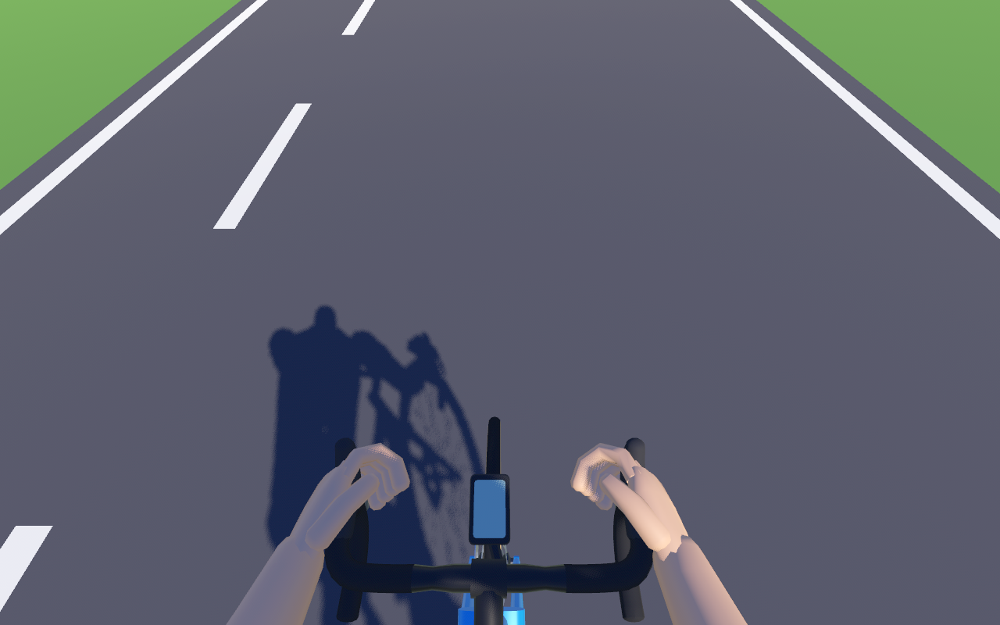

Next to the Quaternius pine, bush, fern, and rock the scenery uses.

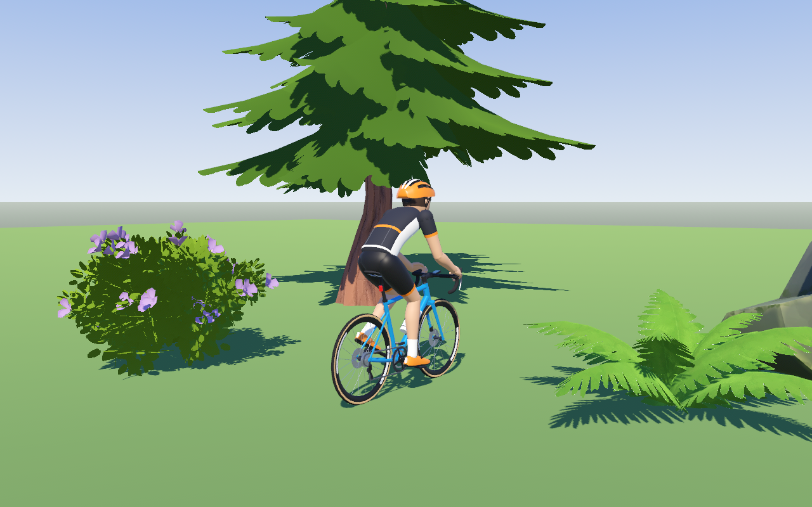

Bars turned 20 degrees to the right at full effort: the hands stay on the
hoods and the shoulders follow.

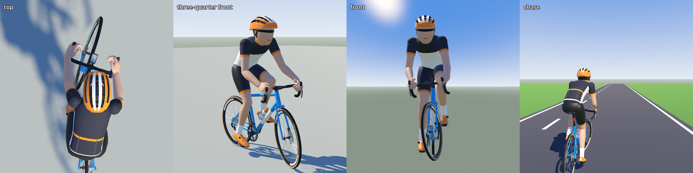

Out of the saddle (`stand = 1`, right pedal going down, so the bike leans
left) and the descending tuck (`tuck = 1`, cranks level).


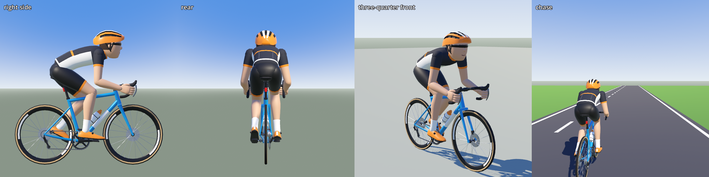

Earlier rounds are kept in `docs/img/rider/history/`: `round1-bike` (frame
and wheels only), `round1`, `round2`, `round3`, and `round4` (the set as it
stood before the kit and the shoulders changed for the game).

## Conventions

- Meters and radians. Colours are sRGB, 0..=1.
- Right-handed, Y up. The bike faces -Z, as a Godot node does. The rider's
  left is -X.
- The model origin is on the road under the bottom bracket. Both tyres
  touch `y = 0`.
- Triangles are counter-clockwise seen from outside, as in glTF. Godot's
  `ArrayMesh` wants clockwise. Use `Surface::indices_clockwise()` there.
- Normals are unit length: smooth where a shape is round, split where two
  faces meet at an edge.
- No textures and no vertex colours. One surface per material.

## Parts

`RiderModel::parts()` returns 22 parts, always in this order. The index is
`PartId::index()` and the name is `PartId::name()`.

| Index | Name | What it is | Local origin |
| --- | --- | --- | --- |
| 0 | `frame` | Frame, seatpost, saddle, bottle, derailleurs, chain, tail light | Model origin |
| 1 | `fork_bars` | Fork, stem, bars, hoods, levers, head unit | Model origin |
| 2 | `front_wheel` | Tyre, rim, hub, spokes, rotor, valve | Axle centre, axle along X |
| 3 | `rear_wheel` | The same, plus the cassette | Axle centre, axle along X |
| 4 | `crankset` | Both arms, spider, chainrings | Bottom bracket, right arm to -Z |
| 5, 6 | `pedal_l`, `pedal_r` | Pedal body and spindle | Middle of the pedal, on its axle |
| 7 | `pelvis` | Hips in bib shorts | Mid-point between the hip joints |
| 8 | `torso` | Jersey, neck, collar | Waist pivot |
| 9 | `head` | Head, helmet, sunglasses, hair | Top of the neck |
| 10, 11 | `upper_arm_l`, `upper_arm_r` | Sleeve and upper arm | Shoulder joint |
| 12, 13 | `forearm_l`, `forearm_r` | Forearm | Elbow |
| 14, 15 | `hand_l`, `hand_r` | Hand | Wrist |
| 16, 17 | `thigh_l`, `thigh_r` | Thigh in the shorts | Hip joint |
| 18, 19 | `shin_l`, `shin_r` | Shin and sock | Knee |
| 20, 21 | `foot_l`, `foot_r` | Shoe | Cleat, on the pedal axle |

There is no hierarchy and no skeleton. Each part has its geometry in its own
local space and one rigid transform (rotate, then translate) straight to
model space. Limbs overlap at rounded joints instead of being skinned. Put
all 22 nodes directly under the rider node.

## API

```rust
pub const WHEEL_RADIUS_M: f32 = 0.34;
pub const CRANK_LENGTH_M: f32 = 0.1725;
pub const MAX_STEER_RAD: f32 = 0.45;

impl RiderModel {
    pub fn build(style: &RiderStyle) -> Self;
    pub fn parts(&self) -> &[Part];
    pub fn part(&self, id: PartId) -> &Part;
    pub fn triangle_count(&self) -> usize;
    pub fn pose(&self, input: &PoseInput) -> Pose;
}
impl Default for RiderModel; // the default kit

pub struct RideSample {
    pub distance_m: f64,
    pub cadence_rpm: Option<f32>,
    pub lean_rad: f32,
    pub grade_pct: f32,
    pub speed_mps: Option<f32>,
    pub power_ratio: Option<f32>, // power over FTP
}
impl Default for RideSample; // at rest, nothing known

impl RideAnimator {
    pub fn new() -> Self;
    pub fn step(&mut self, sample: &RideSample, dt_s: f64) -> PoseInput;
    pub fn pose_input(&self) -> PoseInput;
    pub fn crank_angle_rad(&self) -> f64; // not wrapped
    pub fn wheel_angle_rad(&self) -> f64; // not wrapped
    pub fn speed_mps(&self) -> f32;
    pub fn is_standing(&self) -> bool;
    pub fn is_tucked(&self) -> bool;
}
impl Default for RideAnimator;

impl Part {
    pub fn name(&self) -> &'static str;
    pub fn surfaces(&self) -> &[Surface];
    pub fn triangle_count(&self) -> usize;
}

pub struct Surface {
    pub positions: Vec<[f32; 3]>,
    pub normals: Vec<[f32; 3]>,
    pub indices: Vec<u32>,
    pub material: Material,
    pub style_color: Option<StyleColor>,
}
impl Surface {
    pub fn triangle_count(&self) -> usize;
    pub fn indices_clockwise(&self) -> Vec<u32>;
}

pub struct Material {
    pub base_color: [f32; 3],
    pub roughness: f32,
    pub metallic: f32,
}

pub struct PoseInput {
    pub crank_angle_rad: f32,
    pub wheel_angle_rad: f32,
    pub steer_rad: f32,
    pub effort: f32,
    pub stand: f32,
    pub tuck: f32,
}

pub struct Pose {
    pub transforms: [PartTransform; PartId::COUNT],
    pub anchors: Anchors,
}
impl Pose {
    pub fn transform(&self, part: PartId) -> &PartTransform;
}

pub struct PartTransform {
    pub translation: [f32; 3],
    pub rotation: [f32; 4], // unit quaternion, x y z w
}
impl PartTransform {
    pub const IDENTITY: PartTransform;
    pub fn transform_point(&self, local: [f32; 3]) -> [f32; 3];
    pub fn transform_vector(&self, local: [f32; 3]) -> [f32; 3];
    pub fn to_cols(&self) -> [[f32; 3]; 4]; // X, Y, Z basis, then origin
}

impl PartId {
    pub const COUNT: usize = 22;
    pub const ALL: [PartId; 22];
    pub const fn index(self) -> usize;
    pub const fn name(self) -> &'static str;
    pub const fn is_bike(self) -> bool;
}
```

`build` is deterministic: equal styles give equal models, vertex for vertex.
A different style changes material colours only. Geometry and the surface
layout stay the same.

## Pose input

| Field | Unit | Meaning |
| --- | --- | --- |
| `crank_angle_rad` | radians | 0: right crank horizontal, pointing forward. Positive is forward pedalling. `PI/2`: right pedal at the bottom. `PI`: right crank pointing back. `3*PI/2`: right pedal at the top. The left crank is half a turn behind. Repeats every `2*PI`. |
| `wheel_angle_rad` | radians | Positive rolls forward. Use `distance_m / WHEEL_RADIUS_M`. Wrap it in `f64` before casting, or `f32` loses precision on a long ride. |
| `steer_rad` | radians | About the head-tube axis. Positive turns the bars to the rider's right. Clamped to plus or minus `MAX_STEER_RAD` (0.45). |
| `effort` | 0..=1 | 0: still upper body. 1: shoulders rock about 22 mm each way. Clamped. |
| `stand` | 0..=1 | 0 seated, 1 out of the saddle. Clamped. |
| `tuck` | 0..=1 | 0 on the hoods, 1 in the drops with a flat back. Clamped, and scaled by `1 - stand`. |

What the pose does:

- **Cranks and pedals.** The crankset turns by `crank_angle_rad`. Each pedal
  stays on its axle and tilts with the foot: 5 degrees toe-down in the
  power phase, 27 degrees half-way up the upstroke.
- **Legs.** Two-bone inverse kinematics from the hip to the ankle. Thigh
  0.445 m, shin 0.440 m, never stretched. The knee leads forward and comes
  in 23 mm over the top of the stroke. Knee angle seated: 67.5 to
  145.1 degrees (180 is a straight leg).
- **Hips.** On the saddle. The pushing side drops: 4 mm peak to peak at no
  effort, 9 mm at full effort.
- **Arms.** Two-bone inverse kinematics from the shoulder to the wrist.
  Upper arm 0.320 m, forearm 0.270 m. Elbow angle at rest: 136 degrees.
  The hand is fixed to the bar, so it follows the steering.
- **Sway.** With `effort`, the torso rolls toward the pushing leg, twists a
  little, and nods at twice the cadence. Every term is a sine of the crank
  angle, so it is zero-mean and exactly zero at `effort = 0`.
- **Head.** Rides on the neck but keeps its own orientation, so it keeps
  facing up the road.
- **Wheels.** Both turn by `wheel_angle_rad` about their axles. The front
  one also turns with the steering.
- **Stand.** Hips 50 mm up and 165 mm forward, bobbing 16 mm each way at
  twice the cadence. The bike rolls up to 4.9 degrees on its tyres, away from the
  pushing leg, and the knees open out to clear the top tube.
- **Tuck.** Hands close round the front of the hooks, back about 18 degrees
  flatter, head down. The cranks are level if the caller holds
  `crank_angle_rad` at 0.

Lean into corners is not handled. The caller rotates the whole model.

## Ride animator

`RideAnimator::step` takes one `RideSample` per frame and returns the
`PoseInput`. It is plain arithmetic on a dozen numbers.

| Output | Rule |
| --- | --- |
| Wheels | `distance_m / 0.34`. |
| Cranks | Advance by the cadence. Hold still when it is `None`, zero, or not a number. |
| Steering | 0.35 of the lean at walking pace, less above 18 km/h (down to 0.3 of that), at most 0.12 rad, smoothed over 0.12 s. Positive lean, to the right, turns the bars right. |
| Effort | Power over 1.2 times FTP when `power_ratio` is given. Otherwise 0.35 on the flat plus 0.05 per percent of grade. Zero when not pedalling. Smoothed over 0.8 s. |
| Level cranks | After 0.35 s of coasting the cranks ease round to the nearer level position. `crank_angle_rad()` does not include this, so it still holds still. |

A `dt_s` of zero is a cut, for a seek or a restart: nothing turns and
steering, effort, and posture jump to where the sample puts them.

### Stand and tuck

| Posture | Comes on | Goes off |
| --- | --- | --- |
| Stand | Grade at or above 8 % and pedalling below 68 rpm | Grade below 6 %, cadence above 76 rpm, or not pedalling |
| Tuck | Coasting for 0.35 s at or above 45 km/h on a grade of -2 % or steeper | Pedalling, or below 38 km/h |

The two thresholds of each pair are apart, and a posture is held for at
least a second, so a ride hovering at a threshold does not flicker. Getting
out of the saddle takes 0.6 s and dropping into the tuck 0.8 s, both
eased. Standing wins over tucking. With no cadence sensor the rider never
stands, and counts as coasting unless `power_ratio` says otherwise.

Speed comes from `speed_mps` when given. Otherwise it is estimated from
the change in distance, ignoring any step of more than 6 m as a seek.

## Anchors

`Pose::anchors` holds points in model space, in meters, already posed.
Values at rest:

| Anchor | At rest (x, y, z) | Notes |
| --- | --- | --- |
| `saddle_top` | 0, 0.981, 0.211 | Middle of the saddle's top. Leans with the bike in a stand. |
| `hood_l`, `hood_r` | -0.200 / 0.200, 0.917, -0.571 | Grip point on top of each hood. Turns with the steering. |
| `eye` | 0, 1.518, -0.387 | Between the eyes. Moves with sway, stand, and tuck. |
| `eye_forward` | 0, -0.122, -0.993 | Unit vector the head faces along. |
| `rear_axle` | 0, 0.340, 0.404 | |
| `front_axle` | 0, 0.340, -0.588 | Turns with the steering. |
| `bottom_bracket` | 0, 0.270, 0 | |

## Style

`RiderStyle` holds twelve sRGB colours. `Default` is the penguin kit.

| Field | Default | Where it shows |
| --- | --- | --- |
| `jersey_primary` | very dark blue-grey | Jersey back, shoulders, sleeves |
| `jersey_secondary` | white | Jersey front panel, hem, helmet stripes |
| `jersey_accent` | orange | Collar, cuffs, pocket band, shorts hem, bottle cap |
| `bibs` | near-black | Shorts |
| `helmet` | orange | Helmet shell |
| `shoes` | orange | Shoe uppers |
| `socks` | white | Socks |
| `skin` | light tan | Face, neck, arms, hands, legs |
| `frame` | glacier blue | Frame and fork |
| `bar_tape` | black | Handlebar tape |
| `tyre` | black | Tyre tread |
| `tyre_wall` | tan | Tyre sidewall. Set it to `tyre` for all-black tyres. |

Each `Surface` carries `style_color: Option<StyleColor>`, the style field its
colour came from. A settings menu can recolour a built model by that tag
without rebuilding a mesh. `None` marks a fixed colour such as the chain.

## Numbers

Measured in this checkout.

- **Triangles:** 18,966 of a 20,000 budget. Bike 11,272, rider 7,694.
- **Bounding box at rest:** x -0.271 to 0.271, y 0 to 1.686, z -0.928 to
  0.744. That is 0.54 m wide, 1.69 m tall, 1.67 m long.
- **Bike:** wheelbase 0.992 m, bottom bracket 0.270 m high, cranks 0.1725 m,
  wheels 0.340 m to the outside of a 30 mm tyre, stack 0.565 m, reach
  0.390 m, head angle 73 degrees, seat angle 73.5 degrees, saddle 0.742 m
  from the bottom bracket, hoods 0.400 m apart and 64 mm below the saddle.
- **`pose`:** about 0.4 microseconds per call in a release build on this
  machine (`examples/bench_pose.rs`, two million calls). It returns a `Copy`
  value and does not allocate.
- **`build`:** 2 to 5 ms in a release build.

## Tests

`CRATE=pp-rider ./x test` runs 54 unit tests, 3 integration tests, and two
doc tests. They check, among other things:

- every mesh: indices in range, no degenerate triangle, unit normals,
  normals on the side the winding says, and every part made only of closed
  shells with positive volume;
- the triangle budget, the fixed part order, and that `build` is
  deterministic;
- both tyres on `y = 0` and nothing below the road in any mode;
- over a full revolution in 1 degree steps, for both legs, seated, at full
  effort, standing, and tucked: cleat within 1 mm of the pedal axle, thigh
  and shin length within 0.1 mm, knee angle in range, knee in front of the
  hip-ankle line and not bowed out, no jump between steps;
- left and right legs exactly half a revolution apart;
- hands fixed on the bars for every steering angle, arms never stretched;
- sway exactly zero at no effort and zero-mean with effort;
- wheels turning about their axles by exactly the wheel angle;
- the pose repeating every revolution;
- default colours on the expected parts, and a recolour touching only the
  surfaces tagged with that colour;
- the animator: cranks follow cadence and hold without it, wheels follow
  distance, the bars turn into the bend smoothly and less at speed, the
  rider stands and tucks only when the rules above say so, a ride hovering
  at a threshold switches once, a cut jumps, and nonsense input (not a
  number, negative time) is survived.

`crates/pp-godot` cannot have unit tests (its library only links inside
Godot). `tools/rider-preview/ingame.sh` checks `Rider::set_ride_state`
through the running game before it takes pictures, and `./x smoke` checks
that the wheels and the cranks still turn.

## Previews

`tools/rider-preview/` is a stand-alone Godot 4.7 project. It loads no
GDExtension, so the game library cannot break a render. One script
regenerates every picture in `docs/img/rider/`:

```text
tools/rider-preview/render.sh
```

It builds `examples/export_glb.rs` in the build container, exports one
`.glb` per pose into `tools/rider-preview/.cache/`, and runs
`preview.gd` once. Godot needs a real window. The whole set takes about
8 seconds.

```text
ONLY=chase,closeups tools/rider-preview/render.sh   # some jobs only
OUT=$PWD/docs/img/rider/history/next tools/rider-preview/render.sh
BIKE_ONLY=1 tools/rider-preview/render.sh           # leave the rider out
```

Jobs: `turnaround`, `chase`, `first`, `strip`, `style`, `closeups`,
`arraymesh`, `steer`, `stand`, `tuck`, `compare`.

The in-game pictures come from a second script. It runs the game project
with the library in `godot/bin` (run `./x build` first), always with
`--no-bluetooth`, a scratch settings file, and `--dashboard-port 0`:

```text
tools/rider-preview/ingame.sh                    # every ingame-*.png
ONLY=sequence,stand tools/rider-preview/ingame.sh
OUT=$PWD/docs/img/rider/history/next tools/rider-preview/ingame.sh
tools/rider-preview/ingame.sh bench              # timings, vsync off
tools/rider-preview/ingame.sh shot --out ... --distance 340 --camera chase --bench
```

`ingame.gd` loads `res://main.tscn` the way `godot/tests/shot.gd` does and
drives the ride with the game's `debug_*` methods, so the frames are the
same on every run. It adds its own camera for the side-on and close-up
views. Jobs: `stills`, `compare`, `sequence`, `contact`, `scale`, `bend`,
`stand`, `tuck`, `firstperson`, `eye`, `shadow`, `ridestate`. The last
`shot` form runs `godot/tests/shot.gd` itself with the same safe flags.

To export one pose by hand:

```text
target/debug/examples/export_glb --out rider.glb \
  --crank 55 --wheel 140 --steer 0 --effort 0.5 --stand 0 --tuck 0 --stats
```

The `.glb` has one node per part, named as the part, plus empty nodes
`anchor_*`. `--stats` prints the triangle count of each part and the
anchors.

## Godot integration

`crates/pp-godot/src/rider.rs` is the only file in the game that knows the
model. The rest of the game uses what it used before: the `Rider` class,
`place(position, tangent, distance_m, cadence_rpm, dt, lean)`, and the
`rider_origin`, `wheel_angle`, and `crank_angle` methods.

### What `rider.rs` does

Once, in `ready`: `RiderModel::build`, then one `MeshInstance3D` per part,
named as the part, all direct children of the rider node. Each part is one
`ArrayMesh` with one surface per `Surface`:

```rust
let mut arrays = VarArray::new();
arrays.resize(ArrayType::MAX.ord() as usize, &Variant::nil());
arrays.set(ArrayType::VERTEX.ord() as usize, &positions.to_variant());
arrays.set(ArrayType::NORMAL.ord() as usize, &normals.to_variant());
arrays.set(ArrayType::INDEX.ord() as usize, &indices.to_variant()); // indices_clockwise()
mesh.add_surface_from_arrays(PrimitiveType::TRIANGLES, &arrays);
mesh.surface_set_material(index as i32, &material);
```

Three facts this rests on, checked in Godot 4.7.2 (`arraymesh-check.png`
and every in-game picture):

1. **Winding.** `surface.indices_clockwise()` is the index array.
2. **Colour.** `Material::base_color` is sRGB and goes to `Color::from_rgb`
   as it is.
3. **Transform.** `to_cols()` returns the X, Y, Z basis vectors and the
   origin, the argument order of `Basis::from_cols` and `Transform3D::new`.

Surfaces with the same colour, roughness, and metallic value share one
`StandardMaterial3D`. Every part casts shadows.

Every frame, in `place`: orient and lean the rider node as before, build a
`RideSample`, call `RideAnimator::step`, call `RiderModel::pose`, and set
the 22 transforms. The grade comes from the tangent and the speed from the
change in distance, so stand and tuck work with no help from `Game`.

In `process`, which runs after `Game` has moved the camera: if the active
camera is within 0.75 m of the rider's eyes, the head and the torso are
drawn as shadows only.

### Methods on `Rider`

| Method | For |
| --- | --- |
| `set_ride_state(power_w, ftp_w, grade_pct, speed_mps)` | Tells the next `place` the power, FTP, grade, and speed. Without it the effort is a guess and a cut has no speed to go on. |
| `eye_position()`, `eye_forward()` | The rider's eyes and facing in world space, for a camera. |
| `stand_blend()`, `tuck_blend()`, `steer_angle()`, `effort()` | What the pose is using this frame, for tests and pictures. |
| `debug_override_cadence(rpm)` | Replaces the cadence `place` is given; negative clears it. The simulated rider always spins at 85 rpm, so this is how a picture shows a slow grind. |

### Lines other files need

None of these were made, because those files belong to other work. The
Rust was not compiled. The camera and road changes were tried from the
preview script, at run time, and the pictures above are the result.

**`crates/pp-godot/src/camera.rs`, in `CameraRig::follow`.** Hold the
handlebar camera on the bike. Replace

```rust
        let snap = !self.initialized || dt <= 0.0;
```

with

```rust
        // The handlebar camera rides on the bike. Smoothing its position
        // leaves it behind the rider's back at speed.
        let snap = !self.initialized || dt <= 0.0 || first_person;
```

**`crates/pp-godot/src/road.rs`, in `build_ribbon`.** Wind the ribbon so
its top is the front face. In the loop, swap the second and third
`push_vertex` call of each triangle, so the order of corners is

```text
left[index], left[next], right[index]
left[next],  right[next], right[index]
```

The asphalt then takes direct sun and renders lighter, as in
`ingame-shadow-check.png`; the colours in `ROAD_SHADER` may want to come
down. `cull_disabled` can then go.

**`crates/pp-godot/src/game.rs`, in `present`.** Pass the ride state.
Replace

```rust
        if let Some(rider) = self.rider.as_mut() {
            rider.bind_mut().place(
```

with

```rust
        let ftp_w = f32::from(self.session().settings().ftp_w);
        if let Some(rider) = self.rider.as_mut() {
            let mut rider = rider.bind_mut();
            rider.set_ride_state(
                telemetry.power_w,
                ftp_w,
                telemetry.grade_pct,
                telemetry.speed_mps,
            );
            rider.place(
```

`ingame.sh` checks `set_ride_state` itself through the running game.

**`crates/pp-godot/src/mesh_util.rs`.** `add_cylinder`, `add_sphere`, and
`add_tube` were only used by the placeholder rider. `rider.rs` names them
in a `const _` block so the crate does not fail on dead code. Delete the
three functions (and `CylinderMesh` and `SphereMesh` from the `use`), then
delete that block and the three imports in `rider.rs`.

**`crates/pp-godot/src/game.rs`, in `pose`** (optional). The rider is
placed at `position[1] + 0.06` and the road is drawn at `+ 0.08`
(`world/terrain.rs`). If the 0.06 becomes 0.08, set `MODEL_ORIGIN` in
`rider.rs` to zero.

**`docs/game.md`.** Under "Rough edges", the first two sentences describe
the placeholder. Under "Renderer and timing", "The script run does not sit
on vsync" is not so on this display: `shot.gd --bench` averages 6.94 ms,
which is 144 Hz, and 4.4 ms with vsync off.

**`README.md`.** The layout table has no rows for `crates/pp-rider` and
`tools/rider-preview`.

## What still falls short

- In play, the handlebar view is the rider's back until the camera change
  above is made. That is the largest thing wrong with the rider in the
  game today, and it is not in the rider's files.
- The rider has no shadow on the road until the road change above is made.
- The parts are rigid. The torso does not bend, so a stand or a tuck shows
  a hinge at the waist, and a deeply bent knee shows the overlap of two
  rounded ends, not stretched skin.
- Standing was only seen with the cadence forced to 55 rpm, because the
  simulated rider always spins at 85. It has not been seen with a real
  trainer, and the thresholds (8 % and 68 rpm, 45 km/h) are judgement, not
  measurement.
- The motion was judged from twelve-frame sheets. Nobody has watched it
  move. Spokes are under 3 mm thick and may shimmer when the wheels turn.
- The bars turn in proportion to the lean the game passes, not to the
  road's curvature. The rider does not look into the bend or shift on the
  bike; the whole rig leans as one piece.
- With the handlebar camera at full lean, the outside forearm fills a
  corner of the frame.
- From the chase camera on the fast descent the rider is about 6 m away
  and small, because the camera trails by speed / 7.5. The kit still reads
  at that size; the legs do not.
- The face is a nose, a mouth, and sunglasses. Hands have one pose each for
  the hoods and the drops, and the blend between them passes through the
  bar.
- The chain does not move, and the cassette turns with the wheel while
  coasting. There are no cables or hoses.
- The kit is flat colour: no logo, no lettering, no cloth fold.
- There is one level of detail. A field of other riders would need a
  cheaper one.
- All timings are with the debug library. The release library was not
  measured.
