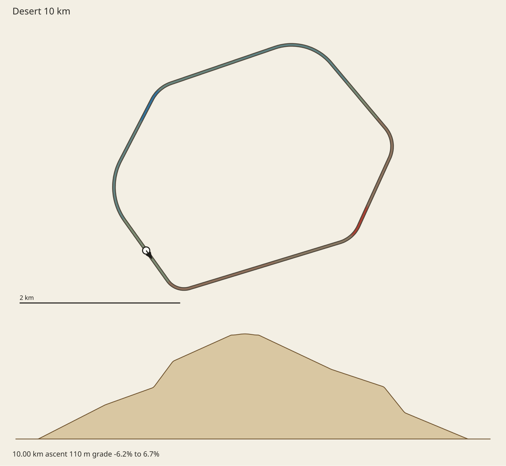
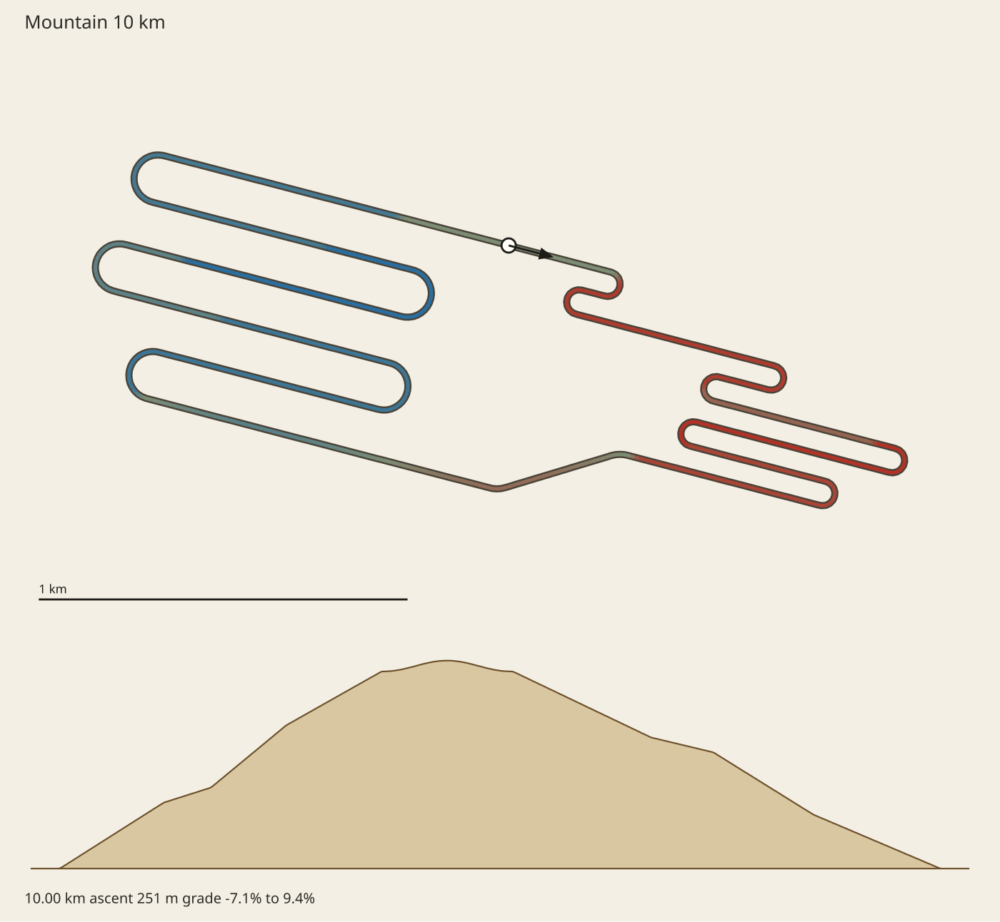
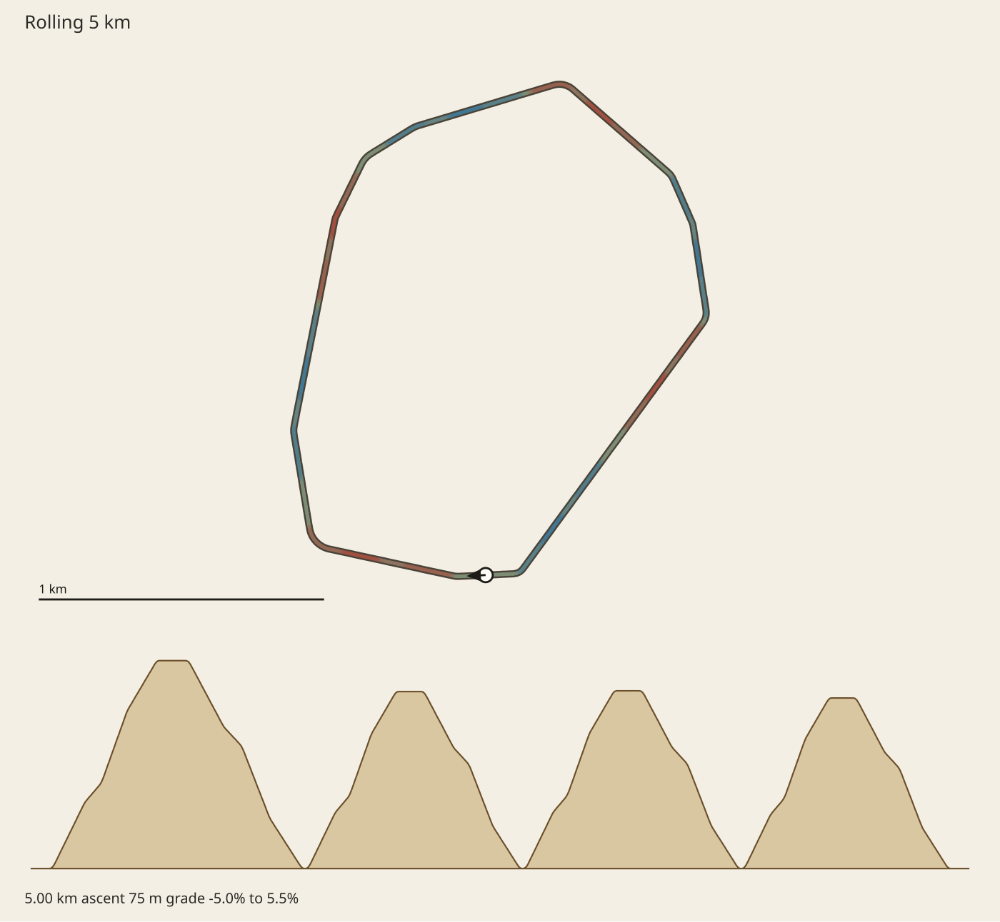
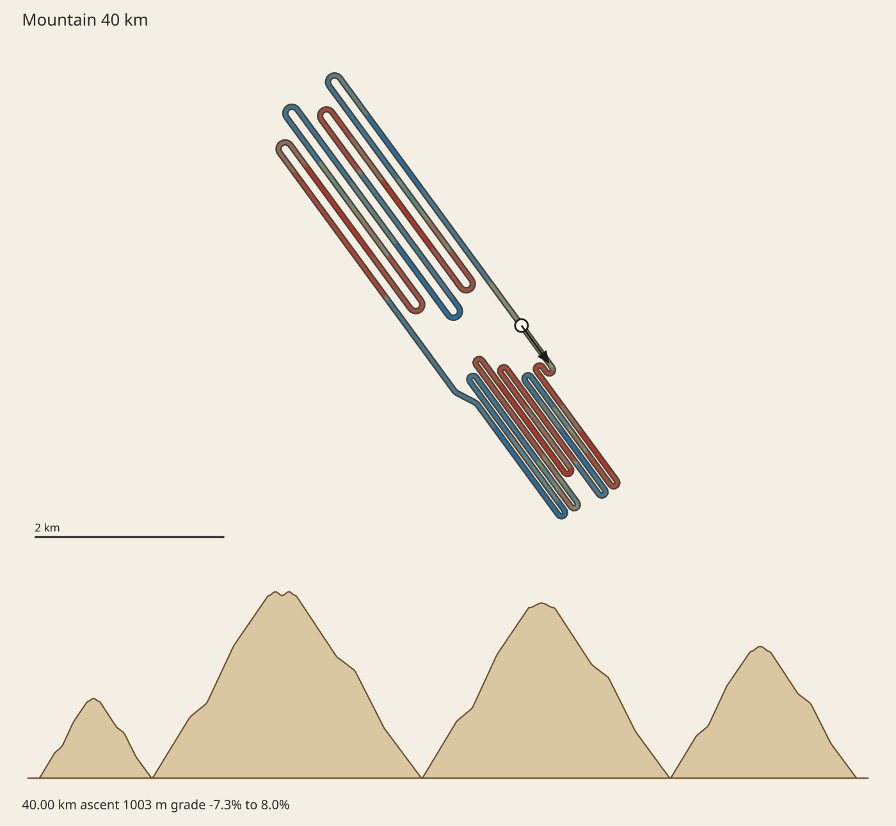
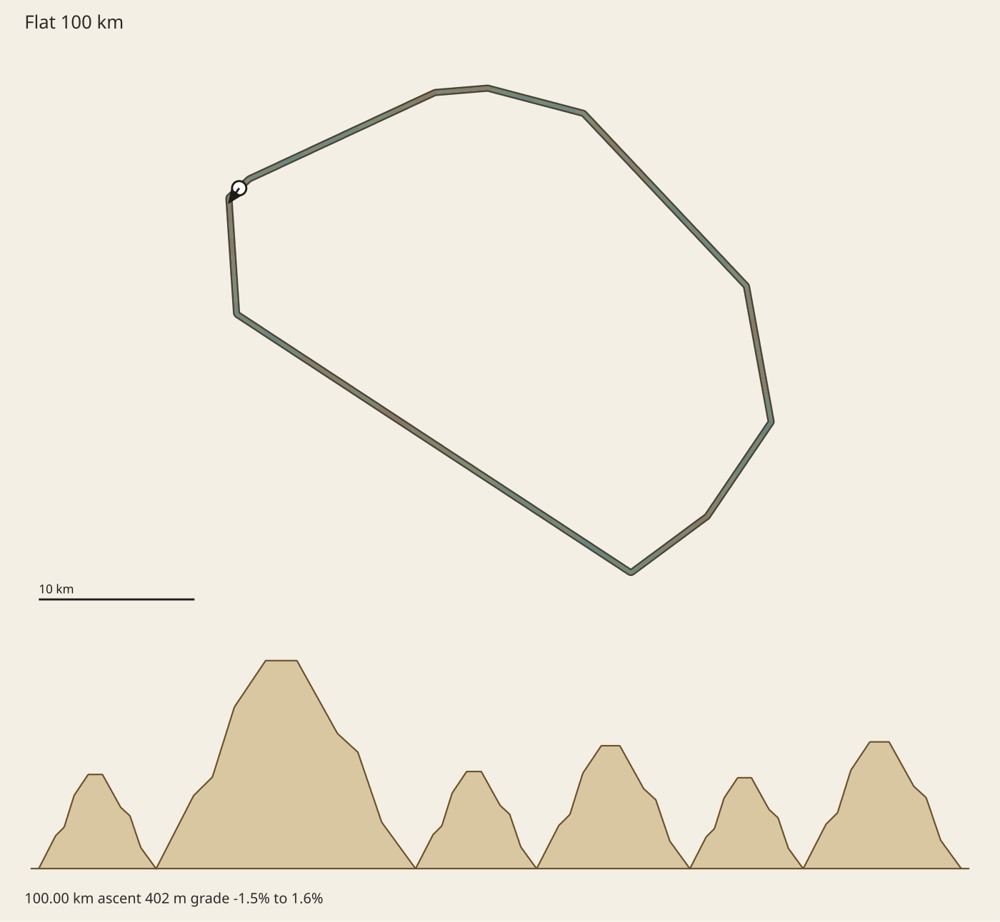
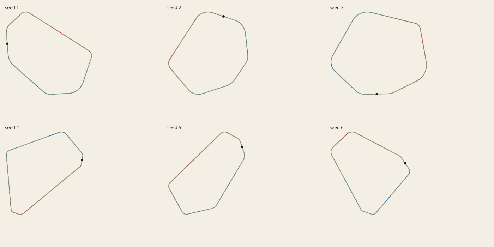

# Route generator

`pp-routegen` builds a rideable course from a seed, a distance, and a
terrain character. It does not link Godot. The output is the JSON
`pp-course` already parses, so a course picker can hand the text to
`Course::from_str` and the existing world builder will mesh it.

The same `RouteSpec` always produces the same bytes. That mapping is a
compatibility promise: players will share seeds. Draws come from ChaCha12
(`rand_chacha` 0.3.1, `rand` 0.8.5). Attempt 0 is seeded with the spec
seed. A rejected candidate uses SplitMix64 of
`seed + attempt * 0x9E3779B97F4A7C15` and tries again, at most 40 times.

## Spec

`RouteSpec` is a name, a `u64` seed, a distance in meters, and a terrain.
Distance must be finite and from 2 km to 100 km. The name is trimmed,
non-empty, at most 64 characters, and free of control characters.

`Terrain::Preset` expands to these numbers. Grades are percent. Lengths
and radii are meters. `twist` runs from 0 (straighter) to 1. Grade rate
is percentage points per meter of horizontal road. Switchback radius is
the floor for a hairpin; ordinary bends use the larger minimum radius.
Ascent is meters of climbing per kilometre of 3D route.

| | Flat | Rolling | Mountain | Desert |
| --- | ---: | ---: | ---: | ---: |
| Ascent, m per km | 4 | 15 | 25 | 11 |
| Max uphill, % | 2 | 6 | 10 | 7 |
| Max downhill, % | 2 | 6 | 10 | 6.5 |
| Typical climb, m | 2000 | 1100 | 8000 | 7000 |
| Min bend radius, m | 55 | 34 | 42 | 85 |
| Switchback radius, m | 55 | 34 | 26 | 85 |
| Twist | 0.22 | 0.55 | 0.80 | 0.18 |
| Climb hairpins per 10 km | 0 | 0 | 6 | 0 |
| Max grade rate, pp/m | 0.08 | 0.18 | 0.22 | 0.10 |

`Terrain::Custom` takes the same struct. The builder treats it as a
mountain when it asks for switchbacks and grades of at least 5%, as a
desert when it is straight and wide, as flat when the cap is 2.5% or
less, and as rolling otherwise. A target ascent that cannot fit under
the grade caps is rejected: at most about 40% of the route can be
climbing at the cap.

## How a loop is built

Flat, rolling, and desert routes are one closed chain of straights and
circular arcs. Every turn has the same sign and the angles sum to exactly
one full circle, so the heading closes and the shape stays a simple
rounded polygon. Two straights whose headings are not parallel are solved
so the polygon also closes in position. The start line is the middle of
one straight, split across the seam, and that straight is at least 150 m
after scaling. Corner radii start at the preset floor and are often
wider; desert bends are several times the 85 m floor when the loop is
long enough.

A mountain is the same kind of closure with a different plan, in the
spirit of the hand-tuned Penguin Pass loop. An odd number of climb legs
and a smaller odd number of descent legs are joined by 180° hairpins.
The climb stack and the descent stack grow in opposite directions. A
short bow and an east-west ridge sit between them. Descent radius is
searched until the northing error is gone; one straight then cancels the
easting error. Length is moved onto the ridge until the two stacks sit
side by side instead of on top of each other. Hairpin count follows
`switchbacks_per_10km`, capped so a valley does not turn into a comb
(about 8 hairpins on a short loop, up to 24 on a very long one).

Either plan is scaled so every length and radius grows or shrinks
together. A closed chain of lines and arcs stays closed under that
scale. The scale is chosen so the 3D centerline, not the horizontal
length, matches the requested distance. `pp-course` is what finally
measures that length.

The grade profile is hold, smooth, and wave spans, the same three shapes
`pp-course` integrates. Smoothsteps ease between pitches, so the grade
matches at every join and the slope is zero at the ends of a transition.
Transition length is at least `1.5 * |change| / max rate`, which keeps
the steepest slope of the smoothstep inside the preset rate. A climb is
not one constant grade: a body pitch, a breather, a steeper kick, and
another body, then back to 0%. Desert climbs keep most of their length
at a shallow drag and put a short ramp near the cap. A descent is the
same shape below zero, scaled so its drop cancels the climb. Waves, when
a crest is long enough, start and end at 0% and add a little extra
ascent without changing the net. Several hills split a long route so no
peak has to carry the whole ascent. Elevation therefore starts at 0 m,
stays non-negative, returns to 0 m, and stays under 2000 m. Total ascent
is within 12% of the target, and at least within 3 m.

If a candidate fails closure, radius, the 150 m flat, clearance,
footprint, grade limits, or ascent, the next attempt uses the derived
sub-seed. The published route is the first success.

## Guarantees

These are checked on the parsed `Course`, not only on the generator's
own numbers.

| Check | Bound |
| --- | --- |
| Parses | `Course::from_str` returns ok. That enforces position within 1 mm, heading within 1e-5 rad, grade continuous across the seam, and net elevation within 1 mm. |
| Length | 3D centerline within 1 m of the request. |
| Start straight | At least 150 m of nearly constant heading and grade within 0.3% of flat, counting both sides of the start line. |
| Radius | Ordinary bends at least the preset minimum. Hairpins, sweeps steeper than about 126°, at least the switchback radius. |
| Clearance | Centerlines at least 25 m apart when the along-track gap is at least 160 m, including across the start line. The generator rejects anything under about 31 m on a 4 m sample before it will emit the route. |
| Grade | Inside the preset caps, sampled every 1 m. Change per meter inside the preset rate, with a small allowance for the 3D sample and `f32`. |
| Elevation | From 0 m up to 2000 m. Net zero because the parser accepted it. |
| Ascent | Within 12% of ascent-per-km times distance, or 3 m, whichever is larger. |
| Footprint | Longest side at most 46% of the distance and at least 3% of it, and no more than 5.5 times the shorter side. A circle is about 32% of its circumference across. The 3% floor is low on purpose: a switchback pass packs a lot of road into a valley, and a 1 km knot of a 100 km route is still rejected. |
| Determinism | Two calls with the same spec return identical JSON. |

Tests cover 200 seeds of each preset, 120 at 5 km and 80 at 10 km, plus
2 km (two seeds) and 100 km (one seed) for every preset. Clearance on
that suite is brute force. A few routes in each batch are also sampled
every 4 m. The whole `pp-routegen` test run is about 212 seconds in
debug.

Fingerprints of four published routes, FNV-1a 64 of the JSON:

| Route | Fingerprint |
| --- | --- |
| Desert 10 km, seed 7 | `ccb3998fbd118f27` |
| Mountain 10 km, seed 11 | `d6f21ae4986f71a3` |
| Rolling 5 km, seed 3 | `d13e48e55dbce8f1` |
| Flat 2 km, seed 1 | `1e4c6612ac421ba8` |

## Pictures



A rounded desert loop. The climb is one long drag with a steeper ramp,
then a matching descent. The polygon is a bit even for a track that grew
around real country.



Switchbacks up one side of a valley and wider turns down the other. The
ladders are very parallel, which is what a built hairpin road looks like,
and the profile is a single col.



A short country loop. The corners are still fairly regular. The hills
are not copies of each other.



Two switchback walls joined by a valley road, and four climbs of
different sizes. The walls are still combs. On a long mountain the grade
also flips along a ladder, so one wall is not a single uninterrupted
climb.



A large county loop, gentle bends, a few metres of rise per kilometre.
It reads as a big polygon more than a lane that wandered between farms.



Six seeds of one spec. The loops are the same kind of shape and not the
same shape.

JSON for the 10 km desert and the 10 km mountain sits next to the
pictures: `docs/img/routes/desert-10km.json` and
`docs/img/routes/mountain-10km.json`.

## Timing

Release build, one call to `generate`, this machine:

| Route | Time |
| --- | ---: |
| 10 km desert, seed 7 | 16 ms |
| 100 km flat, seed 42 | 327 ms |
| 100 km mountain, seed 9 (4 attempts) | 323 ms |

Debug is slower because `Course::from_str` integrates the centerline
every 5 cm. The same 100 km flat route took 3.3 seconds in debug. A
100 km route is still well under a second in release.

## Endless road

`pp-course` cannot store an open route. `parse_course` rejects a path
whose end is more than 1 mm from the start, whose heading is off by more
than 1e-5 rad, whose net elevation exceeds 1 mm, or whose grade does not
match across the start line. Distance queries then wrap with
`rem_euclid`.

`EndlessRoute` is the open road until that changes. It is a pure function
of `(seed, distance)`. The road is cut into 2000 m sections of 3D
centerline. Section `i` depends only on the seed and `i`, plus a solved
bulge amplitude that is cached for the last 8 sections. Easting advances
1640 m per section. Northing and elevation are sums of sines. A
zero-slope bump in the middle of each section is sized so the section's
arc length is the full 2000 m; any residual is a uniform reparameterization,
so the join at `i * 2000` is the same point from both sides. Heading stays
inside about ±0.95 rad of east, so x is strictly increasing and the road
cannot cross itself. Elevation stays between roughly 50 m and 900 m for
any distance. `position_at`, `tangent_at`, `elevation_at`, and
`grade_pct_at` use the same axis convention as `Course` (x east, y up,
z north, heading 0 toward +x). Negative or non-finite distances sample
the start. They do not wrap.

To ride it, `pp-course` would need a course that is allowed to stay open:

1. A `closed` field, defaulting to true so Penguin Pass is unchanged.
2. When `closed` is false, skip the position, heading, net-elevation,
   and grade-seam checks.
3. Stop wrapping distance. Clamp it to the centerline, or reject values
   past the end. `profile` already stops at the length.
4. The ride model should not treat the length as a lap. Distance and the
   lap counter need an open-road mode.
5. The world mesh should sample `EndlessRoute` (or an open `Course`
   built from a window of it) for the chunk around the rider, and drop
   chunks behind. The generator does not emit one giant JSON for an
   endless road.

A course picker does not need any of that for a finite loop:

```text
New route: distance, terrain, seed
    → RouteSpec
    → generate
    → json
    → Course::from_str
```

`examples/generate.rs` writes that JSON and an SVG map:

```text
cargo run -p pp-routegen --example generate -- \
  --seed 7 --distance-km 10 --preset desert \
  --name "Desert 10 km" --out route.json --svg route.svg
```
