# Interface design

The design system for the Penguin Pass interface, and the mockups it was
drawn from. It is written for whoever builds the screens in Godot. Every
number is a pixel in the 1280 x 800 design frame unless it says otherwise.

The mockups are SVG files under `docs/img/ui/src/`, rendered to PNG with
the bundled game font. They are pictures of the design, not screenshots
of the game. `docs/img/ui/render.sh` regenerates every PNG.

## Principles

1. The ride is the picture. The HUD is one instrument on the bottom edge
   and stays under about 20 % of the screen.
2. One glance, one answer. Power first, then cadence and heart, then the
   road, then the ride totals. Same order, same baselines, every state.
3. Readable from the saddle. Nothing smaller than 18 px on the Steam
   Deck or 24 px on a 1080p TV. Live numbers use fixed-width digits.
4. Colour helps but never carries meaning alone. Every state also has a
   word, a shape, or a position.
5. One hand, one pad. Every screen works with D-pad, A, and B. A missing
   value is an em dash, never a zero.

## Colour

### Brand and surfaces

The palette comes from `docs/img/logo.svg`: the night sky, the snow, and
the sunrise.

| Token | Hex | Use |
| --- | --- | --- |
| `ink` | `#0B1220` | Every surface and scrim. Text on yellow. |
| `night` | `#12203F` | Raised well on ink: buttons, tips box, map well, web tiles. |
| `slate` | `#39425A` | Switch track when off. |
| `snow` | `#F4F8FF` | Primary text and numbers. |
| `mist` | `#B4C0D4` | Secondary text: units, labels, explanations. |
| `dusk` | `#7C8AA3` | Absent values, disabled rows, idle arrows. |
| `ridden` | `#66728A` | The part of the course profile behind the rider. |
| `sun` | `#FFD166` | Focus, and the brand accent. Nothing else is yellow except zone 4. |
| `ember` | `#F08A4B` | Brand only (logo sunrise). Not used for state. |

### State

| Token | Hex | Means | Always paired with |
| --- | --- | --- | --- |
| `good` | `#3DD68C` | Connected, on, saved | A tick, a solid disc, or the word |
| `warn` | `#FFB23E` | Reconnecting, changed but not applied | A triangle or spinner, and the word |
| `bad` | `#FF5A52` | Failed, error | A cross, and the reason in words |

### Surfaces

All are `StyleBoxFlat`. There is no background blur anywhere.

| Surface | Fill | Border | Radius |
| --- | --- | --- | --- |
| HUD console | `ink` at 88 % | 1 px `snow` at 14 % | 12 |
| HUD chip | `ink` at 88 % | 1 px `snow` at 14 % | 18 (height 36) |
| Menu panel | `ink` at 94 % | 1 px `snow` at 12 % | 16 |
| Dialog | `ink` at 98 % | 1 px `snow` at 12 % | 20 |
| Toast | `ink` at 96 % | 2 px state colour at 90 % | 24 (height 48) |
| Well | `night`, opaque | none | 12 |
| Row, focused | `sun`, opaque | none | 10 |
| Menu scrim | `ink` at 66 %, whole window | | |
| Summary and course picker scrim | `ink` at 74 %, whole window | | |
| Dialog scrim | `ink` at 60 %, on top of the menu scrim | | |

Shadows are a second flat panel, not a blur: the same shape in black,
offset straight down. Dialog: black at 35 %, 8 px down. Toast: black at
30 %, 4 px down. Nothing else has a shadow.

The title screen has the only gradients. Build them with a
`GradientTexture2D` in a `TextureRect` (a built-in resource, no image
file): left scrim `ink` 86 % at x 0, 50 % at x 432, 0 % at x 720, full
height; foot scrim `ink` 0 % at y 640 to 70 % at y 800, full width.

### Contrast

WCAG contrast ratios, computed from the hex values. The HUD column is
the worst case: the 88 % console over pure white snow.

| Text | On `ink` | On HUD over white | On menu over white |
| --- | --- | --- | --- |
| `snow` | 17.6 | 12.7 | 15.3 |
| `mist` | 10.2 | 7.4 | 8.9 |
| `dusk` | 5.4 | 3.9 | 4.7 |
| `sun` | 13.0 | 9.4 | 11.3 |
| `good` | 10.0 | 7.2 | 8.7 |
| `warn` | 10.4 | 7.5 | 9.1 |
| `bad` | 6.1 | 4.4 | 5.3 |
| `ink` on `sun` (focused row) | 13.0 | | |

`dusk` on the HUD over snow is 3.9, under the 4.5 mark. It is used there
only for a value that is absent. `bad` and zone 6 red are 4.4 in the same
worst case; they are used at 52 px for the grade and with a zone name
beside the ladder.

### Effort ramp: power zones and gradient

One seven-step ramp serves both scales, so "red" means "hard" whether it
is your legs or the road.

| Step | Hex | On `ink` | Power zone | Percent of FTP | Gradient |
| --- | --- | --- | --- | --- | --- |
| `ramp-1` | `#9AA8BD` | 7.8 | Z1 Recovery | up to 55 % | flat, from -1 % to under +1 % |
| `ramp-2` | `#4FA8FF` | 7.5 | Z2 Endurance | 56 to 75 % | downhill, under -1 % |
| `ramp-3` | `#3DD68C` | 10.0 | Z3 Tempo | 76 to 90 % | +1 % to under +3 % |
| `ramp-4` | `#FFD166` | 13.0 | Z4 Threshold | 91 to 105 % | +3 % to under +6 % |
| `ramp-5` | `#FF9A3C` | 8.9 | Z5 VO2 max | 106 to 120 % | +6 % to under +9 % |
| `ramp-6` | `#FF5A52` | 6.1 | Z6 Anaerobic | 121 to 150 % | +9 % to under +12 % |
| `ramp-7` | `#D277FF` | 7.0 | Z7 Sprint | over 150 % | +12 % and over |

The zone model is Andrew Coggan's seven classic power levels (Allen and
Coggan, *Training and Racing with a Power Meter*). Level 7,
"neuromuscular power", is labelled Sprint. A power is in the highest zone
whose lower bound it exceeds: Z2 starts above 0.55 x FTP, Z3 above 0.75,
Z4 above 0.90, Z5 above 1.05, Z6 above 1.20, Z7 above 1.50.

Zone is never colour alone: the ladder lights one of seven positions and
the label reads `Z6 ANAEROBIC`. Grade is never colour alone: it has a
sign and a number.

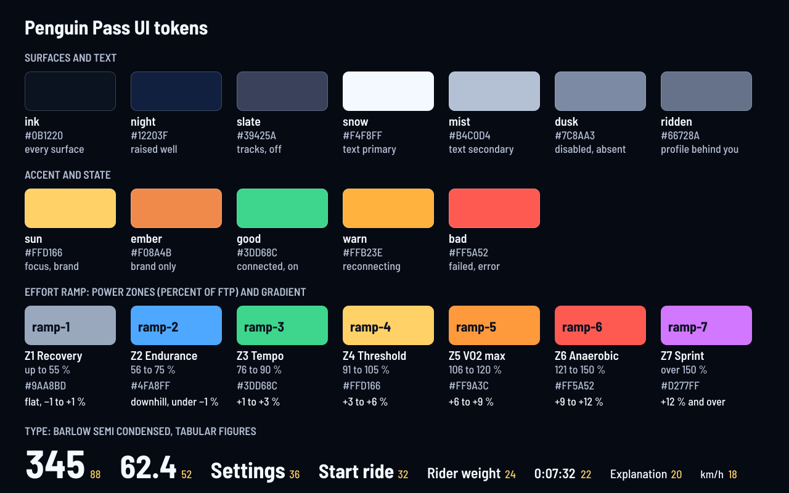

Token sheet: every colour with its hex, the ramp with both scales, and the type sizes.

## Type

One family: **Barlow Semi Condensed** (SIL OFL 1.1), three static
weights, in `godot/assets/fonts/barlow-semi-condensed/`. See `SOURCE.md`
there for the source and checksums.

| Weight | File | Use |
| --- | --- | --- |
| Medium 500 | `BarlowSemiCondensed-Medium.ttf` | Body, labels under numbers, units, unfocused rows |
| SemiBold 600 | `BarlowSemiCondensed-SemiBold.ttf` | Names, values, captions, focused row labels |
| Bold 700 | `BarlowSemiCondensed-Bold.ttf` | Numbers, titles, focused values, focused buttons |

### Size scale

| Role | 800p | 1080p | Weight |
| --- | --- | --- | --- |
| Hero power | 88 | 119 | Bold |
| Summary headline figures | 56 | 76 | Bold |
| HUD primary numbers | 52 | 70 | Bold |
| Summary course name and secondary figures | 40 | 54 | Bold |
| Screen title | 36 | 49 | Bold |
| Title menu item, dialog title | 32 | 43 | Menu item SemiBold, Bold when focused; dialog title Bold |
| Status headline (pairing) | 28 | 38 | SemiBold |
| Row, button, device name | 24 | 32 | Medium, SemiBold or Bold when focused |
| HUD list values | 22 | 30 | SemiBold |
| Body: explanations, hints, chip names, toasts | 20 | 27 | Medium or SemiBold |
| Minimum: units, labels, captions | 18 | 24 | Medium; captions SemiBold |

Captions (`TIME`, `Z6 ANAEROBIC`, `COURSE`) are 18 px SemiBold, upper
case, letter spacing 0.06 em. Nothing else is tracked except the
wordmark (0.03 em).

### Scaling rule

Project stretch mode `canvas_items`, aspect `expand`, base size
1280 x 800. The scale is `min(width / 1280, height / 800)`. The HUD and
every menu lay out in a 1280 x 800 design frame centred in the window.
Scrims, the title gradients, and the 3D view fill the whole window.

- Steam Deck 1280 x 800: scale 1, the frame is the screen.
- TV 1920 x 1080: scale 1.35. The frame is 1728 x 1080 physical pixels
  with a 96 px band of scenery on each side. The 18 px minimum becomes
  24.3 px.

Do not stretch the console to the full width of a 16:9 screen. The
instrument keeps one shape on every display.

### Tabular numerals

The default digits are proportional. Turn on the OpenType feature `tnum`
for every number that can change while it is on screen: all HUD numbers,
the live strip, settings values, summary figures, the seed cells, and the
companion dashboard. Names and sentences keep the default digits (`Tacx Neo 2T`
looks wrong with fixed-width digits). In Godot: a `FontVariation` per
weight with `opentype_features` set to `tnum` = 1.

Digit advance with `tnum`: 0.495 em Medium, 0.507 em SemiBold, 0.521 em
Bold. Cap height is 0.70 em. To centre a line of text in a box, put the
baseline at box centre + 0.35 x size.

### Number formatting

| Value | Format | Example |
| --- | --- | --- |
| Power | whole watts, no thousands separator | `215 W`, `1085 W` |
| Cadence, heart rate | whole number | `86 rpm`, `141 bpm` |
| Speed | one decimal under 100, none from 100 | `16.4 km/h`, `102 km/h` |
| Grade | sign and one decimal; no sign inside +/-0.05 | `+10.0`, `−9.8`, `0.0` |
| Distance | two decimals under 100 km, one from 100 | `2.10 km`, `100.0 km` |
| Elevation, ascent | whole metres | `134 m` |
| Time | `h:mm:ss`, always with the hour | `0:07:32` |
| Weight | one decimal | `75.0 kg` |
| FTP | whole watts | `250 W` |
| Difficulty | whole percent | `50 %` |
| Missing value | em dash in `dusk`, the unit stays | `—` over `bpm` |

The minus sign is U+2212, not a hyphen: it is as wide as the plus. A unit
is separated from its number by a gap (a space in running text). The hero
slot fits four digits; power is clamped to 9999 for display.

## Layout

- **Grid:** 4 px. Common steps: 8, 12, 16, 20, 24, 32.
- **Safe margin:** 32 px on every side of the design frame. Nothing is
  drawn outside it except scrims.
- **Radii:** 2 (ladder segment), 8 (inner chip), 10 (row), 12 (console,
  button, well), 16 (menu panel), 20 (dialog), half height (chips,
  toasts, switch).
- **Strokes:** 1 px hairlines at 12 to 14 % `snow` for panel borders and
  dividers. 2 px for outlined buttons, toasts, and icons.
- **Row heights:** 48 (settings row), 64 (device row, title item), 56
  (button), 36 (chip), 48 (toast).

### Safe margins on a TV and in the hand

On the Deck the 32 px margin is 4 % of the height and keeps the HUD off
the bezel. On a 16:9 TV the side margin is 96 + 43 = 139 physical pixels
(7.2 % of the width) and the top and bottom margin is 43 px (4 %). Panel
edges sit inside the 3.5 % action-safe area. HUD text sits inside the
5 % title-safe area: the lowest baseline is 52 px from the bottom
(6.5 %), the highest text is 43 px from the top (5.4 %). The menu hint
bar and the version line are the lowest text anywhere: baseline 39 px
from the bottom (4.9 %).

## Ride HUD

Three layouts were drawn over the same frame, with the same numbers.

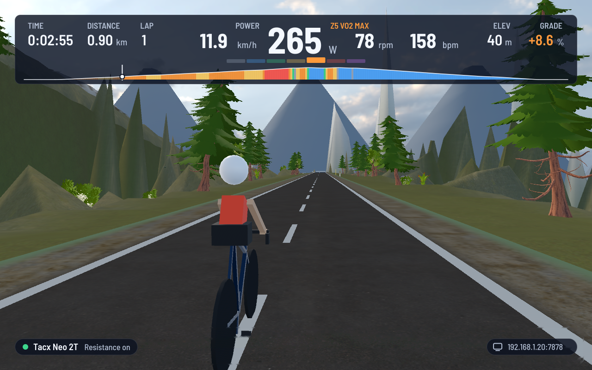

Concept A, top bar: everything in one strip across the top.

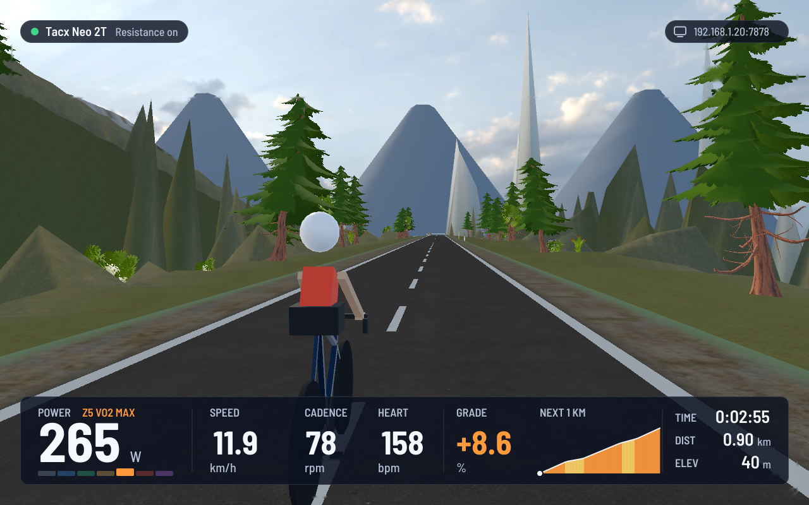

Concept B, bottom console: one panel on the bottom edge, power on the left.

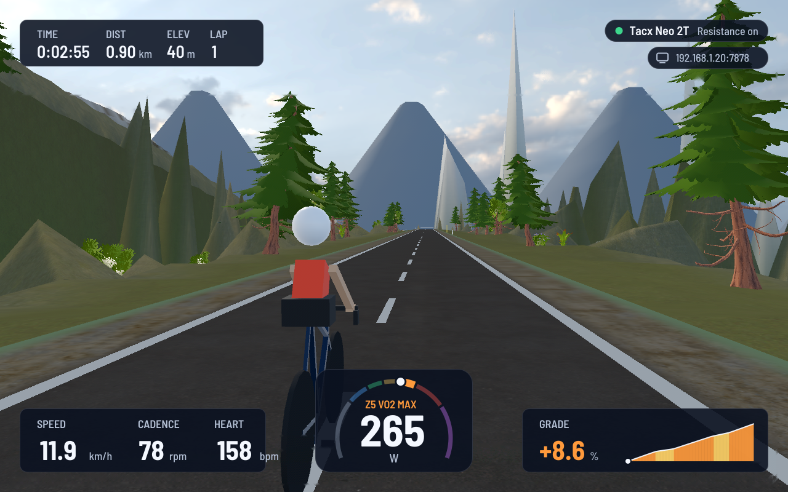

Concept C, cockpit: a power dial at bottom centre with panels in the corners.

**Chosen: B, the bottom console.** It reads as one instrument, and it
covers road surface, the least interesting part of the picture, leaving
the mountains and the horizon open. A puts a fitness-app header across
the sky, the best part of every frame. C scatters five panels around the
screen and parks its dial on the rider.

### Anatomy

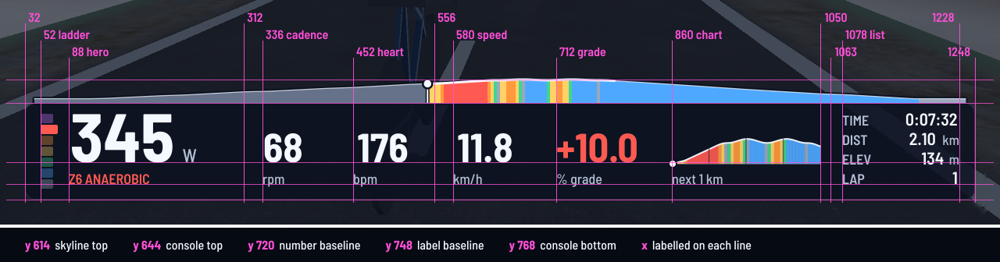

Console anatomy: every x position and baseline, at 1280 x 800.

The console is one panel, x 32, y 644, 1216 x 124. The course profile
stands on its top edge.

| Part | Geometry |
| --- | --- |
| Console panel | x 32 to 1248, y 644 to 768, radius 12 |
| Number baseline | y 720, every primary number |
| Label baseline | y 748, every label under a number |
| Dividers | 1 px `snow` 14 %, y 660 to 752, at x 312.5, 556.5, 1063.5 |
| Zone ladder | x 52, y 658 to 754. Seven segments 16 x 12, 2 px apart, radius 2, Z1 at the bottom. Current zone solid and 22 wide; the rest at 34 % |
| Hero power | x 88, 88 px Bold. `W` 24 px Medium `mist`, 8 px after the digits |
| Zone label | x 88, caption in the zone colour: `Z6 ANAEROBIC` |
| Cadence | x 336, 52 px Bold; label `rpm` |
| Heart rate | x 452, 52 px Bold; label `bpm` |
| Speed | x 580, 52 px Bold; label `km/h` |
| Grade | x 712, 52 px Bold in the gradient colour; label `% grade` |
| Next kilometre | x 860 to 1050, y 664 to 722. Label `next 1 km` |
| Ride list | captions at x 1078, values right-aligned at x 1228; baselines y 673, 698, 723, 748. `TIME`, `DIST`, `ELEV`, `LAP`. Values 22 px SemiBold, units 18 px `mist`, 4 px after |
| Course skyline | x 44 to 1236, standing on y 644, at most 30 px tall |

**Hero power** is the 3-second average, so it holds still long enough to
read. At 0 W the label reads `COASTING` in `mist` and no ladder segment
is lit.

**Next kilometre.** The road from the rider to 1000 m ahead, in 4 px
columns coloured by the gradient scale, 92 % opaque, with a 2 px `snow`
line on top. The vertical scale spans at least 60 m so a flat road draws
flat. `ink` ticks every 250 m. The rider is a `snow` dot of radius 5 at
the left end. On a loop the window wraps across the start line.

**Course skyline.** One lap (or the whole route when it is not a loop).
The floor is 22 % of the height range below the lowest point; the scale
spans at least 60 m. Behind everything, the same shape in `ink` at 88 %
with a 5 px `ink` outline so it reads over snow. Ridden part: one shape
in `ridden`. Road ahead: 4 px columns in gradient colours. Top line 1.25
px `snow` at 75 %; over the next kilometre it is 3 px solid, which ties
the skyline to the chart. The rider is a 2 px `snow` post with a dot of
radius 6, both cased in `ink`.

**Ride list, last row.** `LAP` and the lap number on a loop. `LEFT` and
the distance to the finish on a route that ends.

### Chips

All chips: height 36, radius 18, 14 px side padding, 8 px between parts,
at y 32. The climb and sprint panel is centred, 420 by 64, and its top
is this same y 32.

| Chip | Position | Content |
| --- | --- | --- |
| Trainer | left edge x 32 | Mark, name (20 px SemiBold), state (18 px `mist`) |
| Dashboard | 8 px left of the menu chip | Screen icon, address (18 px `mist`). Absent when the dashboard is off |
| Menu | right edge x 1248 | Menu glyph (or `Esc` keycap), `Menu` |

Trainer chip states, each with its own mark:

| State | Mark | Words |
| --- | --- | --- |
| Controlled | solid `good` disc, 14 px | name, `Resistance on` |
| Reading only | `good` ring, 3 px stroke | name, `Reading only` |
| Reconnecting | `warn` spinner | name, `Reconnecting` in `warn` |
| Simulated rider | keyboard icon | `Simulated rider` |

**Power hint.** Only with the simulated rider: a pill at x 32, y 562,
height 40, with the up and down glyphs, `Power`, and `±25 W`. It hides
after the first power change and returns when the pause menu closes.

### States

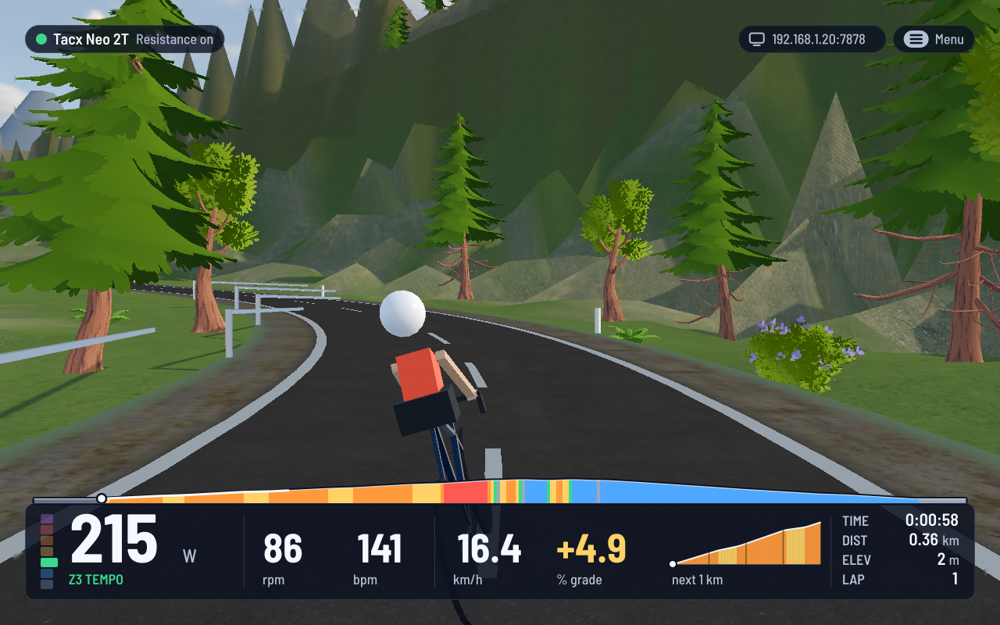

Steady: tempo on the first ramp, switchback ahead, trainer controlled, companion dashboard on.

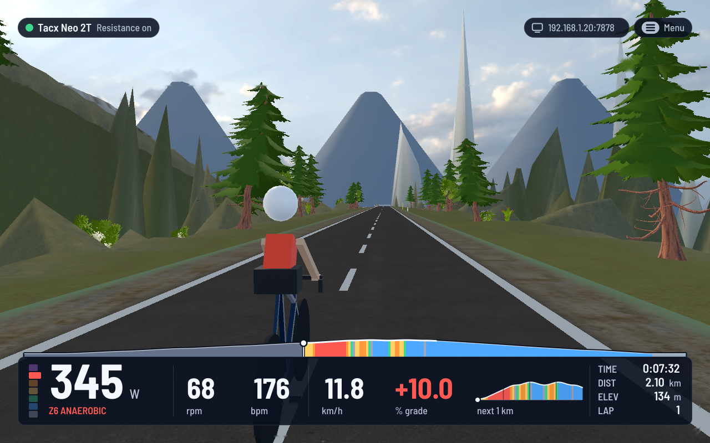

Hard effort: Z6 on the +10.0 % pitch. Red ladder position, red grade, red road in the next kilometre.

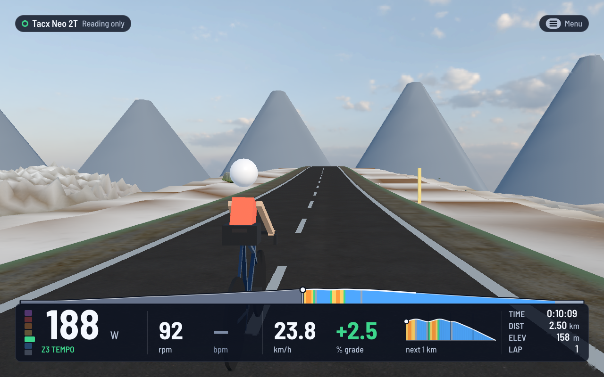

Summit, the brightest frame: no heart-rate strap (em dash), a trainer that only reports power, dashboard off.

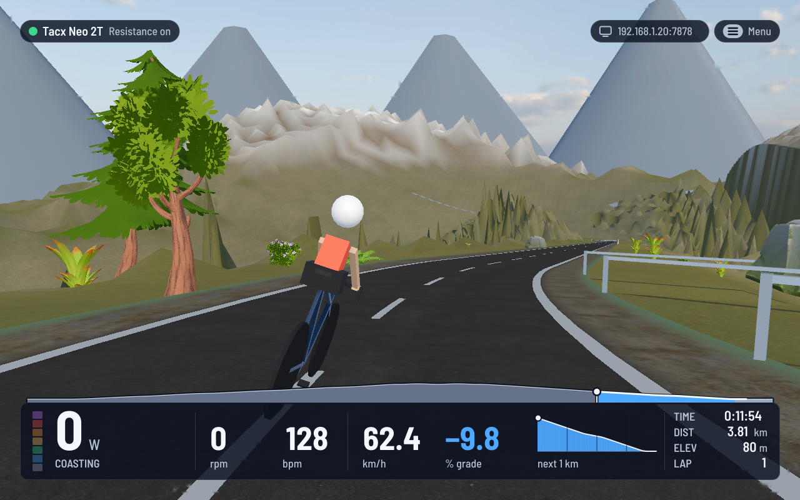

Descent: 62.4 km/h, 0 W reads `COASTING`, grade and the road ahead are blue.

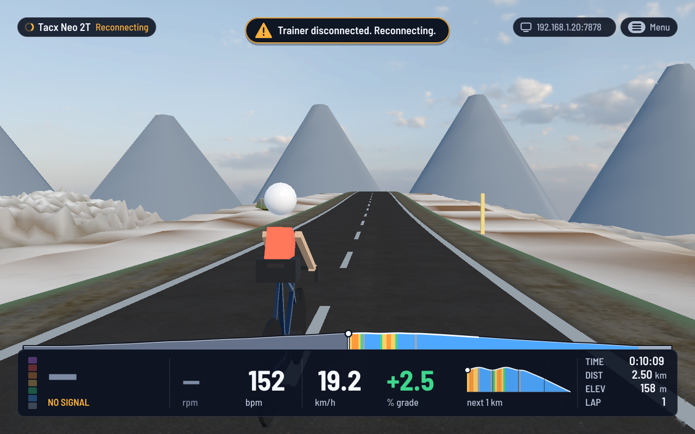

Trainer reconnecting: power and cadence are unknown, not zero; `NO SIGNAL`, an amber chip, and a toast.

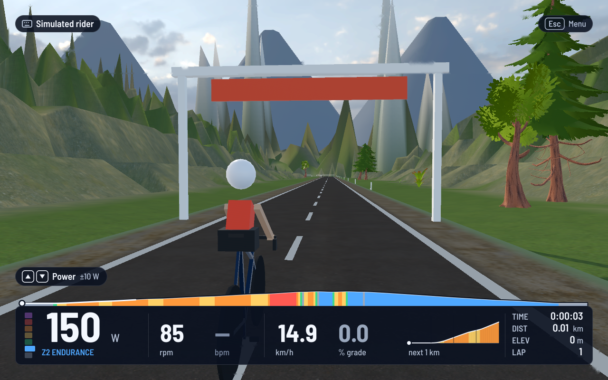

Simulated rider with a keyboard: keyboard chip, power hint, `Esc` on the menu chip.

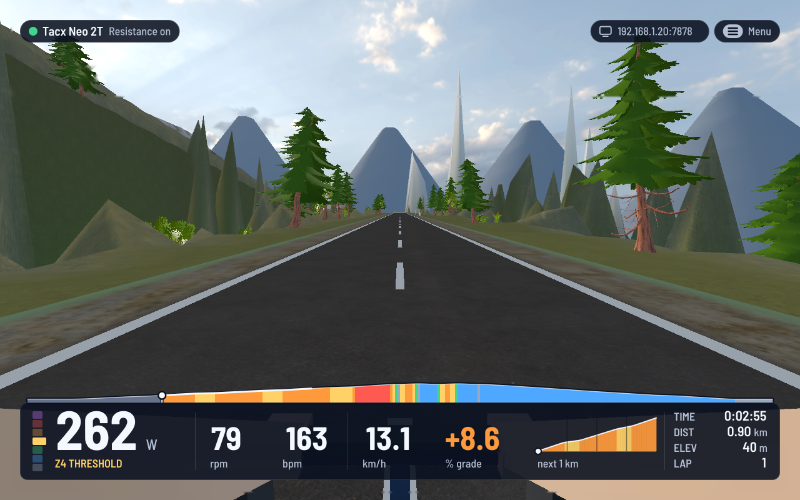

First-person camera: the same console; the handlebars sit above it.

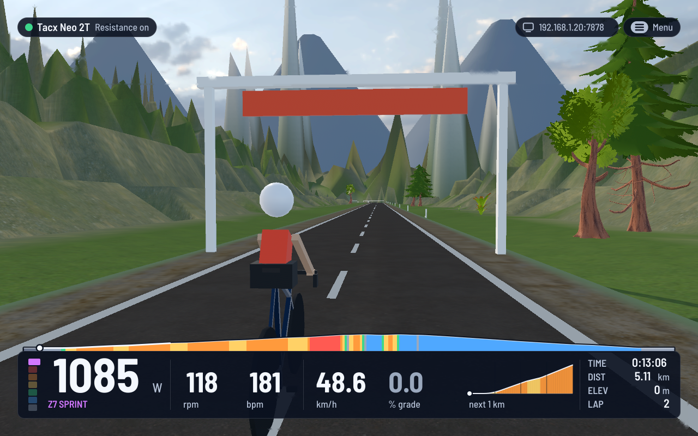

Widest case: four-digit power in Z7 on lap 2.

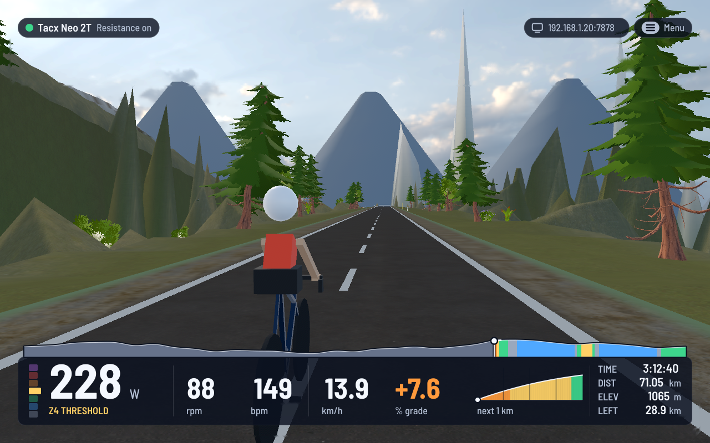

A 100 km route: the skyline holds the whole route and the last row reads `LEFT`.

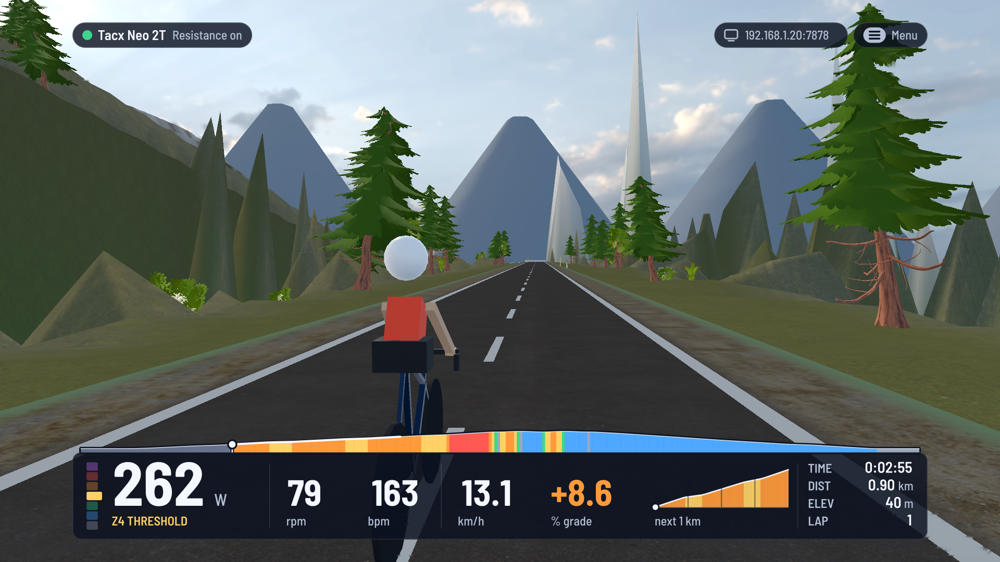

1920 x 1080: the same frame at 1.35, centred, 96 px of scenery on each side.

### Coverage

Measured on the mockups: console 14.7 %, skyline 2.0 % (its filled
area), chips 1.9 %. Total **18.6 %** in the full state, 17.9 % with the
Dashboard chip absent, 18.5 % with the power hint. Counting the skyline as its
whole 30 px box gives 20.2 %.

### Half-size check

`docs/img/ui/half/` holds every HUD mockup at 640 x 400. At that size
the hero power, the four primary numbers, the lit ladder position, and
the grade colour read clearly. The ride list and the chips are small but
legible. They are the numbers a rider looks for, not the ones that must
jump out.

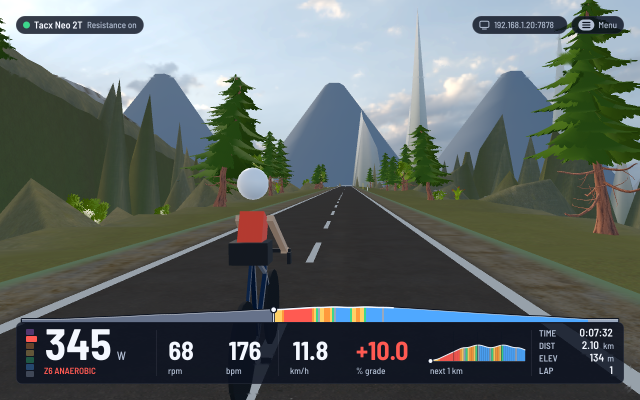

The climb at 640 x 400.

## Menus

Every menu draws over the running ride. While a menu is open the console
and chips are hidden and a live strip in the menu header carries power
and speed.

### Common parts

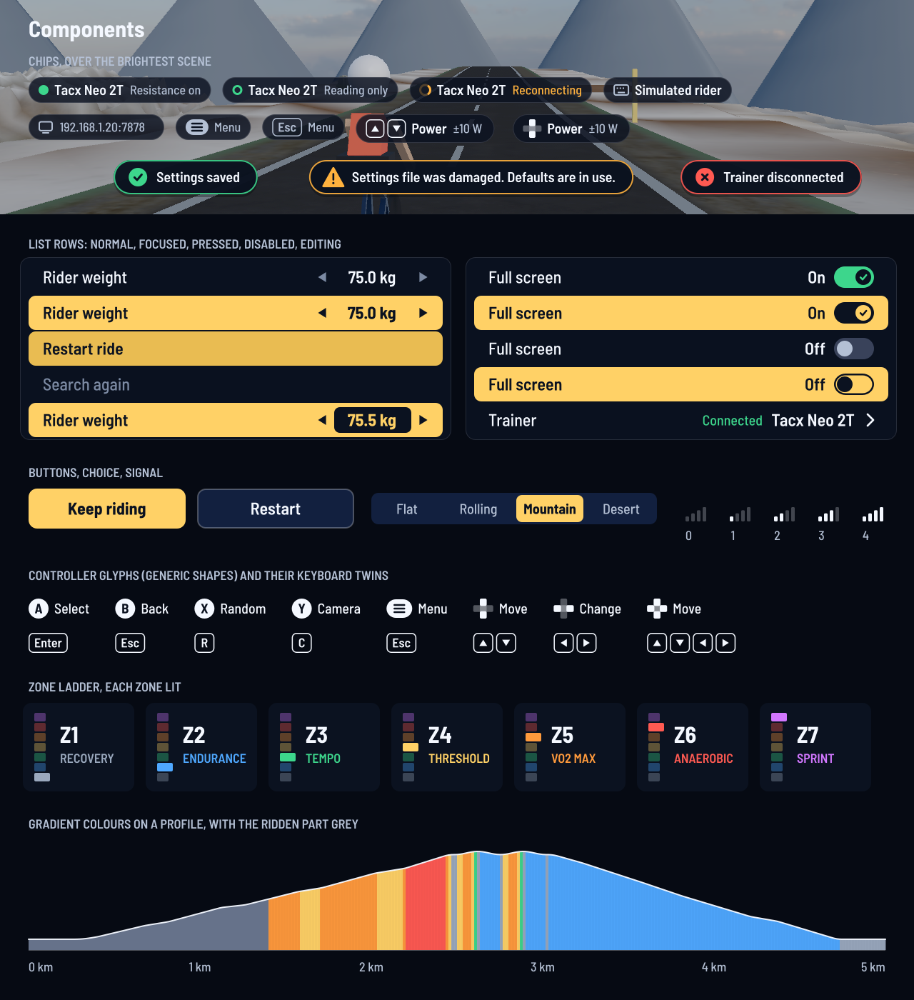

Component sheet: chips, toasts, row states, buttons, the segmented choice, signal bars, controller glyphs with their keyboard twins, the ladder with each zone lit.

**Screen title.** 36 px Bold `snow`, x 220, baseline y 68.

**Live strip.** Right edge x 1060, y 36, height 40, radius 20, menu
surface. A 12 px zone-colour square, power (24 px Bold) and `W`, a
hairline, speed (24 px Bold) and `km/h`.

**Menu panel.** x 220, y 92, 840 x 624. Rows are inset 12: x 232, width
816.

**Row.** Height 48, pitch 50, radius 10. Groups are separated by an extra
14. Label at x + 20, 24 px. Right inset 20.

| State | Fill | Label | Value |
| --- | --- | --- | --- |
| Normal | none | Medium, `snow` | SemiBold, `snow`; arrows `dusk` |
| Focused | `sun` | SemiBold, `ink` | Bold, `ink`; arrows `ink` |
| Pressed | `#E9BC52` for 80 ms | as focused | as focused |
| Disabled | none | Medium, `dusk` | `dusk`; cannot take focus |
| Editing | `sun` | SemiBold, `ink` | Bold `sun` on an `ink` chip (108 x 36, radius 8) |

Row kinds:

- **Action** (`Restart ride`): label only.
- **Nav** (`Trainer`): value right-aligned 26 px in from the row's right
  inset, then a 16 px chevron. State word (`Connected` in `good`, 20 px)
  12 px left of the value.
- **Value** (`Rider weight`): a 112 px value slot, centred text, with a
  14 px arrow on each side. The arrows are always drawn so every right
  edge lines up and the row says "left and right change this". At the end
  of the range the arrow on that side drops to 25 %.
- **Toggle** (`Full screen`): a 56 x 30 switch at the right, the word
  `On` or `Off` 12 px left of it. On: `good` track, knob right, tick in
  the knob. Off: `slate` track, knob left. Focused: `ink` track with a
  `sun` knob when on; a 2.5 px `ink` outline with an `ink` knob when off.
  Extra text (the dashboard address) sits 44 px left of the word, 20 px `mist`.

"Editing" is a look, not a mode. Left and right change a value row at
once. The row shows the editing chip from the first change until 800 ms
after the last one, or until focus leaves. There is nothing to confirm
and nothing to cancel, so B always means back.

**Explanation line.** Under a hairline at y 653.5: an `i` in a 22 px
ring at x 248, y 685, then one line of 20 px `mist` text at x 282. It
explains the focused row. A warning replaces it: `!` in the ring and the
text in `warn`.

**Hint bar.** Right-aligned at x 1248, centred on y 754. Each hint is a
28 px glyph, 8 px, a 20 px Medium label; hints are 28 px apart. The most
used hint is rightmost.

**Glyphs.** Generic shapes only: a disc with `A`, `B`, `X`, or `Y`; a
pill with three bars for the menu button; a cross with the live arms
solid for the D-pad. With a keyboard the same slots show outlined
keycaps: `Enter`, `Esc`, `R`, `C`, and arrow keys. Show the set for the
device that sent the last input.

**Button.** Height 56, radius 12. Focused: `sun` fill, 24 px Bold `ink`.
Normal: `night` fill, 2 px `snow` outline at 28 %, 24 px SemiBold
`snow`. Pressed: `#E9BC52`.

**Segmented choice.** Height 44, radius 10, `night` well. The chosen
segment is a solid chip inset 3 px, radius 8, 20 px Bold `ink` text:
`snow` normally, `sun` when the control has focus.

**Signal.** Four bars 5 px wide, 8 px pitch, rising to 20 px. Unlit bars
at 25 %. Always with a word: `Very weak` (0), `Weak` (1), `Fair` (2),
`Good` (3), `Strong` (4).

**Spinner.** A ring at 25 % with a 100 degree arc, one turn per second.
It always has words beside it.

### Title

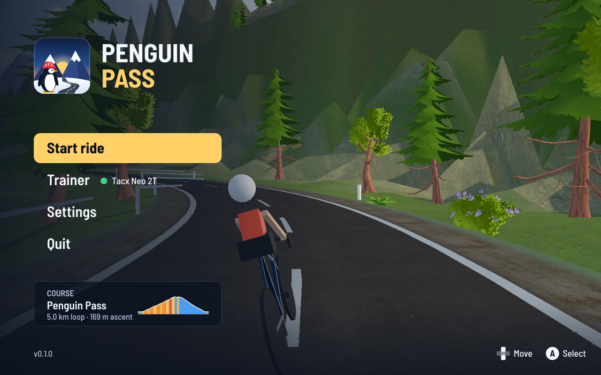

Title on the Deck: `Start ride` focused, trainer connected, course line, version.

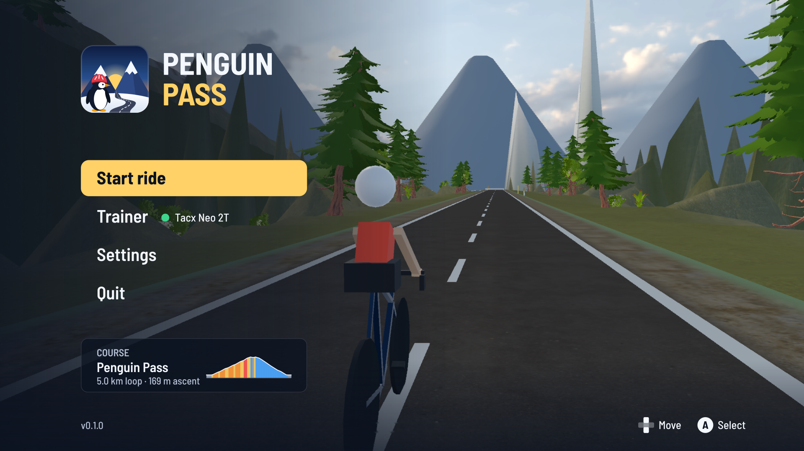

Title at 1920 x 1080: the same frame at 1.35 over a wider view.

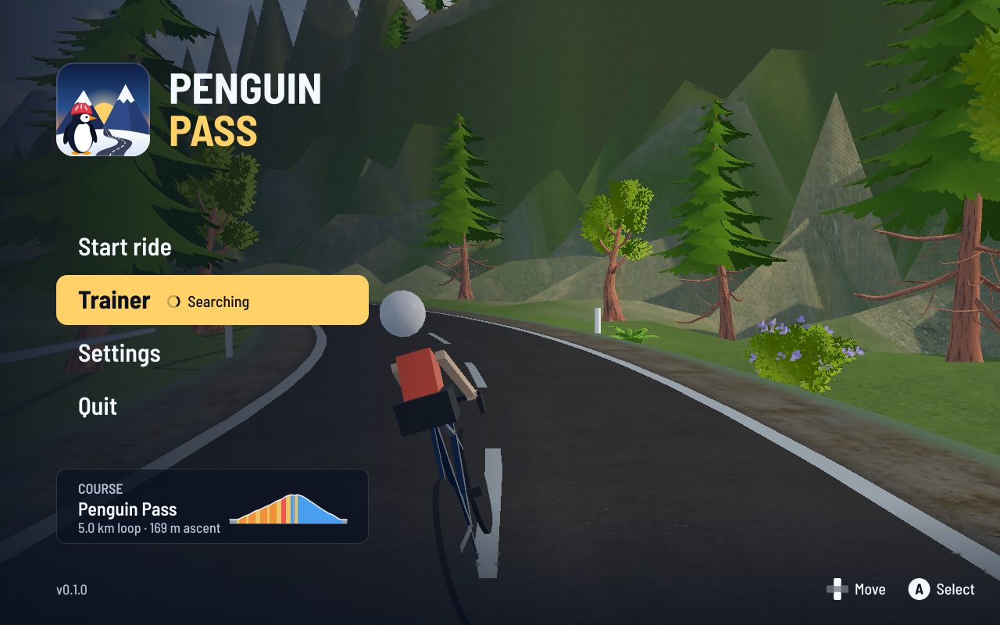

`Trainer` focused while the game searches.

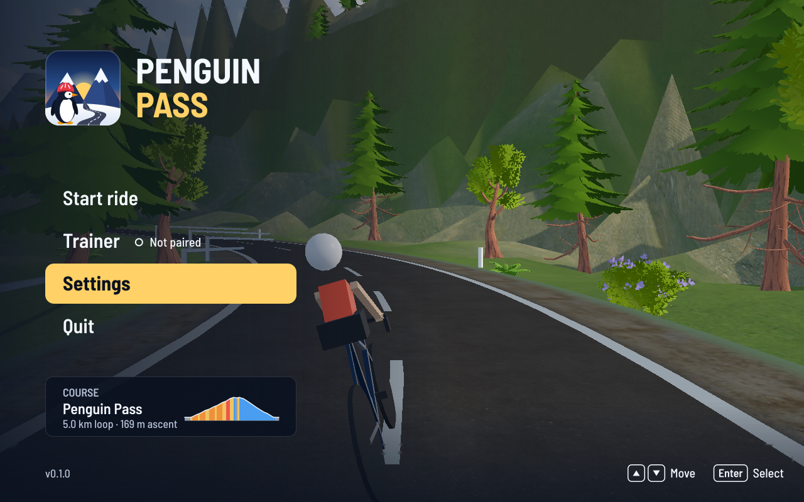

No trainer paired, keyboard glyphs.

| Part | Geometry |
| --- | --- |
| Badge | `docs/img/logo.svg` at 120 x 120, x 72, y 80 |
| Wordmark | x 216. `PENGUIN` `snow`, baseline y 133; `PASS` `sun`, baseline y 187. 56 px Bold, tracking 0.03 em |
| Menu items | x 72, width 400, height 64, pitch 68, first at y 284, radius 14. Label at x 100, 32 px |
| Trainer state | 20 px after the `Trainer` label: mark and words, 20 px Medium |
| Course card | x 72, y 600, 400 x 96, HUD surface. Caption `COURSE`, name 24 px, facts 18 px, profile 150 x 40 at the right |
| Version | x 72, baseline y 761, 18 px `mist` |
| Hints | `Move`, `Select` |

Trainer state on the title: solid `good` disc and the trainer name;
spinner and `Searching`; hollow ring and `Not paired`.

The background is the live course with a slow camera. The rider must
stay right of x 500 so the menu never covers it.

The course card is a line of information today. When the course picker
ships it becomes the fifth menu item and A opens the picker.

### Settings (pause menu)

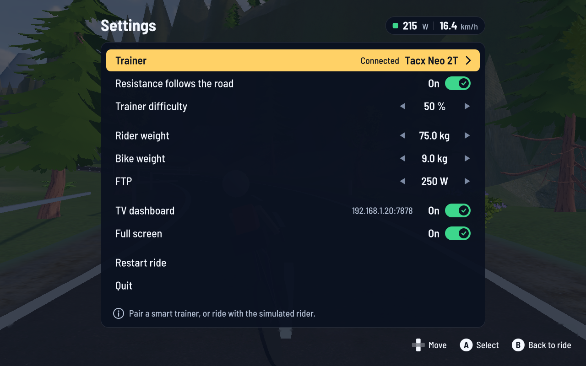

Default: opened from the ride, `Trainer` focused, its explanation below.

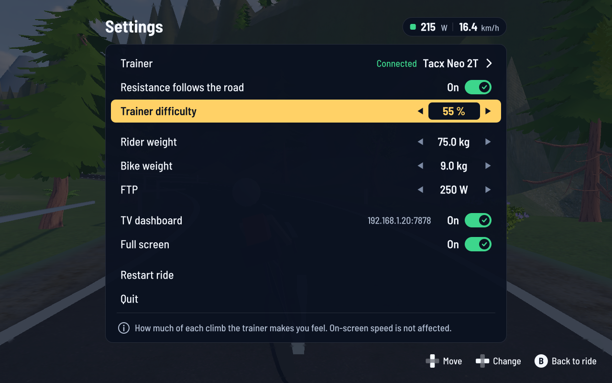

A value being changed: the editing chip, the hint reads `Change`.

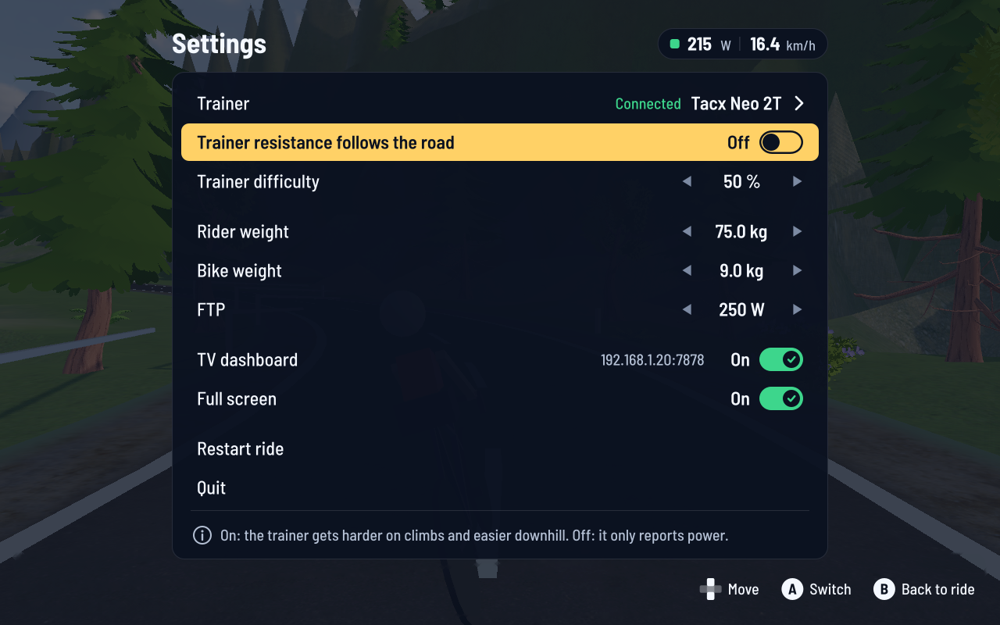

A toggle focused and off: word, knob position, and outline all change.

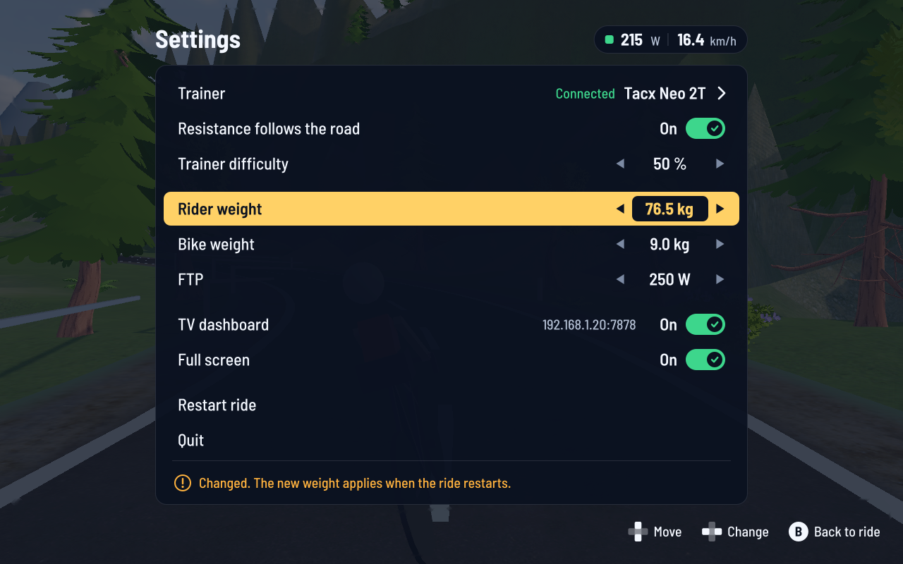

Rider weight changed mid-ride: the amber line says when it applies.

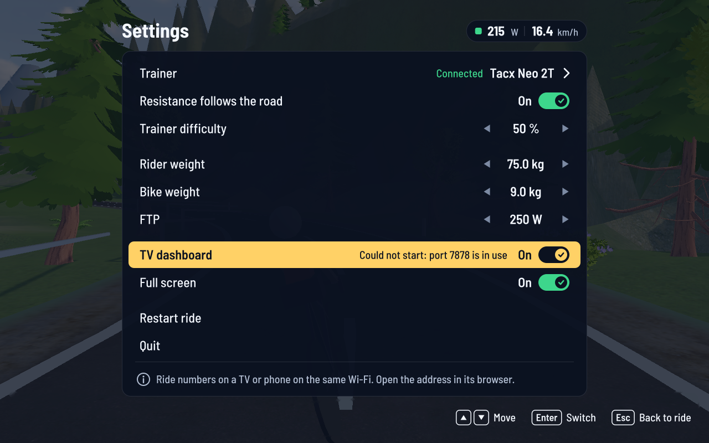

The companion dashboard could not start: the reason replaces the address. Keyboard glyphs.

Rows, top to bottom. First row at y 108.

| Row | Kind | Range, step, default | Explanation line |
| --- | --- | --- | --- |
| Trainer | nav | trainer name and state, or `Simulated rider` | Pair a smart trainer, or ride with the simulated rider. |
| Trainer resistance follows the road | toggle | default on | On: the trainer gets harder on climbs and easier downhill. Off: it only reports power. |
| Trainer difficulty | value | 0 to 100 %, step 5, default 50 % | How much of each climb the trainer makes you feel. On-screen speed is not affected. |
| Rider weight | value | 30.0 to 200.0 kg, step 0.5, default 75.0 kg | Your weight in riding kit. Heavier riders climb slower at the same power. |
| Bike weight | value | 4.0 to 30.0 kg, step 0.5, default 9.0 kg | Bike plus bottles. Added to rider weight to work out your speed. |
| FTP | value | 50 to 600 W, step 5, default 200 W | The power you can hold for an hour. It sets the power zones on the ride screen. |
| Companion dashboard | toggle | default on; address or error beside it | Ride numbers on a phone or tablet on the same Wi-Fi. Open the address in its browser. |
| Full screen | toggle | | Fill the whole display. Off puts the game in a window. |
| Restart ride | action | opens the confirm dialog | Go back to the start line. Time and distance return to zero. |
| Quit | action | opens the confirm dialog | End this ride and see the summary. |

The mockups show FTP 250 W as a sample value.

When rider weight, bike weight, or FTP changes after the ride has moved,
the explanation line becomes the amber note `Changed. The new weight
applies when the ride restarts.` (or `The new FTP applies ...`).

With no trainer connected, `Trainer resistance follows the road` and
`Trainer difficulty` are disabled.

Opened from the title, the same menu drops `Restart ride`, renames the
B hint to `Back`, and has no live strip.

### Trainer pairing

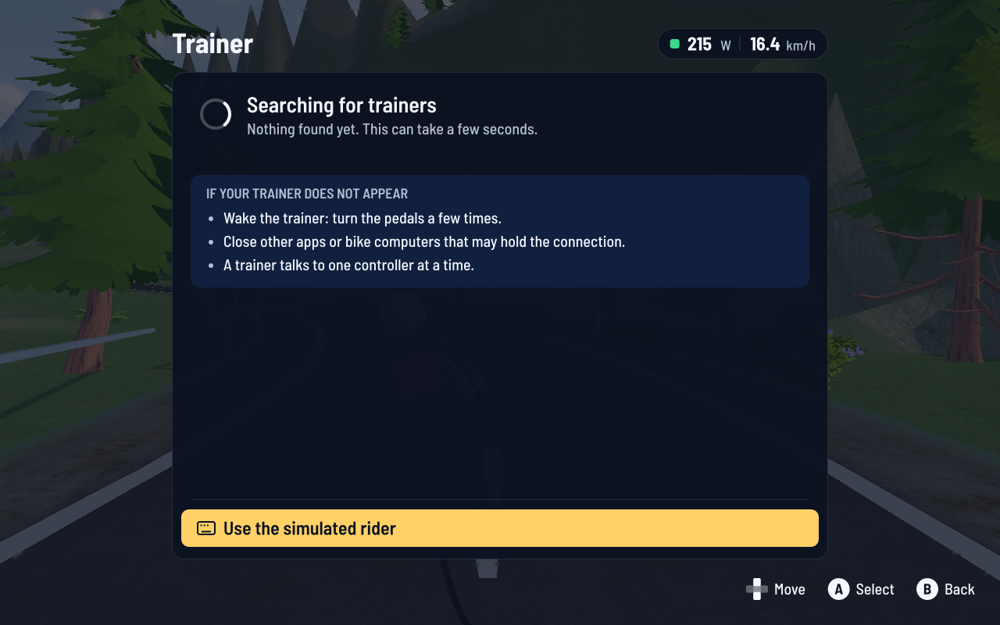

Searching, nothing found yet: the tips box fills the empty list.

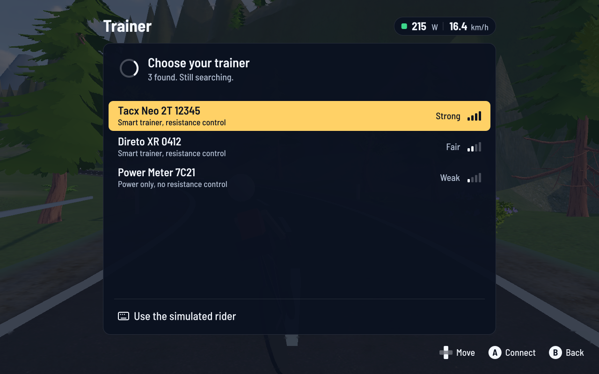

Trainers found: name, what it can do, signal in bars and a word.

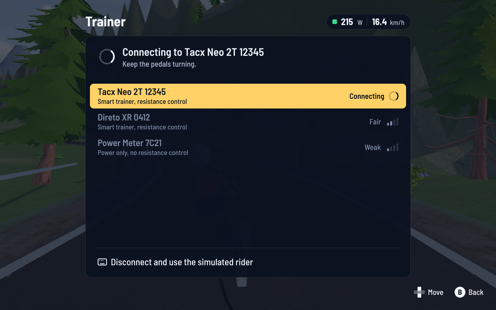

Connecting: the chosen row shows a spinner and `Connecting`; the others dim.

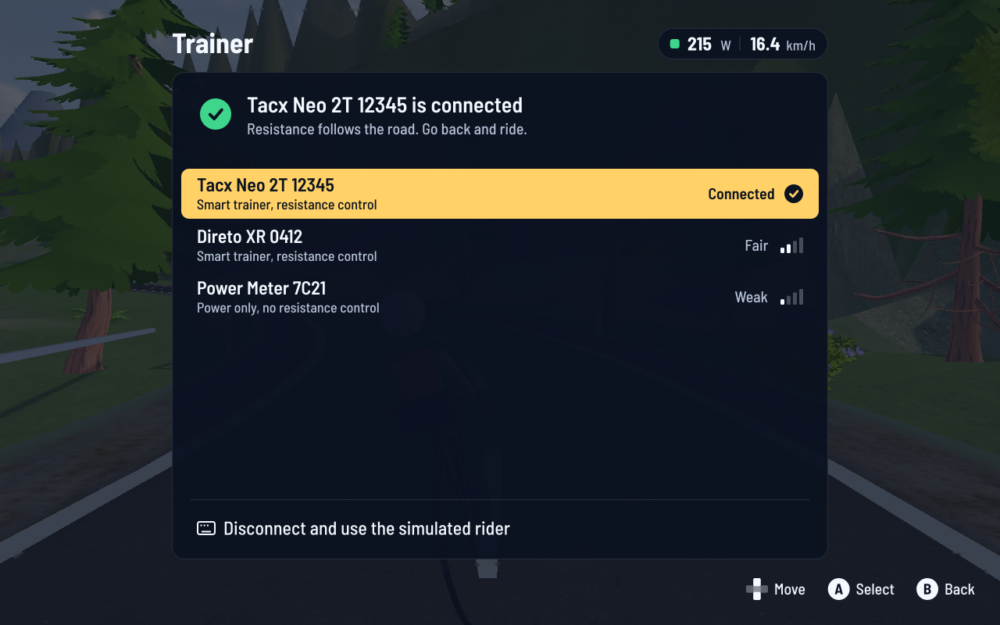

Connected: tick, sentence, and the row says `Connected`.

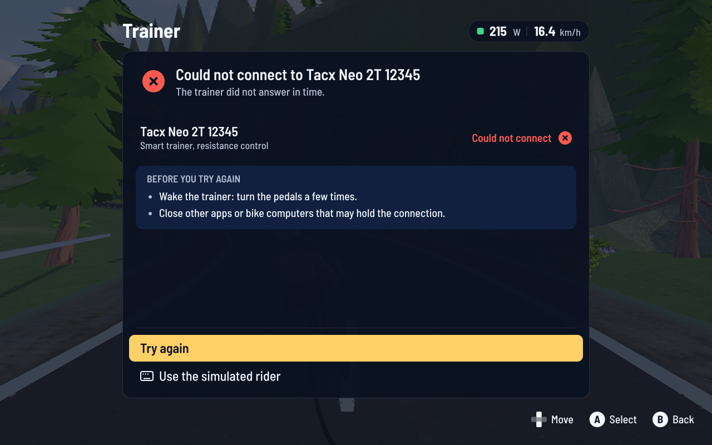

Failed, with the reason in the sentence, what to check, and `Try again` focused.

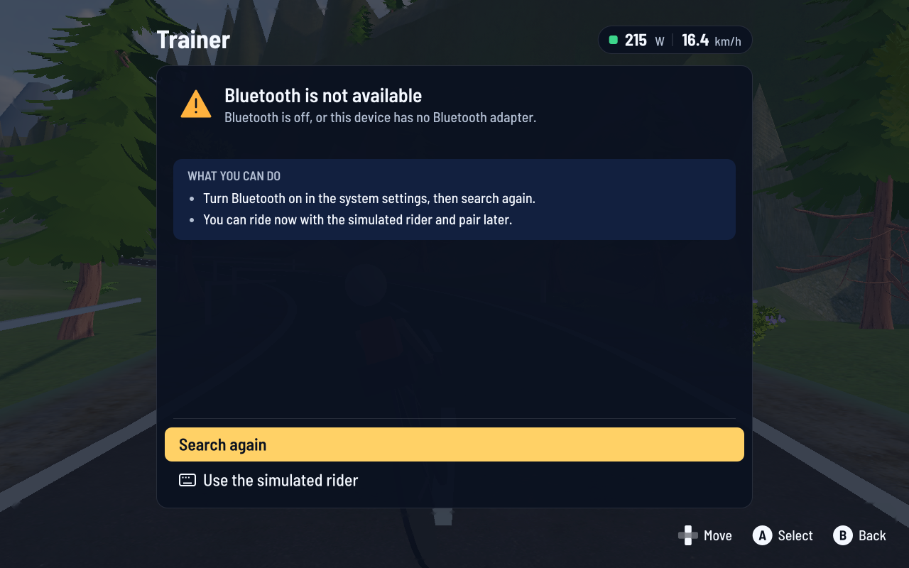

Bluetooth unavailable: what that means and what to do.

| Part | Geometry |
| --- | --- |
| Status block | Mark 40 px, centre (276, 146). Headline 28 px SemiBold at x 316, baseline y 144. Sentence 20 px `mist`, baseline y 172 |
| Device row | x 232, width 816, height 64, pitch 66, first at y 216. Name 24 px SemiBold, baseline + 29. Kind 18 px `mist`, baseline + 52. Signal bars and word at the right |
| Tips box | x 244, width 792, `night`, radius 12. Caption, then 20 px lines at 30 px pitch with bullets |
| Action rows | Standard rows at the bottom: last at y 652, the one above at y 602. A hairline 12 px above the first |

| State | Mark | Headline | Sentence | Action rows |
| --- | --- | --- | --- | --- |
| Searching | spinner | Searching for trainers | Nothing found yet. This can take a few seconds. | Use the simulated rider |
| Found | spinner | Choose your trainer | `N` found. Still searching. | Use the simulated rider |
| Connecting | spinner | Connecting to `name` | Keep the pedals turning. | Disconnect and use the simulated rider |
| Connected | `good` disc with tick | `name` is connected | Resistance follows the road. Go back and ride. | Disconnect and use the simulated rider |
| Failed | `bad` disc with cross | Could not connect to `name` | The reason, one sentence | Try again; Use the simulated rider |
| Unavailable | `warn` triangle | Bluetooth is not available | Bluetooth is off, or this device has no Bluetooth adapter. | Search again; Use the simulated rider |

Devices sort by signal, strongest first, and do not reorder while one
has focus. The kind line says what the device can do: `Smart trainer,
resistance control` or `Power only, no resistance control`.

Searching tips: `Wake the trainer: turn the pedals a few times.` `Close
other apps or bike computers that may hold the connection.` `A trainer
talks to one controller at a time.`

### Confirm dialog

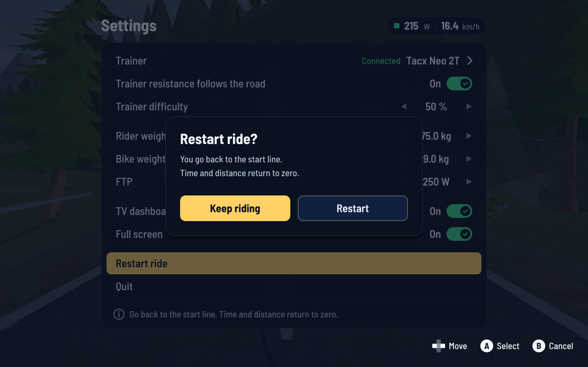

`Restart ride?` over the dimmed menu; focus opens on `Keep riding`.

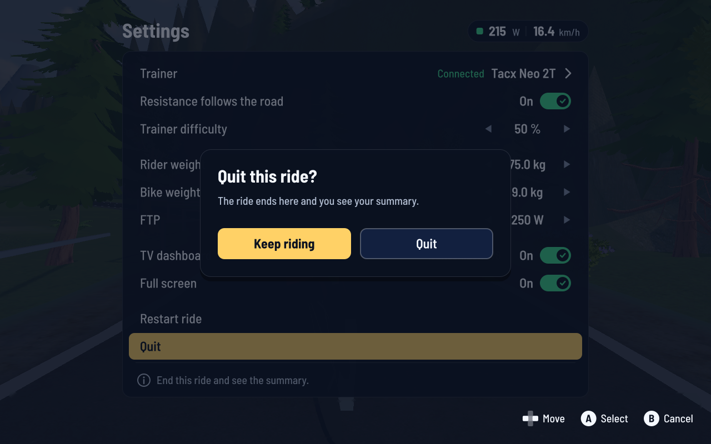

`Quit this ride?` with one line of consequence.

Width 560, centred, 16 px above centre. Height 200 + 30 per body line.
Title 32 px Bold at x + 32, y + 60. Body 20 px `mist` from y + 100, 30
px pitch. Two buttons 240 x 56, 16 px apart, 32 px from the bottom and
sides. The safe choice is on the left and has focus. The other button
names the action (`Restart`, `Quit`), never `OK` or `Yes`.

### Toasts

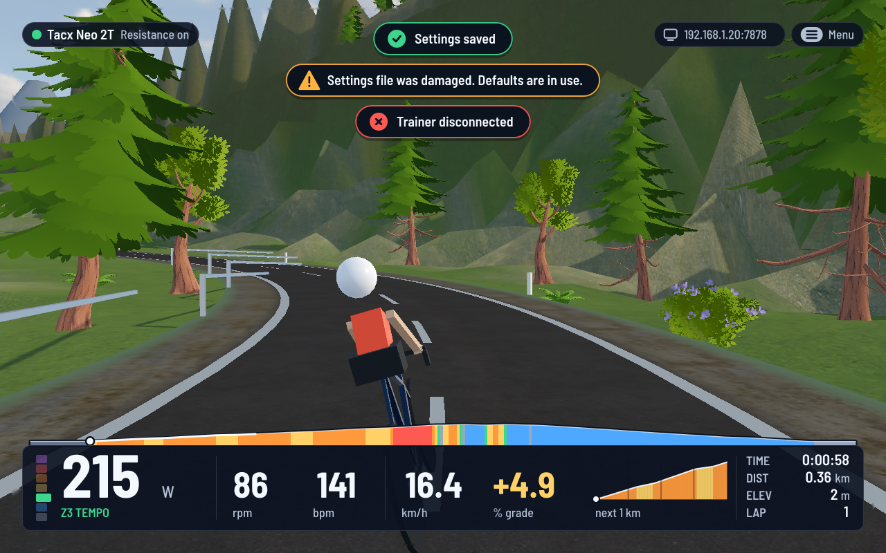

The three toasts, stacked for the picture: saved, damaged settings file, trainer disconnected.

Top centre, y 32, height 48, radius 24. Icon 28 px at x + 20, text 20 px
SemiBold at x + 60, 24 px right padding. One at a time; a second waits
its turn. They never take focus.

| Kind | Outline and icon | Text | Stays |
| --- | --- | --- | --- |
| Saved | `good`, disc with tick | Settings saved | 3 s |
| Warning | `warn`, triangle | Settings file was damaged. Defaults are in use. | 6 s |
| Warning | `warn`, triangle | Trainer disconnected. Reconnecting. | until it reconnects or gives up |
| Error | `bad`, disc with cross | Trainer disconnected | 6 s |

### Ride summary

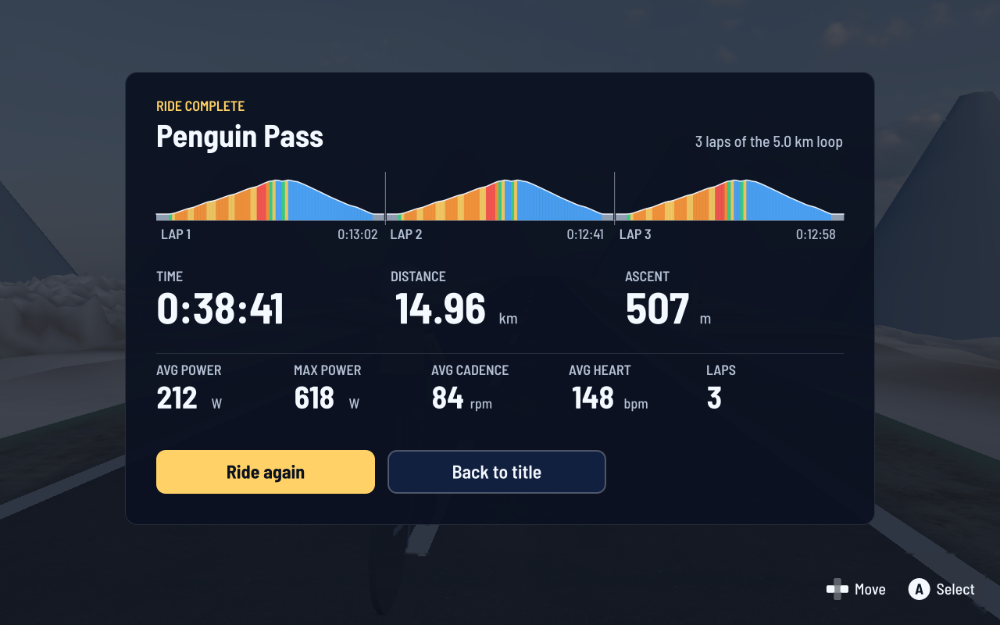

Ride summary: laps as a skyline with lap times, three headline figures, five secondary figures.

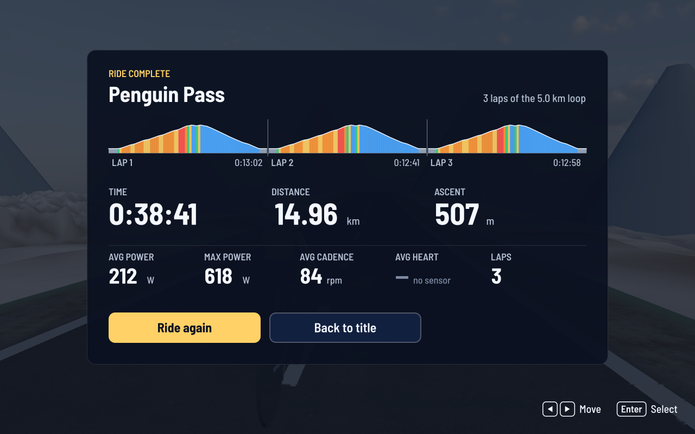

No heart-rate strap: an em dash and `no sensor`, keyboard glyphs.

Panel x 160, y 92, 960 x 580, over a 74 % scrim. Content inset 40.

| Part | Geometry |
| --- | --- |
| Caption | `RIDE COMPLETE` in `sun`, baseline y 142 |
| Course name | 40 px Bold, baseline y 188; `3 laps of the 5.0 km loop` 20 px `mist`, right-aligned |
| Lap skyline | x 200 to 1080, 56 px tall, standing on y 282. One profile per lap, divided by lines. Lap caption and lap time under each, baseline y 306 |
| Headline figures | Time, Distance, Ascent. Captions at y 360, numbers 56 px Bold, columns at x 200, 500, 800 |
| Secondary figures | Avg power, Max power, Avg cadence, Avg heart, Laps. Captions at y 480, numbers 40 px Bold, columns every 176 px from x 200 |
| Buttons | `Ride again` (focused) at x 200, `Back to title` at x 496; 280 x 56, y 576 |

With more than six laps the skyline shows the whole ride as one profile
and the lap times are dropped.

### Course picker

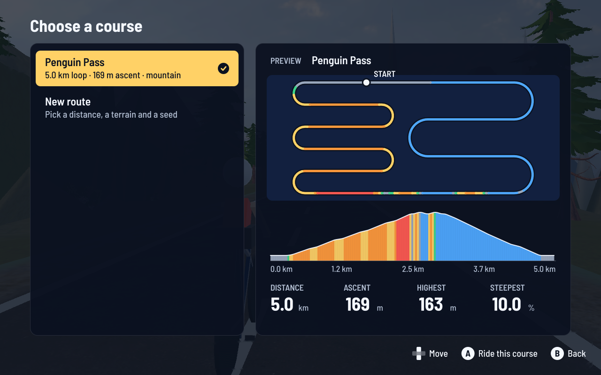

The fixed loop selected: map coloured by gradient, profile, four facts.

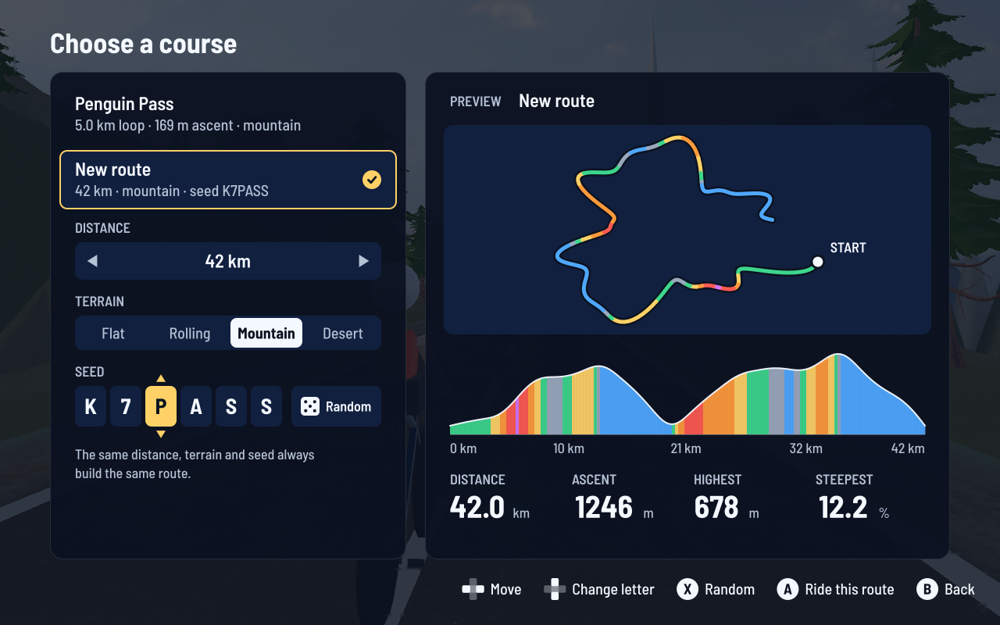

A new route: distance, terrain, and the seed with one character being changed.

Two panels from y 92 to 716: list x 64, width 456; preview x 544, width
672.

| Part | Geometry |
| --- | --- |
| Course card | x 76, width 432, height 76, pitch 84, first at y 108. Title 24 px, facts 20 px. The chosen course has a 2 px `sun` outline and a tick; focused is the `sun` fill |
| Distance | Caption, then a 392 x 48 `night` stepper at x 96, y 310. 2 to 100 km, step 1 |
| Terrain | Segmented choice at y 404: Flat, Rolling, Mountain, Desert |
| Seed | Six cells 40 x 52, 5 px apart, at y 494. The active cell is `sun` with an arrow above and below. Letters A to Z and digits |
| Random | A `night` button right of the cells with a dice mark and the word |
| Map | `night` well x 568, y 160, 624 x 268. Route 5 px in gradient colours on a 10 px `ink` casing. Start dot and `START` |
| Profile | x 576, y 444, 608 x 112, with five distance labels below |
| Facts | Distance, Ascent, Highest, Steepest: captions at y 620, numbers 40 px Bold, every 156 px |

On a keyboard the seed can be typed directly. The same distance,
terrain, and seed always build the same route, and the panel says so.

## Companion dashboard web page

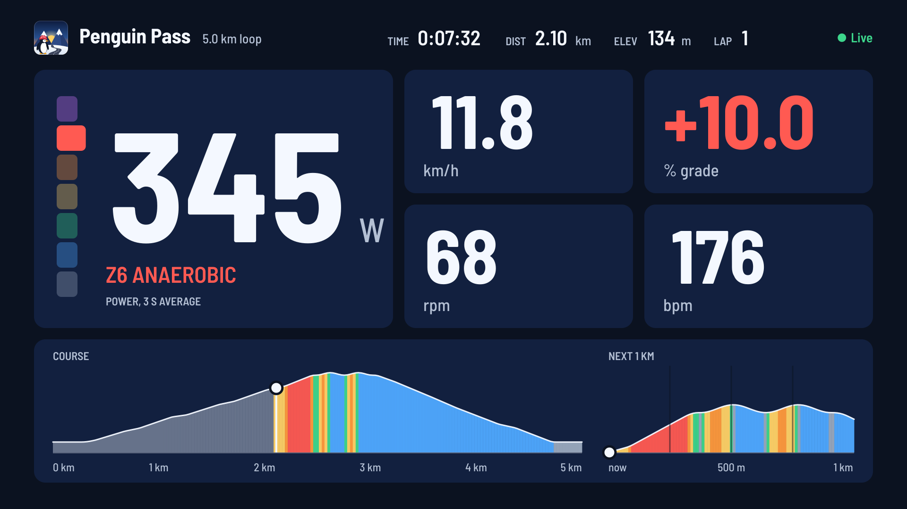

The web page at 1920 x 1080: power takes the left half, four tiles, the course along the bottom.

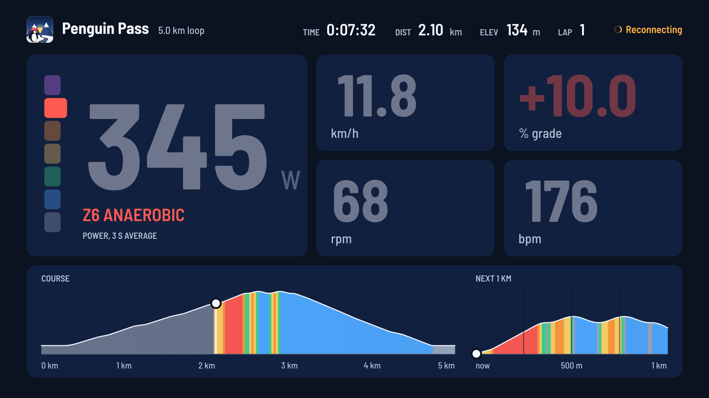

Stream dropped: the last numbers dim to 40 %, the status reads `Reconnecting` with a spinner.

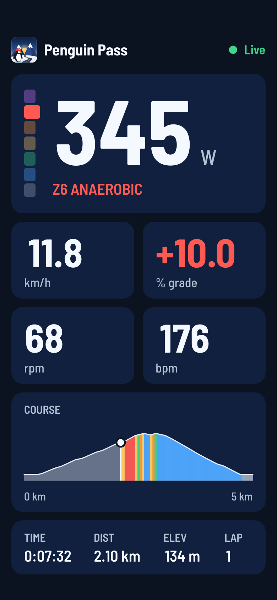

The same page on a phone held upright (390 x 844 CSS px, drawn at 2x).

Same tokens and the same font, served by the game with
`font-feature-settings: "tnum"`. No 3D view. Background `ink`, tiles
`night`, radius 24.

At 1920 x 1080 (CSS px): margin 72. Header: badge 72, name 44 px Bold,
then `TIME`, `DIST`, `ELEV`, `LAP` at 44 px, and the status at the right
(`Live` with a `good` disc, or `Reconnecting` with a `warn` spinner).
Power tile x 72, y 148, 760 x 548: ladder with 44 x 54 segments, number
330 px Bold, zone name 48 px, `POWER, 3 S AVERAGE` 24 px. Four tiles to
the right, two by two, 24 px apart: speed, grade, cadence, heart; number
160 px Bold, label 36 px. Course panel along the bottom: the lap profile
with the rider marker, and the next kilometre at the right. Smallest text
24 px.

Phone: one column, 16 px margin. Power tile 196 tall with a 128 px
number, four tiles 108 tall with 56 px numbers, course panel, then time,
distance, elevation, lap. Scale the layout between the two with CSS
`clamp()` on the viewport width; switch to the phone layout when the page
is taller than it is wide.

## Navigation

- **Move:** D-pad or left stick. Up and down move between rows. Left and
  right change a value row, move between dialog buttons, and move
  between seed cells.
- **A** selects, switches a toggle, or opens. **B** goes back one level.
  **Menu** opens the pause menu from the ride and closes every menu back
  to the ride.
- **Keyboard:** arrow keys, `Enter`, `Esc`. `F11` toggles full screen
  anywhere.
- **Wrap-around:** a fresh press on the last row goes to the first, and
  the reverse. A held direction stops at the end and does not wrap.
  Values clamp at their limits and never wrap.
- **Hold to repeat:** the first repeat comes after 400 ms, then 10 per
  second. On a value row, after 1.5 s of holding it rises to 30 per
  second.
- **Disabled rows** are skipped.
- **Focus is always visible.** Exactly one thing has the `sun` fill.

| Screen | Focus lands on | B does |
| --- | --- | --- |
| Title | `Start ride`; after a sub-screen, the item that opened it | Nothing. Quitting is the `Quit` item |
| Settings | `Trainer`; after pairing, `Trainer`; after a cancelled dialog, the row that opened it | Back to the ride (or the title) |
| Pairing: searching | `Use the simulated rider` | Back to settings; the search goes on |
| Pairing: found | The strongest trainer, when the first one appears and the rider has not moved focus | Back |
| Pairing: connecting | Stays on the chosen trainer | Back; the connection attempt continues |
| Pairing: connected | The connected trainer | Back |
| Pairing: failed | `Try again` | Back |
| Pairing: unavailable | `Search again` | Back |
| Confirm dialog | The safe choice (`Keep riding`) | Cancel, same as the safe choice |
| Summary | `Ride again` | Nothing |
| Course picker | The current course | Back to the title, keeping the last confirmed course |

In the ride: Menu opens settings, Y (or `C`) switches the camera, and
with the simulated rider D-pad up and down (or the arrow keys) change
power by 25 W.

## Motion

Nothing essential depends on animation. Every state is complete in a
still frame, and every animation may be skipped.

| What | Duration | Easing |
| --- | --- | --- |
| Menu or dialog opens | 120 ms: fade in, rise 8 px | ease out (cubic) |
| Menu or dialog closes | 80 ms: fade out | ease in |
| Scrim | 120 ms fade | linear |
| Focus moves | instant; the new fill fades in over 80 ms | ease out |
| Press | 80 ms of the pressed fill | none |
| Switch knob | 100 ms slide | ease out |
| Ladder changes zone | 120 ms cross-fade | linear |
| Toast | 160 ms in (fade, drop 8 px), 200 ms out | ease out, ease in |
| Spinner | one turn per second | linear |
| HUD hides for a menu | 120 ms fade | linear |

Numbers never tween or roll. Refresh HUD numbers at most four times a
second so the digits can be read. The skyline marker and the next
kilometre move every frame.

## Review rounds

What was wrong in each round and what changed. The superseded pictures
are under `docs/img/ui/history/`.

**Ride HUD**

1. Three concepts (`history/round1/`). A covered the mountains and read
   as a fitness-app header. C scattered five panels and its dial sat on
   the rider. B read as one instrument. Chose B.
2. Added the whole course and the ride totals inside the panel
   (`history/round2/`). The hero number was cramped between a caption
   and a zone bar. The thin course band looked like decoration. The
   grey box around the next kilometre was arbitrary.
3. Moved the course onto the top edge as a skyline, dropped the captions
   for one label under each number, put every number on one baseline,
   turned the zone bar into a ladder (`history/round3/`). The ridden
   part of the skyline showed stripes and was too faint. The ladder was
   too small to find.
4. One grey shape for the ridden part, a heavier line over the next
   kilometre, a wider ladder with dim segments at 34 %
   (`history/round4/`). Added the states: reconnecting, simulated,
   first person, four-digit power, a 100 km route, 1080p.
5. Half-size check and close crops (`history/checks/`). Road markings
   showed through the console behind the numbers, so the HUD surface
   went from 82 % to 88 %.

**Title**

1. Climb frame, 448 px menu, trainer state at the right of its row,
   version top right (`history/title-round1/`). The focus fill collided
   with the rider, the scrim was murky, the version was lost in the sky.
2. Menu 400 px, trainer state straight after its label, version bottom
   left, lighter scrim, five frames compared (`history/title-round2/`).
3. Switchback frame with the rider right of the menu, lockup at 120 px,
   trainer state in `snow`, the 1080p version (`history/title-round3/`).

**Menus**

1. First pass (`history/menus-round1/`). Value rows without arrows had a
   ragged right edge; the HUD showed through the scrim; the hint bar drew
   twice under dialogs.
2. Arrows always drawn, the editing chip, the live strip, the HUD hidden
   under menus, pairing actions matched to the states
   (`history/menus-round2/`).

Known shortfalls, not fixed by the mockups: in the chase view the
console covers the lower part of the rear wheel; the title uses ride
frames because there is no title camera yet; the rider is the
placeholder model.

## What the design needs from the game

- A 3-second average power for the hero number.
- Power unknown (not 0 W) while the trainer is reconnecting.
- Whether the trainer is controlled or only read, and a signal strength
  for each found trainer as 0 to 4 bars.
- A reason string when pairing fails, and a distinct "Bluetooth
  unavailable" state.
- The start error of the companion dashboard as a short string.
- Ride totals for the summary: time, distance, ascent, average and
  maximum power, average cadence, average heart rate if a strap was
  present, lap count, and each lap's time.
- Which input device was used last, to pick the glyph set.
- A chase camera that keeps the wheels above y 614, and a title camera
  that keeps the rider right of x 500.
- For the course picker: a route generator that takes distance, terrain,
  and seed, and returns the outline and the profile.
- The companion dashboard needs the font files served by the game.

## Build order

1. **Theme.** Load the three font files, make a `tnum` `FontVariation`
   for each weight, define the colour tokens and the `StyleBoxFlat`
   surfaces from the tables above. Set the stretch mode and the centred
   1280 x 800 frame.
2. **Console.** Panel, the five numbers on their baselines, labels,
   dividers, ride list. Check against `sheet-console-anatomy.png`.
3. **Ladder and zone label,** then the grade colour.
4. **Next kilometre chart and the skyline.** One drawing routine serves
   both, and later the title card, the summary, and the picker.
5. **Chips,** then the absent and reconnecting states.
6. **Row component** with all five states and four kinds, the
   explanation line, and the hint bar with both glyph sets.
7. **Settings** over the ride, with the live strip and the HUD hidden.
8. **Pairing,** all six states.
9. **Dialog and toasts.**
10. **Title.**
11. **Summary.**
12. **Companion dashboard restyle.**
13. **Course picker,** when the generator exists.

## Regenerating the mockups

```text
docs/img/ui/render.sh            every PNG from src/*.svg
docs/img/ui/render.sh hud-       only names that start with hud-
REGEN=1 docs/img/ui/render.sh    rebuild the SVGs from tools/gen.py first
```

`render.sh` points `rsvg-convert` at the bundled font through
`docs/img/ui/fonts.conf`; nothing is installed. `tools/gen.py` writes the
SVGs (Python standard library only). `tools/clean_plates.py` makes the
HUD-free background frames in `src/plates/` from `docs/img/shots/`.
`history/font-check/` holds the proof that the renders use the bundled
font: the same text with the right family name and with a wrong one.
